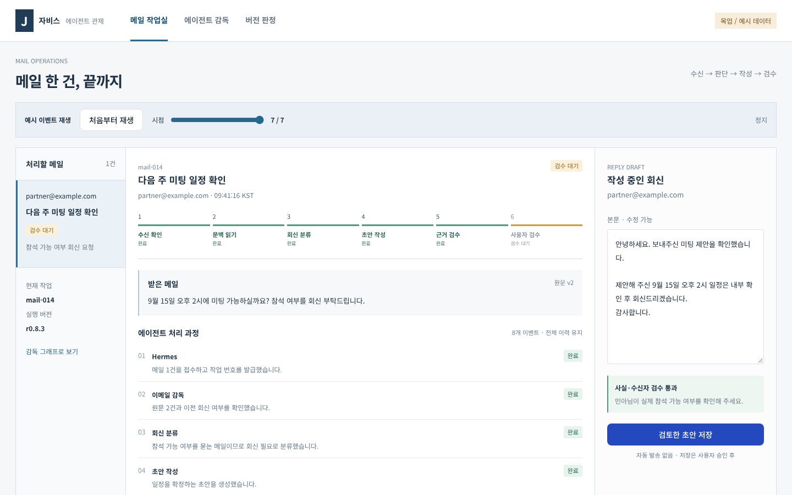
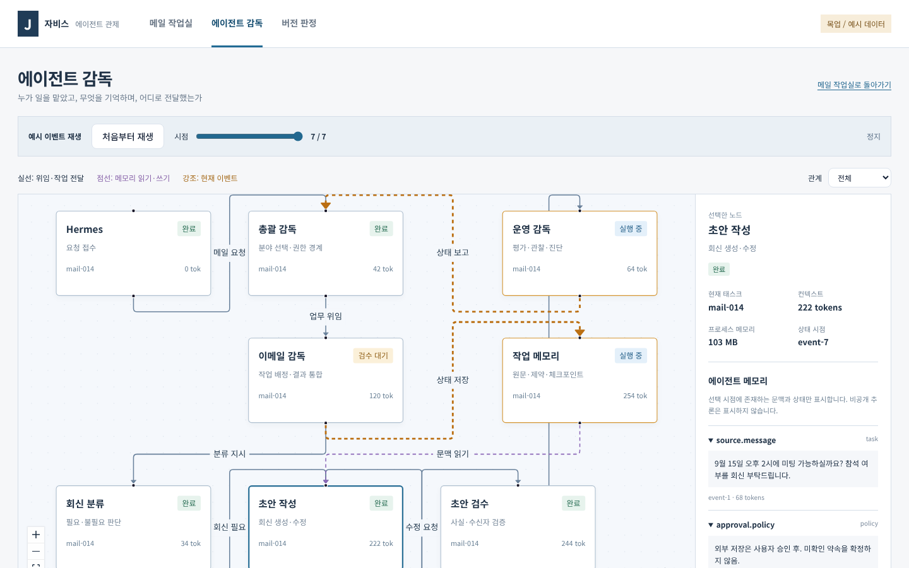
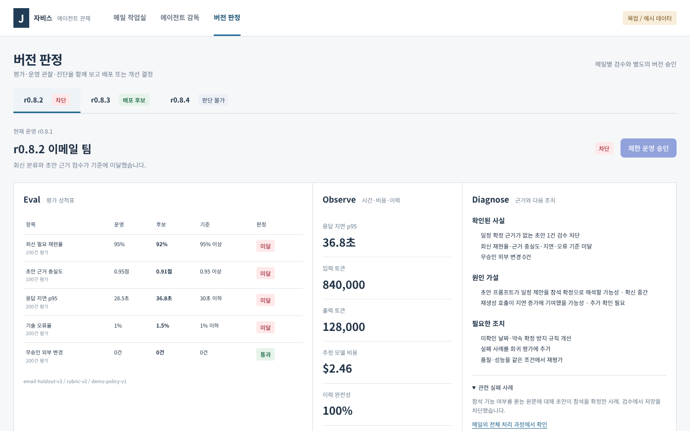
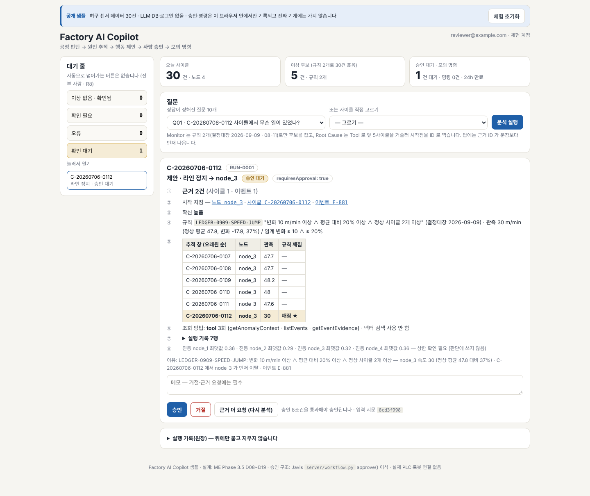
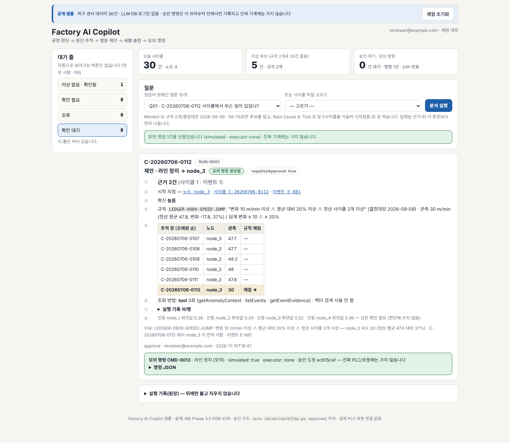

# 자비스 관제

들어온 메일에 AI가 답장 초안을 쓰고, **사람이 승인한 것만** 메일함 임시보관함에 저장되도록 지켜보는 관제 화면입니다.

> 포트폴리오용 사본입니다. 회사 데이터는 없고, 원본 저장소는 비공개이며, 주소·이메일은 `example.com`으로 바꿨습니다.


## 무엇을 하나요

- **AI가 초안을 쓰지만, 사람이 승인해야만 저장됩니다.** 자동 발송 기능은 아예 없습니다. 승인된 초안도 Gmail에 "임시보관(DRAFT)"으로만 들어갑니다.
- **AI 둘이 나눠서 일합니다.** 한 AI(Hermes)가 메일을 분류하고 답장 초안을 쓰면, 다른 AI 역할(Critic)이 그 초안을 검수합니다. 그 다음이 사람 차례입니다.
- **AI 설정을 바꿀 때도 사람이 판정합니다.** 지금 쓰는 버전과 새 후보 버전을 가상 사례 30건 × 3회로 비교한 뒤, 사람이 검토해서 바꿀지 정합니다("버전 판정").
- **같은 구조를 공장 데이터로 옮긴 작은 샘플이 있습니다.** [`samples/factory-copilot/`](samples/factory-copilot/README.md) — 이상 감지 → 원인 추적 → 조치 제안 → 사람 승인 → 모의 명령. 가짜 센서 기록 30건으로 돌고, AI 모델·DB 없이 실행됩니다.

<!-- MERGE-CHECK: 체험 링크 -->

## 화면

아래는 모두 실제로 띄운 화면을 캡처한 것입니다. 관제 화면 3장은 예시 데이터(목업 모드)로 띄웠습니다.


*메일 작업실 — 메일 한 건이 수신부터 사람 검수까지 어디에 와 있는지, 오른쪽에 AI가 쓴 답장 초안과 "검토한 초안 저장" 버튼.*


*에이전트 감독 — 어떤 AI 역할이 일을 맡아 누구에게 넘겼고, 무엇을 기억하는지 그래프로 표시.*


*버전 판정 — 후보 버전의 평가 점수·운영 관찰·진단을 한 화면에 놓고 사람이 배포 여부를 결정(숫자는 예시).*


*공장 샘플 — "라인 정지" 제안이 근거와 함께 승인 대기 중. 승인·거절·근거 더 요청 중 하나를 사람이 고릅니다.*


*공장 샘플 — 승인한 뒤에야 모의 명령 1건이 만들어진 상태. 실제 기계로는 가지 않습니다.*

## 에이전트 흐름

<!-- MERGE-CHECK: 에이전트 흐름 설명은 합칠 때 채움 -->

## 빠르게 실행해 보기

Node 22 이상이 필요합니다.

**관제 화면(예시 데이터)**

```sh
npm ci
npm run dev        # 터미널에 나오는 http://127.0.0.1:... 주소를 엽니다
```

**공장 샘플**

```sh
cd samples/factory-copilot
node --test tests/*.test.mjs                          # 테스트 30개
cd public && python3 -m http.server 8799 --bind 127.0.0.1   # http://127.0.0.1:8799
```

화면에서 질문 하나를 고르고 "분석 실행" → "승인" → "모의 명령 생성" 순으로 눌러 볼 수 있습니다.

서버(`server/`) 실행은 PostgreSQL과 환경 변수가 필요합니다. [server/README-ko.md](server/README-ko.md)를 보세요.

## 기술 구성

| 구분 | 사용한 것 |
|---|---|
| 화면 | React 19, Vite, TypeScript, TanStack Query, @xyflow/react(그래프), Tailwind CSS, MSW(예시 응답) |
| 서버 | Python, FastAPI, Uvicorn |
| 저장소 | PostgreSQL (psycopg) |
| 흐름 관리 | LangGraph (+ PostgreSQL 체크포인트) |
| 관찰 | LangSmith |

## 검사 현황

이 브랜치에서 직접 돌려 확인한 것:

| 대상 | 명령 | 결과 |
|---|---|---|
| 화면 | `npm test` | 24개 통과 |
| 화면 빌드 | `npm run build:mock` | 성공 |
| 공장 샘플 | `node --test tests/*.test.mjs` | 30개 통과 |
| 서버 | `pytest` (테스트용 PostgreSQL + `JARVIS_DATABASE_URL`, `JARVIS_OPERATOR_TOKEN` 필요) | 62개 통과 |
| 연결 스크립트 | `npm run test:bridge` / `npm run test:web-login-config` | 5개 / 3개 통과 |

확인하지 **않은** 것:

- 실제 Gmail 수집·승인·초안 저장, 실제 Hermes 호출, LangSmith 전송. 저장소 문서에 과거 실제 검증 기록(2026-09-13 초안 1건)이 남아 있지만 이번에 다시 확인한 것은 아닙니다.
- 브라우저에서 버튼을 눌러 보는 상호작용 검사. 위 스크린샷은 화면이 뜨는지만 확인한 것이고(공장 샘플만 승인 → 모의 명령까지 클릭), 자동화된 화면 검사는 없습니다.
- 테스트 통과를 실제 운영 검증으로 보지 않습니다. 자세한 범위는 [handover/verification.md](handover/verification.md)에 있습니다.

## 더 읽을 문서

- [STACK.md](STACK.md) — 기술 선택 이유와 운영 연결 경계
- [DESIGN-CONTRACT.md](DESIGN-CONTRACT.md) — 화면 설계 약속과 검증 한계
- [OPERATIONS.md](OPERATIONS.md) — 운영 방법
- [LLMOPS-IMPLEMENTATION.md](LLMOPS-IMPLEMENTATION.md) — 평가·관찰 구현
- [server/README-ko.md](server/README-ko.md) — 서버 설명
- [samples/factory-copilot/README.md](samples/factory-copilot/README.md) — 공장 샘플 설명
- [handover/README.md](handover/README.md) — 인수인계 문서
- [docs/MOCKUP-NOTES.md](docs/MOCKUP-NOTES.md) — 이전 README 원문(목업 기술 메모)
