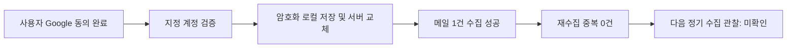

# Gmail 재인증 및 수집 복구 완료

최종 목표: 지정 계정의 Gmail 인증을 서버에 반영하고 수집과 중복 방지를 확인한다.

1. 사용자가 프로덕션 전환 후 직접 Google 로그인·권한 허용을 완료했다.
2. 지정 계정 일치 확인 후 Windows DPAPI 저장 및 운영 서버 인증정보 교체가 성공했다.
3. 메일 1건 수집과 동일 조건 재수집을 검증했다.

현재 위치: Gmail 복구 → 서버 반영 및 수동 수집 검증 완료 → 다음 정기 수집 관찰.

|검사|결과|
|---|---|
|지정 계정 일치|통과|
|서버 인증정보 반영|GMAIL_SERVER_CONNECTED|
|API health|ok|
|메일 수집 limit=1|HTTP 200, 신규 1건|
|동일 조건 재수집|HTTP 200, 신규 0건|
|자동 수집 설정|활성화, 다음 정기 실행 성공은 미확인|
|메일 발송|실행하지 않음|

## Before / After

이전: API 정상이나 Gmail invalid_grant 및 수집 실패.
이후: 재인증한 계정 확인과 수집 성공. 이번 테스트에서 중복 추가 없음.
테스트 상태의 7일 만료는 기존 실패 원인 후보다. 재인증 성공만으로 과거 만료 원인을 확정하지 않는다.

## 핵심 파일과 다음 행동

- backend/gmail_auth.py: 사용자 OAuth 동의·계정 확인 후 서버 설치 도구로 자격증명을 전달한다.
- server/configure-gmail.py: 프로필 계정을 확인하고 기존 인증정보를 백업한 뒤 잠금 하에 원자적으로 교체한다.
- server/gmail.py / server/workflow.py: Gmail 읽기와 수집 흐름. server/repository.py의 account+gmail_id 유일 조건이 중복을 막는다.
- 다음: 다음 정기 수집의 operations/collect.json에서 최근 시각과 ok=true를 확인한다. 과거 오류 기록이 남아 있는 것과 새 실행 실패를 구분한다.
- 재발 시 인증 오류 종류·계정·OAuth 상태부터 확인한다. 토큰을 채팅에 붙이거나 실패한 초안 저장을 무조건 반복하지 않는다.
- 공유 메모리 장애·과거 게시 실패 2건·프로젝트 PR·통합 업무 화면은 이번 작업에서 변경하지 않았다.

에이전트 인계: Gmail 수동 검증 완료로 갱신하고 정기 수집 관찰은 미확인으로 유지한다. 문서 읽음 ACK는 별도다.

검증 시각(UTC): 2026-09-20T08:03:49.714596+00:00
