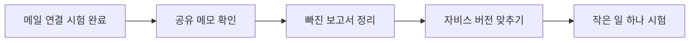

# 자비스를 고치는 일, 쉽게 보기

**핵심 한 줄:** 메일은 다시 가져올 수 있어요. 이제 함께 쓰는 공책과 남은 일을 하나씩 확인해요.

## 메일을 다시 가져올 수 있어요

상태: 직접 시험 성공

Google에 다시 로그인해서 연결을 고쳤어요. 편지 1개를 가져왔고, 다시 눌러도 같은 편지가 두 번 쌓이지 않았어요. 정해진 시간에도 저절로 가져오는지는 더 확인해야 해요.

핵심 기능: 편지를 가져오고, 같은 편지를 두 번 넣지 않기

내가 할 일: Google 로그인은 끝났어요. 지금 다시 로그인할 필요는 없어요.

완료 확인: 다음 예약 시간에 편지를 가져온 기록이 성공으로 남으면 끝나요. 새 편지가 없어도 오류 없이 끝났다면 괜찮아요.

Before: 메일 가져오기 · 연결 오류로 멈춤

After: 메일 가져오기 · 직접 시험 성공 · 자동 실행 확인 남음

## 같은 공책을 보게 해야 해요

상태: 아직 해결 전

에이전트들이 함께 쓰는 공책을 찾지 못하고 있어요. 그래서 다시 연결하려는 일이 계속 반복됐어요. 공책이 없어졌는지, 다른 계정으로 찾는지는 아직 몰라요.

핵심 기능: 에이전트들이 같은 최신 메모를 보기

내가 할 일: 로그인이나 공책 공유 허용을 요청받으면 직접 확인해 주세요. 그전에는 공책을 새로 만들거나 지우지 않아도 돼요.

완료 확인: 양쪽에서 같은 확인용 메모가 보이고, 연결 실패가 반복되지 않으면 끝나요. 에이전트에게 메모를 읽고 한 줄로 답하게 해 주세요.

Before: 공유 공책 · 찾을 수 없음 · 연결 반복

After: 공유 공책 · 양쪽 메모 일치 · 읽었다는 답변

## 빠진 보고서 두 개를 정리해요

상태: 두 건 확인 필요

보고서 13개는 올라갔고, 예전 보고서 2개는 실패 기록이 남아 있어요. 원래 올리려던 곳에도 없었어요. 새 보고서가 대신하고 있는지 먼저 찾아봐야 해요. 오늘 생활비 알림과 파일은 받았다고 확인해 주셨어요.

핵심 기능: 빠진 보고서를 찾고, 이미 받은 파일과 구분하기

내가 할 일: 새 보고서를 받으면 열리는지만 확인해 주세요. 오늘 생활비 알림과 파일은 이미 받았다고 알려주셨어요.

완료 확인: 두 보고서마다 “다시 올림” 또는 “새 문서가 대신함”과 문서 위치가 남으면 끝나요.

Before: 예전 보고서 2개 · 올리기 실패 · 처리 여부 모름

After: 각 보고서에 결과 표시 · 다시 올림 / 새 문서로 대체

## 실행 중인 것과 보관한 것을 맞춰요

상태: 전체 비교 필요

지금 돌아가는 자비스에는 프로젝트 보기 기능이 있어요. 그런데 모두가 기준으로 삼는 저장소에는 아직 합쳐지지 않았어요. 중요한 파일 두 개는 내용이 같았지만, 나머지도 확인해야 해요.

핵심 기능: 누가 다시 설치해도 같은 자비스가 되게 하기

내가 할 일: 개발자가 확인 결과를 보여주면 프로젝트 목록과 내용을 열어 원하는 화면인지 확인해 주세요.

완료 확인: 보관된 버전으로 다시 설치했을 때 프로젝트 화면이 같고, 들어오면 안 되는 사람은 볼 수 없으면 끝나요.

Before: 프로젝트 보기 · 운영에는 있음 · 기준 저장소와 미정렬

After: 프로젝트 보기 · 보관한 버전과 실행 버전 일치

## 한 가지 심부름부터 맡겨요

상태: 새로 만들 계획

지금 “에이전트 실행” 화면은 메일 처리만 보여줘요. 모든 에이전트의 일을 보여주는 화면은 아직 확인되지 않았어요. 먼저 저장소 하나에서 만들 수 있는 도구 목록을 적는 일만 맡겨 봐요.

핵심 기능: 누가 어떤 일을 어디까지 했는지 보기

내가 할 일: 처음 시험할 저장소 하나를 정하고, 에이전트가 만든 도구 목록을 보고 필요한 것을 골라 주세요.

완료 확인: 같은 작업 하나를 자비스와 에이전트 양쪽에서 찾고, 실제 결과물까지 열 수 있으면 첫 시험이 끝나요.

Before: 에이전트 실행 · 메일 처리 단계만 보임

After: 메일 처리 / 전체 업무 구분 · 한 작업의 담당·진행·결과 보기

## 읽는 방법과 상태 기준

고친 메일 확인 → 같은 공책 연결 → 빠진 보고서 정리 → 자비스 버전 맞추기 → 심부름 하나 시험

기존 진단 16:26~16:30 및 메일 복구 시험 17:03 이후 결과를 반영했습니다. 문서 수정이며 운영 장애를 추가 복구하지 않았습니다.

## 전체 흐름도

