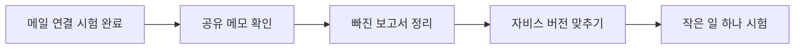

# 내가 할 일과 에이전트에게 맡길 일

**핵심 한 줄:** 메일 재인증과 수동 수집은 완료됐습니다. 나머지는 에이전트에게 한 항목씩 맡기고 결과로 확인합니다.

## 메일을 다시 가져올 수 있어요

상태: 직접 시험 성공

인증정보를 교체한 뒤 수집 요청(limit=1)이 HTTP 200으로 성공했고 added는 1개였습니다. 동일 조건 재수집은 added 0개입니다. 자동 수집 설정은 켜져 있지만 다음 예약 실행 결과는 미확인입니다.

핵심 기능: 편지를 가져오고, 같은 편지를 두 번 넣지 않기

내가 할 일: Google 로그인은 끝났어요. 지금 다시 로그인할 필요는 없어요.

에이전트에게 전달할 요청문:

> 다음 자동 수집 기록의 시각과 성공 여부를 확인하세요. 수동 시험은 신규 1건, 재시험은 0건으로 성공했습니다. 과거 오류와 새 실행 결과를 구분하고, 메일 본문·인증정보는 보고하지 마세요.

핵심 파일: server/gmail.py · server/workflow.py · server/repository.py

가설: 예약 수집도 새 인증정보를 사용해 성공할 것이다.

검증: 다음 정기 실행의 operations/collect.json에서 at과 ok를 확인합니다. added=0은 새 대상이 없다는 뜻일 수 있으므로 실패로 처리하지 않습니다.

작업 경계: 메일 분석·초안 작성·발송은 이 점검에 포함하지 않습니다.

완료 확인: 다음 예약 시간에 편지를 가져온 기록이 성공으로 남으면 끝나요. 새 편지가 없어도 오류 없이 끝났다면 괜찮아요.

Before: 메일 가져오기 · 연결 오류로 멈춤

After: 메일 가져오기 · 직접 시험 성공 · 자동 실행 확인 남음

## 같은 공책을 보게 해야 해요

상태: 아직 해결 전

운영 로그에서 Vault not found와 재시작 반복을 확인했습니다. 이는 원격 보관함을 찾지 못한다는 증거이며, 삭제·권한·계정·설정 중 어느 것이 원인인지는 미확정입니다.

핵심 기능: 에이전트들이 같은 최신 메모를 보기

내가 할 일: 로그인이나 공책 공유 허용을 요청받으면 직접 확인해 주세요. 그전에는 공책을 새로 만들거나 지우지 않아도 돼요.

에이전트에게 전달할 요청문:

> 공유 메모리 동기화 로그에 Vault not found가 있었습니다. 서비스를 실행하는 계정과 로컬·원격 보관함 연결을 대조하세요. 원인은 아직 확정하지 마세요. 변경 전 백업과 복구 계획을 제시하고, 복구 후 확인용 메모가 양쪽에 같은지 검증하세요.

핵심 파일: obsidian-headless-hermes-brain.service (운영 서비스)

가설: 서비스 계정이 잘못된 보관함을 가리키거나 접근 권한이 없다.

검증: 같은 실행 계정에서 ob sync-list-local과 ob sync-list-remote를 비교합니다. 로컬 백업 후 기존 보관함 연결을 바로잡고 일회성 동기화와 재시작 증가 중단을 확인합니다.

작업 경계: 새 빈 보관함으로 대체하거나 충돌 파일을 지우지 않습니다. 동기화 성공과 에이전트 읽음 확인은 별도입니다.

완료 확인: 양쪽에서 같은 확인용 메모가 보이고, 연결 실패가 반복되지 않으면 끝나요. 에이전트에게 메모를 읽고 한 줄로 답하게 해 주세요.

Before: 공유 공책 · 찾을 수 없음 · 연결 반복

After: 공유 공책 · 양쪽 메모 일치 · 읽었다는 답변

## 빠진 보고서 두 개를 정리해요

상태: 두 건 확인 필요

진단 당시 게시 13건·실패 2건이었습니다. 실패 manifest의 원래 ME 경로에는 파일이 없었습니다. 다른 경로의 최신 보고서로 대체됐는지는 미확인입니다. 이번 새 문서 게시 수를 포함한 현재 전체 건수로 해석하면 안 됩니다.

핵심 기능: 빠진 보고서를 찾고, 이미 받은 파일과 구분하기

내가 할 일: 새 보고서를 받으면 열리는지만 확인해 주세요. 오늘 생활비 알림과 파일은 이미 받았다고 알려주셨어요.

에이전트에게 전달할 요청문:

> 과거 실패 보고서 2건을 원본 내용과 게시 경로로 대조하세요. 최신 문서가 대신하는지 먼저 확인하고, 누락이면 한 건씩 복구하세요. 기존 실패 기록은 보존하고 게시됨 또는 대체됨의 근거 링크를 남기세요. 발송 기록과 사용자 수신 확인을 분리하세요.

핵심 파일: scripts/finance_reports.py

가설: 과거 실패 문서의 내용이 새 문서에 이미 반영되어 있을 수 있다.

검증: 두 원본을 최신 문서와 비교합니다. 한 건은 dirty checkout, 다른 건은 Git diff 실패였으므로 원인을 각각 확인합니다. 복구 후 원격 내용 해시 또는 대체 문서 링크를 남깁니다.

작업 경계: 실패 영수증이 있으면 자동 재시도를 건너뜁니다. 기록을 지워 무조건 재전송하지 않습니다.

완료 확인: 두 보고서마다 “다시 올림” 또는 “새 문서가 대신함”과 문서 위치가 남으면 끝나요.

Before: 예전 보고서 2개 · 올리기 실패 · 처리 여부 모름

After: 각 보고서에 결과 표시 · 다시 올림 / 새 문서로 대체

## 실행 중인 것과 보관한 것을 맞춰요

상태: 전체 비교 필요

PR #2는 마지막 확인 때 OPEN이었습니다. project-reader는 바이트까지 같고 live-bridge는 줄바꿈을 통일하면 같습니다. PR 21개 변경 파일과 전체 빌드 결과를 대조한 것은 아닙니다.

핵심 기능: 누가 다시 설치해도 같은 자비스가 되게 하기

내가 할 일: 개발자가 확인 결과를 보여주면 프로젝트 목록과 내용을 열어 원하는 화면인지 확인해 주세요.

에이전트에게 전달할 요청문:

> Javis PR #2와 운영 사본의 변경 파일 전체를 비교하세요. project-reader는 동일했고 live-bridge는 줄바꿈만 달랐습니다. 이것을 전체 일치로 확대하지 마세요. 권한·읽기 전용 동작·검사를 확인한 뒤 병합과 같은 버전 배포 계획, 이전 버전 복구 방법을 제시하세요.

핵심 파일: src/v2/ProjectsConsole.tsx · scripts/live-bridge.mjs · scripts/project-reader.mjs

가설: 나머지 운영 파일도 PR과 동작이 같을 것이다.

검증: PR 변경 파일 전체와 빌드 출처를 대조하고, 프로젝트 목록·상세·빈 결과·권한 없는 요청을 검사합니다. 병합 후 같은 커밋으로 만든 결과물을 배포했는지 기록합니다.

작업 경계: 보고서 수정으로 PR이 병합되거나 서비스가 배포되지는 않습니다.

완료 확인: 보관된 버전으로 다시 설치했을 때 프로젝트 화면이 같고, 들어오면 안 되는 사람은 볼 수 없으면 끝나요.

Before: 프로젝트 보기 · 운영에는 있음 · 기준 저장소와 미정렬

After: 프로젝트 보기 · 보관한 버전과 실행 버전 일치

## 한 가지 심부름부터 맡겨요

상태: 새로 만들 계획

RuntimeConsole은 메일 작업 목록과 상세·이벤트를 읽습니다. RunGraph는 메일 6개 단계를 그립니다. 범용 작업의 실행·취소·재시도 관리가 구현됐다는 증거는 없습니다.

핵심 기능: 누가 어떤 일을 어디까지 했는지 보기

내가 할 일: 처음 시험할 저장소 하나를 정하고, 에이전트가 만든 도구 목록을 보고 필요한 것을 골라 주세요.

에이전트에게 전달할 요청문:

> 현재 에이전트 실행 화면은 메일 전용입니다. 전체 업무는 별도 읽기 전용 목록부터 설계하세요. 첫 시험은 저장소 1개의 위젯 후보 표 작성입니다. 작업 번호·담당·상태·결과 링크를 연결하고, 완료라고 표시하기 전에 실제 결과를 확인하세요. 반복 실행 방지와 실패 기록을 포함한 예상안을 먼저 제출하세요.

핵심 파일: src/v2/OperationsConsole.tsx · src/api/live.ts · server/api.py

가설: 한 저장소의 작업 이력을 읽는 어댑터로 전체 업무 화면의 첫 단계를 검증할 수 있다.

검증: 제안 필드 task_id·agent_id·repo·state·evidence_url을 정하고 한 작업을 조회합니다. 그다음에만 실행·취소·중복방지 계약을 추가합니다. 이 필드는 기존 API가 아니라 설계안입니다.

작업 경계: 16개 저장소 동시 실행, 고객 연락, 계약, 배포를 첫 파일럿에 섞지 않습니다.

완료 확인: 같은 작업 하나를 자비스와 에이전트 양쪽에서 찾고, 실제 결과물까지 열 수 있으면 첫 시험이 끝나요.

Before: 에이전트 실행 · 메일 처리 단계만 보임

After: 메일 처리 / 전체 업무 구분 · 한 작업의 담당·진행·결과 보기

## 읽는 방법과 상태 기준

기록 확인 → 에이전트에게 요청 → 필요한 사용자 행동 → 결과로 검증 → 다음 항목

기존 진단 16:26~16:30 및 메일 복구 시험 17:03 이후 결과를 반영했습니다. 문서 수정이며 운영 장애를 추가 복구하지 않았습니다.

## 전체 흐름도

