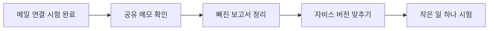
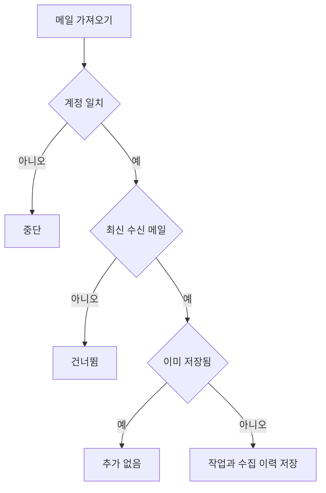
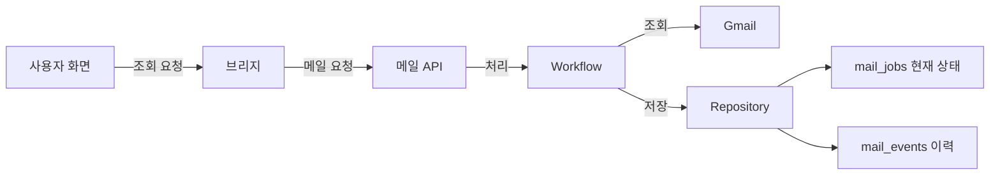

# 처음 맡는 개발자를 위한 자비스 인수인계

**핵심 한 줄:** 자비스는 메일을 가져와 검토하고 초안으로 저장하는 도구입니다. 화면의 값이 어디서 만들어지는지 따라가며 유지보수합니다.

처음 읽는 순서: 제품 역할 → 메일 화면 → 요청·처리·저장 → 실패 점검. API는 프로그램 간 요청 창구, DB는 내용을 보관하는 저장소입니다.

## 메일 가져오기

사용자가 메일을 가져오면 왼쪽 목록에 새 항목이 생깁니다. 가져오기는 분석이나 답장 발송과 다릅니다.

핵심 파일과 역할: server/api.py가 요청 창구, workflow.py가 처리 순서, gmail.py가 Google 연결, repository.py가 저장 담당입니다. 인증이 끊겼으면 gmail.py 쪽, 중복이 생겼으면 repository.py의 유일 조건부터 확인합니다.

|단계·담당|받는 값|처리·분기|반환·화면 결과|
|---|---|---|---|
|F1 · 요청 / api.collect(body) → Workflow.collect(limit)|가져올 수 limit: 기본 3, 허용 1~10|POST /api/v1/mail/collect가 수집 흐름을 호출합니다.|added에 새 작업 번호 목록, limit에 요청 수를 반환합니다.|
|F2 · 조건 확인 / Workflow.collect|Google 계정과 수신 메일|수집 잠금 → 계정 확인 → 대화의 최신 수신 메일인지 확인. 오래된 항목은 건너뜁니다.|조건을 통과한 편지만 저장 대상으로 보냅니다.|
|F3 · 저장 / Repository.add(account,gmail_id,payload)|계정·Google 메일 번호·메일 내용|account+gmail_id가 같으면 추가하지 않습니다. 새 작업이면 collected 이력을 남깁니다.|새 id 또는 None. 첫 시험 1건, 재시험 0건이 이 경로의 관찰 결과입니다.|
|F4 · 화면 / RuntimeConsole / 메일 목록 조회|저장된 작업 요약|목록과 선택한 작업을 다시 조회합니다. 수집과 분석은 별도 동작입니다.|state는 진행 표시, 제목은 목록 항목, 이벤트는 실행 상세에 사용됩니다.|

저장 관계: mail_jobs는 편지 한 건의 현재 상태를 보관합니다. mail_events는 그 편지에서 일어난 일의 기록입니다. mail_events.job_id → mail_jobs.id는 실제 외래키이며 작업 하나에 이력 여러 개가 연결됩니다.

## 메일 실행 단계 보기

사용자가 메일을 고르면 그 메일의 실행 단계가 보입니다. 카드를 누르는 것은 설명 선택이며 에이전트에게 새 일을 시키는 동작이 아닙니다.

핵심 파일과 역할: OperationsConsole.tsx는 표시, src/api/live.ts는 요청과 상태 표현, server/api.py와 repository.py는 조회 담당입니다. 전체 에이전트 업무 화면을 만들려면 별도 작업 계약이 필요합니다.

|단계·담당|받는 값|처리·분기|반환·화면 결과|
|---|---|---|---|
|F1 · 메일 선택 / RuntimeConsole()|선택한 메일 작업 id|liveApi.list는 5초, job/events는 3초마다 다시 조회합니다.|선택한 작업과 사건 목록을 RunGraph에 전달합니다.|
|F2 · 실행 선택 / RunGraph({events,job})|작업 사건 배열과 현재 작업|마지막 run_id와 같은 사건만 골라 노드별 마지막 사건을 찾습니다.|node_started는 실행 중, node_failed는 실패, 기록 없음은 기록 없음으로 표시합니다.|
|F3 · 카드 선택 / setSelected(node)|누른 노드 이름|선택 상태를 바꿉니다. intake 뒤 triage와 security는 병렬이며 draft 앞에서 합류합니다.|아래 설명 영역에 해당 노드의 시도·시간·오류를 보여줍니다.|

저장 관계: mail_events.details 안의 run_id는 실행 묶음, node는 단계, attempt는 시도 횟수, duration_ms는 걸린 밀리초입니다. mail_jobs.state는 사람이 검토·승인할 현재 상태입니다.

## 프로젝트 보기

다른 프로젝트의 기록을 자비스에서 읽어 보여주는 기능입니다. 메일 저장소와 다른 조회 경로이므로 메일 API에 프로젝트 조회를 억지로 연결하면 안 됩니다.

핵심 파일과 역할: PR #2의 project-reader.mjs와 live-bridge.mjs를 기준으로 읽습니다. main에 합쳐진 상태로 오인하지 말고, 배포 파일 전체 대조 후 같은 버전으로 정렬합니다.

|단계·담당|받는 값|처리·분기|반환·화면 결과|
|---|---|---|---|
|F1 · 조회 / ProjectsConsole → createBridge|로그인 세션·조회 조건|GET /api/v1/projects를 별도 readProjects로 전달합니다.|readProjects가 준 status와 data로 응답합니다.|
|F2 · 권한·조건 / projectReader(settings)(email,params)|계정·page·project|계정 허용 여부와 조회 조건을 검사합니다. 토큰은 서버에서만 사용합니다.|권한 없음403, 미설정503, 잘못된 조건400, 연결오류502로 구분합니다.|
|F3 · 외부 결과 / projectReader|외부 프로젝트 서비스 응답|정상 JSON 응답을 확인해 전달합니다.|성공 status200과 data. mail_jobs에 저장하는 경로가 아닙니다.|

저장 관계: 이 문서가 확인한 것은 외부 프로젝트 조회 경로입니다. 외부 서비스의 전체 DB 구조는 여기서 확인하지 않았으므로 추정 ERD를 만들지 않습니다.

## 보고서 게시와 알림

보고서가 저장소에 올라가는 일과 사용자가 메시지를 받는 일은 서로 다른 결과입니다. 화면이 없는 작업은 결과 파일과 알림 문구에서 출발해 읽습니다.

핵심 파일과 역할: scripts/finance_reports.py가 제출·게시·알림을 담당합니다. 실패 기록 삭제로 복구하지 말고 명시적인 재처리와 대체 문서 기록을 설계합니다.

|단계·담당|받는 값|처리·분기|반환·화면 결과|
|---|---|---|---|
|F1 · 제출 / submit|HTML·MD 보고서|내용 해시와 대상 경로를 manifest에 기록합니다.|outbox에 원본과 manifest 저장.|
|F2 · 게시 / publish → publish_one|게시 대기 manifest|원본 해시·작업 폴더·원격 내용을 확인합니다. 기존 receipt가 있으면 건너뜁니다.|receipts에 게시 성공 또는 실패 이력 저장.|
|F3 · 알림 / notify()|게시 결과와 HTML|알림 마커가 없으면 시도 마커를 먼저 남기고 문구를 출력합니다.|notified의 dispatch_attempted는 실제 사용자 수신을 증명하지 않습니다.|

저장 관계: 이 기능은 DB 테이블 대신 파일을 사용합니다. outbox는 원본, receipts는 게시 결과, notified는 알림 시도 기록입니다. 같은 보고서 ID로 연결되지만 DB 외래키는 아닙니다.

## 공유 메모리 동기화

각 에이전트의 로컬 메모를 원격 보관함과 맞추는 운영 서비스입니다. 메모가 복사됐다고 모델이 읽었다고 판단하지 않습니다.

핵심 파일과 역할: obsidian-headless-hermes-brain.service의 실행 환경이 출발점입니다. 운영 설정을 백업하고 연결 대상을 검증한 뒤 복구합니다.

|단계·담당|받는 값|처리·분기|반환·화면 결과|
|---|---|---|---|
|F1 · 실행 환경 / 운영 systemd 서비스|서비스 사용자·작업 폴더·보관함 연결|같은 실행 계정의 로컬 연결과 원격 보관함을 확인합니다.|운영 로그와 연결 목록이 진단 근거입니다.|
|F2 · 연결 실패 / Obsidian Headless|원격 보관함 접근|현재 확인된 오류는 Vault not found입니다. 서비스는 다시 실행을 반복했습니다.|삭제·권한·다른 계정 중 무엇인지는 미확정입니다.|
|F3 · 복구 검증 계획 / 일회성 동기화 후 연속 실행|백업한 설정·올바른 기존 보관함|확인 메모 왕복과 재시작 증가 중단을 확인합니다.|그 뒤 에이전트가 문서 이름과 요약으로 읽음 답변을 남겨야 합니다.|

저장 관계: 로컬 파일과 원격 보관함 관계입니다. 전용 앱 화면이나 메일 DB 테이블이 확인된 기능이 아니므로 만들었다고 설명하지 않습니다.

## 현재 상태

- 메일을 다시 가져올 수 있어요: 인증정보를 교체한 뒤 수집 요청(limit=1)이 HTTP 200으로 성공했고 added는 1개였습니다. 동일 조건 재수집은 added 0개입니다. 자동 수집 설정은 켜져 있지만 다음 예약 실행 결과는 미확인입니다.
- 같은 공책을 보게 해야 해요: 운영 로그에서 Vault not found와 재시작 반복을 확인했습니다. 이는 원격 보관함을 찾지 못한다는 증거이며, 삭제·권한·계정·설정 중 어느 것이 원인인지는 미확정입니다.
- 빠진 보고서 두 개를 정리해요: 진단 당시 게시 13건·실패 2건이었습니다. 실패 manifest의 원래 ME 경로에는 파일이 없었습니다. 다른 경로의 최신 보고서로 대체됐는지는 미확인입니다. 이번 새 문서 게시 수를 포함한 현재 전체 건수로 해석하면 안 됩니다.
- 실행 중인 것과 보관한 것을 맞춰요: PR #2는 마지막 확인 때 OPEN이었습니다. project-reader는 바이트까지 같고 live-bridge는 줄바꿈을 통일하면 같습니다. PR 21개 변경 파일과 전체 빌드 결과를 대조한 것은 아닙니다.
- 한 가지 심부름부터 맡겨요: RuntimeConsole은 메일 작업 목록과 상세·이벤트를 읽습니다. RunGraph는 메일 6개 단계를 그립니다. 범용 작업의 실행·취소·재시도 관리가 구현됐다는 증거는 없습니다.

## 읽는 방법과 상태 기준

화면에서 시작 → 요청 경로 찾기 → 처리 조건 확인 → 저장값 연결 → 실패 지점 점검

기존 진단 16:26~16:30 및 메일 복구 시험 17:03 이후 결과를 반영했습니다. 문서 수정이며 운영 장애를 추가 복구하지 않았습니다.

## 전체 흐름도

## 화면 Before / After

아래는 설명용 화면 모형의 문구입니다. 메일 수동 시험만 확인 결과이고 나머지 After는 개선 예상입니다.

|화면|Before|After|
|---|---|---|
|메일 가져오기|연결 오류|수동 시험 성공, 예약 실행 관찰 필요|
|공유 메모|보관함을 찾지 못함|양쪽 확인 메모 일치와 읽음 답변|
|보고서 결과|실패 두 건 처리 여부 불명|재게시 또는 대체 문서 링크 표시|
|프로젝트 보기|운영과 main 미정렬|동일 배포 출처와 권한 검증|
|에이전트 실행|메일 단계만 조회|메일과 전체 업무 구분, 단일 작업 추적|

## 메일 구조와 처리 분기

