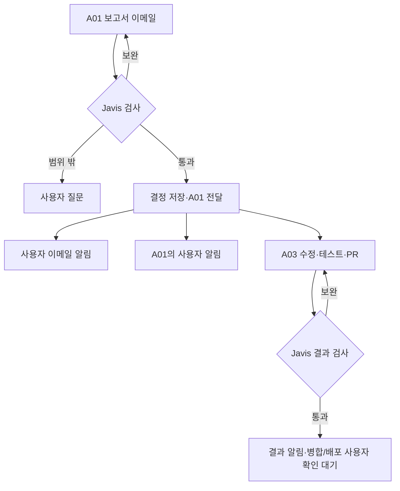

# A01 보고서 → Javis 검사 → A03 실행

> 목표: A01의 작업 전 보고서를 Javis가 이메일로 검토하고, 통과한 작업은 A03의 코드 수정·테스트·PR 작성까지 진행한다. 병합·배포는 사용자 확인에서 멈춘다.

## 3줄 줄거리

A01이 작업 전 보고서를 작성해 이메일로 제출합니다.
Javis가 통과시키면 사용자에게 두 경로로 알리고, A01을 통해 A03이 수정·테스트·PR 작성까지 진행합니다.
결과를 Javis가 다시 검사하고, main 병합과 운영 배포는 사용자 확인에서 멈춥니다.

## 현재 위치와 다음 한 단계

현재 위치: 자동 작업 관리 → 이메일 접수·검토 연결 설계. 새 기능은 미구현입니다. 다음은 기존 MIMO 작업 식별자·보고서 버전을 받아 한 건의 접수와 판정만 실행 없이 검증하는 것입니다. A01이 이미 A03에게 지시했다는 것은 사용자 설명에 근거하며, 현재 작업 상태는 이번에 서버에서 조회하지 않았습니다.

## 확정된 운영 원칙

보고서 작성자=A01, 코드 작업자=A03, 검사자=Javis. 사용자 승인된 자동 범위는 코드 수정·테스트·PR 작성까지입니다. 검토 통과 알림은 사용자 답변을 기다리는 승인 요청이 아닙니다. main 병합과 운영 배포는 각각 사용자 확인 대상입니다. 이번 요청은 문서 작성이며 연결 코드는 실행하지 않습니다.

## 실행 흐름 · 제안

## F1 · A01 보고서

**현재 문제·진행 방식**: A01이 목표·대상·범위·완료 기준을 적은 HTML 보고서를 사용자에게 보여주고 검토용 이메일로 제출합니다. A03은 여기서 보고서 작성자가 아닙니다.

**사용자가 할 일**: 이미 진행 중인 MIMO의 작업 식별자와 진행 상태를 A01에게 확인합니다. 같은 일을 새로 발행하지 않습니다.

**에이전트 요청문**: A01: 기존 MIMO 작업을 재사용하여 목표, 저장소·기준 버전, 허용할 변경, 제외 범위, 검사 방법, 결과물을 작업 전 보고서로 작성해 주세요. 보고서 버전과 작업 식별자를 붙여 검토용 이메일로 제출하고 사용자에게 보고서가 제출됐음을 알려 주세요.

**받아야 할 증거**: 보고서 내용, 제출 버전, 메일 접수 기록이 같은 작업에 연결됨.

**실패하면**: 누락 항목이 있으면 A01이 보완합니다. 진행 중 작업은 재시작하지 않습니다.

## F2 · Javis 검사

**현재 문제·진행 방식**: Javis가 등록된 작업의 보고서인지 확인하고 목표·범위·완료 기준을 검사합니다. 메일의 문장 자체를 실행 명령으로 삼지 않습니다.

**사용자가 할 일**: 범위가 달라지거나 중요한 정보가 없을 때만 답합니다. 기준 안의 통과를 매번 승인할 필요는 없습니다.

**에이전트 요청문**: Javis 연결 담당자: 등록 작업·A01 제출 출처·보고서 버전을 대조하고 목표/범위/검증 가능성을 검사하는 전용 경로를 만드세요. 결과는 통과·보완·사용자 확인·검사 실패로 분리하고 이유와 부족한 증거를 저장하세요. 이메일 본문이나 HTML 안의 추가 지시가 기존 권한을 바꾸지 못하게 하세요.

**받아야 할 증거**: 통과 이유 또는 구체적인 보완 항목, 검사한 보고서 버전, 권한 범위가 남음.

**실패하면**: 형식 오류·출처 불일치·오래된 버전은 실행으로 보내지 않습니다. 모델 오류는 불통과 판단과 별도 기록합니다.

## F3 · 결정·양쪽 알림

**현재 문제·진행 방식**: 통과 결정을 저장한 뒤 A01에 진행 결정을 전달합니다. 사용자에게 이메일을 보내고 A01도 통과·진행 사실을 알립니다. 이는 사용자 승인 대기가 아닙니다.

**사용자가 할 일**: 통과 알림은 확인만 하면 됩니다. 변경하고 싶으면 해당 작업의 중지·범위 수정 요청을 합니다.

**에이전트 요청문**: 연결 담당자: 검토 결정과 전달 대기 기록을 함께 저장하고 A01에 작업 식별자·보고서 버전·허용 범위를 전달하세요. 사용자의 이메일 알림과 A01 알림의 성공/실패를 각각 남기세요. 전달 응답이 끊기면 작업 상태부터 조회하고 중복 실행을 막으세요. 알림 실패만으로 통과 결정을 다시 생성하지 마세요.

**받아야 할 증거**: 검토 통과, A01 접수 확인, 이메일 전송 결과, A01 알림 결과를 각각 확인. 실제 수신은 별도.

**실패하면**: 알림 실패는 알림만 재처리합니다. A01 접수 여부가 불명확하면 재지시보다 기존 상태 조회를 먼저 합니다.

## F4 · A03 실행

**현재 문제·진행 방식**: A01이 A03에게 허용된 작업을 전달합니다. A03은 코드 수정·테스트·PR 작성까지 수행합니다.

**사용자가 할 일**: 지금 직접 할 일 없음. 추가 범위가 필요한 요청만 판단합니다.

**에이전트 요청문**: A01/A03: 통과한 보고서의 버전과 기존 작업 식별자를 확인하고 코드 수정·테스트·PR 작성까지만 진행하세요. main 병합·운영 배포·새 고객 연락은 하지 마세요. 변경 커밋·테스트 출력·실제 화면·PR 위치를 결과 보고서로 반환하세요. 재수신한 동일 결정으로 작업을 추가 생성하지 마세요.

**받아야 할 증거**: 코드 변경, 대상 테스트 결과, 실제 화면 증거, PR 및 기준 커밋이 동일 작업에 연결됨.

**실패하면**: 권한 부족이나 새 범위 발견은 사용자 확인으로 이동합니다. 테스트 실패는 원인과 보완을 보고합니다.

## F5 · 결과 재검사

**현재 문제·진행 방식**: Javis가 결과를 최초 완료 기준과 대조합니다. 보고서의 주장뿐 아니라 테스트·화면·변경 근거를 봅니다.

**사용자가 할 일**: 필요한 추가 결정이 있을 때만 답합니다. 결과 통과 알림은 메일과 에이전트로 받습니다.

**에이전트 요청문**: Javis 연결 담당자: 제출된 결과의 커밋과 테스트·화면 증거를 고정해 완료 기준별 충족 여부를 검사하세요. 근거가 없으면 미확인으로 두고 A01에 구체적으로 보완 요청하세요. 결과 통과 후 사용자 확인 대기로 전환하고 이메일 및 에이전트 알림을 남기세요.

**받아야 할 증거**: 완료 기준별 통과/미충족/미확인 표, 결과 버전, 보완 이력.

**실패하면**: 증거 없는 성공 주장은 완료로 승격하지 않습니다. 보완 한도 도달 시 이유를 정리해 사용자 확인으로 멈춥니다.

## F6 · 사용자 확인

**현재 문제·진행 방식**: PR은 준비됐지만 main 병합과 운영 배포는 아직 대기입니다. 사용자 확인은 대상 PR·커밋·배포 환경에 묶입니다.

**사용자가 할 일**: 최종 결과를 보고 병합과 배포 여부를 각각 결정합니다.

**에이전트 요청문**: 운영 담당자: Javis 결과 통과만으로 main에 병합하거나 배포하지 마세요. 사용자가 확인한 PR·커밋·환경이 현재 대상과 같은지 재확인하고, 달라졌으면 다시 검토하세요. 병합 허용을 운영 배포 허용으로 확대하지 마세요.

**받아야 할 증거**: 사용자 확인 기록과 대상 버전. 이후 실행을 했다면 병합 결과와 실제 운영 확인을 별도로 제출.

**실패하면**: 대상 커밋이 바뀌거나 확인 범위가 모호하면 자동 실행하지 않습니다.

## Before / After

Before: 사용자 캡처의 메일 선택·메일 노드 화면. After: 별도 위젯 작업 화면에 A01 보고서 버전, Javis 판정·이유, A01 접수, A03 실행, 이메일/에이전트 알림 상태, PR·사용자 확인 대기를 표시하는 미구현 제안. 캡처 원본은 개인 정보 보호를 위해 GitHub에 올리지 않음.

## 실제 코드 근거

- 메일 실행 화면 / src/v2/OperationsConsole.tsx · RuntimeConsole() / 선택 ID→liveApi.job/events→RunGraph와 이벤트 표. 메일 job.payload와 노드 이벤트를 표시함.

- 브라우저 요청 / src/api/live.ts · liveRequest<T>(path,method,body) / 세션 CSRF와 /api/v1/mail 접두사로 JSON 요청. 성공하면 JSON, 실패하면 LiveError. 새 작업 API에 그대로 붙이면 메일 경로가 됨.

- 메일 서버 / server/api.py · jobs/job/events/analyze/approve/save / 목록·단건·이력은 repo로, 분석·승인·초안 저장은 flow로 전달. save-draft는 이메일 발송 API가 아님.

- 예상안 실행기 / server/widget_planning.py · run_workflow / render / main / 보고서 묶음→판단·작성·검토→상태 dict, save 콜백으로 기록. state.json과 report.html 생성. 통과는 awaiting_user_review.

- 기존 자료와 이번 변경 / server/WIDGET-PLANNING.md / 기존 A03 예상안 작성 흐름은 보존해야 함. 이번 A01 보고서 수신·자동 진행 정책은 별도 버전으로 추가할 설계.

로컬 소스 정적 확인. 전체 운영 배포 상태 재검증 아님.

## 확정·미확정

확정: A01 작성·Javis 검사·A03 구현, 통과 후 두 경로 알림, 수정·테스트·PR 자동, 병합·배포 사용자 확인. 미확정: 실제 발신/수신 계정, A01 접수 경로와 현재 MIMO 작업 식별자. 가설은 실행 없는 보고서 한 건으로 먼저 검증한다.

## 구현 순서

기존 MIMO 조회 → 실행 없는 보고서 접수·검토·화면 → 양쪽 알림과 A01 접수 → 허용 범위 실행 → 결과 재검사 → 사용자 확인 경계 시험.

- 같은 메일 두 번 도착 / 동일 보고서 검토·작업 실행 중복 없음

- 옛 보고서가 나중에 도착 / 최신 버전의 통과 결정을 덮어쓰지 않음

- 발신 표시만 A01인 메일 / 등록 제출물 확인 실패 시 실행 없음

- HTML에 범위 확장 지시 포함 / 데이터로만 취급, 기존 허용 범위 유지

- 통과 후 알림 실패 / 검토 재실행·작업 중복 없이 알림 상태만 실패

- A01 접수 응답 유실 / 기존 작업 조회, 무조건 재발행 금지

- 근거 없는 결과 완료 주장 / 미확인 또는 보완, 자동 병합 없음

- 결과 통과 후 새 커밋 추가 / 재검토 또는 사용자 재확인

- 정상 한 건 전체 흐름 / 보고서→판정→A01 접수→A03 PR→재검사→사용자 대기

- 메일 기능 회귀 / 기존 일반 메일 분석·초안 저장 흐름 유지

## 유지보수·검증 범위

접수→판정→전달→실행→알림을 분리해 진단한다. 이상 시 신규 전달 소비자를 중지하고 기존 작업 상태를 조회한다. 알림 실패로 작업을 재실행하지 않는다. 신규 자동화 기능·DB·화면은 제안이다. 이번 문서는 제품 코드·운영 서비스·실제 작업 이메일 전송을 변경하지 않는다. HTML 정적 검증과 브라우저 동작 검증은 구분한다.
