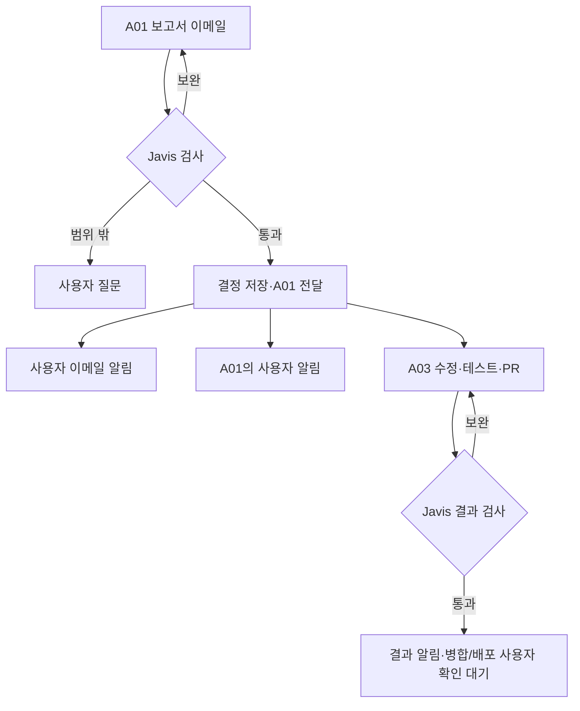

# 이메일 기반 작업 검토·실행 연결 인수인계

> 목표: A01의 작업 전 보고서를 Javis가 이메일로 검토하고, 통과한 작업은 A03의 코드 수정·테스트·PR 작성까지 진행한다. 병합·배포는 사용자 확인에서 멈춘다.

## 3줄 줄거리

A01이 작업 전 보고서를 작성해 이메일로 제출합니다.
Javis가 통과시키면 사용자에게 두 경로로 알리고, A01을 통해 A03이 수정·테스트·PR 작성까지 진행합니다.
결과를 Javis가 다시 검사하고, main 병합과 운영 배포는 사용자 확인에서 멈춥니다.

## 현재 위치와 다음 한 단계

현재 위치: 자동 작업 관리 → 이메일 접수·검토 연결 설계. 새 기능은 미구현입니다. 다음은 기존 MIMO 작업 식별자·보고서 버전을 받아 한 건의 접수와 판정만 실행 없이 검증하는 것입니다. A01이 이미 A03에게 지시했다는 것은 사용자 설명에 근거하며, 현재 작업 상태는 이번에 서버에서 조회하지 않았습니다.

## 확정된 운영 원칙

보고서 작성자=A01, 코드 작업자=A03, 검사자=Javis. 사용자 승인된 자동 범위는 코드 수정·테스트·PR 작성까지입니다. 검토 통과 알림은 사용자 답변을 기다리는 승인 요청이 아닙니다. main 병합과 운영 배포는 각각 사용자 확인 대상입니다. 이번 요청은 문서 작성이며 연결 코드는 실행하지 않습니다.

## 처음 읽는 개발자를 위한 읽는 순서

제품은 현재 개인 메일 처리 화면과 별도 예상안 실행기를 갖고 있습니다. 이 문서는 그 위에 작업 검토를 연결하는 설계입니다. 아래 실제 코드 표로 현재 동작을 먼저 이해한 뒤 F1~F6 화면·입력·처리·저장 관계를 읽으세요. 신규 API와 저장 필드는 제안으로 표시하며 기존 DB에 있다고 가정하지 않습니다.

## 실행 흐름 · 제안

## F1 · 제출물 수신

**화면과 입력**: 화면에 “보고서 접수”를 표시하는 단계입니다. A01이 만든 보고서와 설명용 메타데이터(task_id, report_version, source_commit, report_digest)를 받습니다. 이 필드들은 신규 계약 제안이며 기존 API 필드가 아닙니다.

**처리·수정 위치**: 메일 수집 기능은 재사용 후보입니다. 수집 직후 허용된 출처와 등록 작업을 대조하는 분류 경로를 추가하고, 일반 메일 답변 흐름과 작업 검토 흐름을 나눕니다. 서명된 제출 정보 또는 서버에 등록된 보고서 해시 대조 등 출처 검증 방법은 구현 전에 확정해야 합니다.

**출력·저장·주의점**: 정규화한 제출 기록과 접수/거절 사유를 반환하고 작업 보고서 저장소에 보존합니다. 제목·From 주소만으로 자동 실행 권한을 부여하지 않습니다.

## F2 · 판단 표시

**화면과 입력**: 사용자가 새 위젯 작업 화면에서 보고서 버전을 선택하면 판단 이유와 부족한 기준을 봅니다. 목표·허용 작업은 등록된 정책에서 읽고 메일로 덮어쓰지 않습니다.

**처리·수정 위치**: 현재 widget_planning.py의 run_workflow(bundle, call, save, max_revisions=2)는 A01 판단→A03 예상안 작성→검토입니다. 이번 흐름은 A01이 이미 작성한 보고서를 받으므로 이 작성 단계를 그대로 재사용하면 역할이 틀립니다. 별도 검토 진입점에서 계약 검사→정책 검사→모델 검토를 조합하는 변경이 필요합니다.

**출력·저장·주의점**: 제안 결과: passed / needs_revision / needs_user / failed. 판단 이유·입력 해시·정책 버전을 저장하고 화면에 표시합니다. 기존 awaiting_user_review 값을 일괄 자동 실행 상태로 바꾸면 안 됩니다.

## F3 · 전달과 알림

**화면과 입력**: 화면에서 “검토 통과”, “A01 접수”, “메일 알림”, “에이전트 알림”을 별도 줄로 보여줍니다. 하나가 성공해도 다른 줄을 성공으로 만들지 않습니다.

**처리·수정 위치**: 결정 저장과 outbox(보낼 일 목록) 기록을 한 트랜잭션에 넣는 구조를 제안합니다. 소비자는 decision_id와 action으로 중복을 제거합니다. A01 수신 확인이 없으면 dispatch_unknown 상태로 두고 조회합니다. 알림은 독립적으로 처리하며 본문에 새 실행 권한을 넣지 않습니다.

**출력·저장·주의점**: 사용자 알림과 A01 제어 메시지는 목적지가 다릅니다. 아직 실제 전송 API와 A01 실행 접수 계약은 이번 조사에서 확인하지 못했습니다. 구현 전에 기존 경로의 인증·수신 확인 방식을 확인해야 합니다.

## F4 · 실행 결과 연결

**화면과 입력**: 진행 상태를 보고 있는 사용자는 작업의 PR, 커밋, 테스트, 화면을 엽니다. A03 결과에는 작업 식별자와 검토 통과한 계획 버전이 필요합니다.

**처리·수정 위치**: 실제 개발 실행은 기존 예상안 모델 호출과 다릅니다. 현재 call_model(role,data)는 예상안 생성을 위한 역할 호출입니다. 도구가 꺼진 모델 경로를 실제 개발 실행으로 표시하지 않습니다. A01→A03 실행 접수 경로를 확인하고 기존 MIMO 작업에 연결합니다.

**출력·저장·주의점**: A03은 결과 파일과 실행 상태를 반환합니다. PR 생성까지 허용하며 브랜치 보호·사용자 확인 조건을 우회하지 않습니다. 메일 job ID는 새 작업의 기본키가 아닙니다.

## F5 · 재검사 상세

**화면과 입력**: 완료 기준별로 테스트 통과·화면 확인·근거 부족을 보여줍니다. 모델의 찬성 한 줄은 최종 완료 표시가 아닙니다.

**처리·수정 위치**: 결과의 source_commit과 증거 버전을 맞춥니다. 기계 검사 가능한 테스트 결과·파일 범위는 규칙으로 확인하고 모델은 설명·누락 점검을 보조합니다. 스크린샷만으로 기능 테스트를 대체하지 않습니다. 보완 결과는 새 버전으로 남깁니다.

**출력·저장·주의점**: 제안 상태: result_reviewing → needs_revision 또는 awaiting_user_merge_deploy. 알림 전송은 이 업무 상태와 별도 열에 남깁니다. 초기 보완 한도 2회는 제안이며 운영 정책으로 명시해야 합니다.

## F6 · 최종 확인 경계

**화면과 입력**: 사용자에게 “PR 준비됨 / 병합 대기 / 배포 대기”를 표시합니다. 승인은 일반 답장 문구에서 추측하지 않습니다.

**처리·수정 위치**: 사용자 확인은 인증된 동작으로 대상 PR·커밋·환경·허용 작업을 고정해 기록하는 방식을 제안합니다. 뒤에 새 커밋이 추가되면 기존 확인을 재사용하지 않습니다. 병합 후 배포 전 확인 범위도 다시 대조합니다.

**출력·저장·주의점**: 이번 문서는 설계 인수인계입니다. 제안한 API·DB·화면·전송기는 아직 구현되지 않았습니다. 제품 코드, 권한 또는 운영 배포는 이 문서 작업에서 바꾸지 않습니다.

## Before / After

Before: 사용자 캡처의 메일 선택·메일 노드 화면. After: 별도 위젯 작업 화면에 A01 보고서 버전, Javis 판정·이유, A01 접수, A03 실행, 이메일/에이전트 알림 상태, PR·사용자 확인 대기를 표시하는 미구현 제안. 캡처 원본은 개인 정보 보호를 위해 GitHub에 올리지 않음.

## 실제 코드 근거

- 메일 실행 화면 / src/v2/OperationsConsole.tsx · RuntimeConsole() / 선택 ID→liveApi.job/events→RunGraph와 이벤트 표. 메일 job.payload와 노드 이벤트를 표시함.

- 브라우저 요청 / src/api/live.ts · liveRequest<T>(path,method,body) / 세션 CSRF와 /api/v1/mail 접두사로 JSON 요청. 성공하면 JSON, 실패하면 LiveError. 새 작업 API에 그대로 붙이면 메일 경로가 됨.

- 메일 서버 / server/api.py · jobs/job/events/analyze/approve/save / 목록·단건·이력은 repo로, 분석·승인·초안 저장은 flow로 전달. save-draft는 이메일 발송 API가 아님.

- 예상안 실행기 / server/widget_planning.py · run_workflow / render / main / 보고서 묶음→판단·작성·검토→상태 dict, save 콜백으로 기록. state.json과 report.html 생성. 통과는 awaiting_user_review.

- 기존 자료와 이번 변경 / server/WIDGET-PLANNING.md / 기존 A03 예상안 작성 흐름은 보존해야 함. 이번 A01 보고서 수신·자동 진행 정책은 별도 버전으로 추가할 설계.

로컬 소스 정적 확인. 전체 운영 배포 상태 재검증 아님.

## API·저장 계약 제안

별도 /api/v1/widget-work 아래 작업 조회·보고서 접수·결과 접수·사용자 확인 경로를 제안한다. 실제 구현된 API가 아니다. 작업 1:N 보고서, 보고서 1:N 결정, 결정 1:N 전달/알림, 작업 1:N 결과·확인 기록. DB·외래키·마이그레이션 미확정.

- task_id / 기존 MIMO 작업과 모든 기록을 연결하는 키 / 작업 카드 / 진행 조회

- report_version + report_digest / Javis가 어떤 보고서를 검사했는지 고정 / 보고서 버전·판정 이유

- policy_version + allowed_actions / 수정·테스트·PR 허용, 병합·배포 제외 / 허용 범위 배지

- decision_id + decision / 통과/보완/사용자 확인/실패 및 이유 / 검토 상태

- dispatch_status + agent_job_id / A01 접수 여부와 A03 기존 실행 연결 / 작업 진행

- result_commit + evidence_refs / 테스트·화면·PR이 같은 코드 결과인지 확인 / 결과 검수표

- email_notice / agent_notice / 각 채널의 대기·전송·실패·수신 미확인 / 알림 상태

- user_confirmation / 대상 PR·커밋·환경별 병합/배포 허용 / 사용자 확인 대기

## 구현 순서

기존 MIMO 조회 → 실행 없는 보고서 접수·검토·화면 → 양쪽 알림과 A01 접수 → 허용 범위 실행 → 결과 재검사 → 사용자 확인 경계 시험.

- 같은 메일 두 번 도착 / 동일 보고서 검토·작업 실행 중복 없음

- 옛 보고서가 나중에 도착 / 최신 버전의 통과 결정을 덮어쓰지 않음

- 발신 표시만 A01인 메일 / 등록 제출물 확인 실패 시 실행 없음

- HTML에 범위 확장 지시 포함 / 데이터로만 취급, 기존 허용 범위 유지

- 통과 후 알림 실패 / 검토 재실행·작업 중복 없이 알림 상태만 실패

- A01 접수 응답 유실 / 기존 작업 조회, 무조건 재발행 금지

- 근거 없는 결과 완료 주장 / 미확인 또는 보완, 자동 병합 없음

- 결과 통과 후 새 커밋 추가 / 재검토 또는 사용자 재확인

- 정상 한 건 전체 흐름 / 보고서→판정→A01 접수→A03 PR→재검사→사용자 대기

- 메일 기능 회귀 / 기존 일반 메일 분석·초안 저장 흐름 유지

## 유지보수·검증 범위

접수→판정→전달→실행→알림을 분리해 진단한다. 이상 시 신규 전달 소비자를 중지하고 기존 작업 상태를 조회한다. 알림 실패로 작업을 재실행하지 않는다. 신규 자동화 기능·DB·화면은 제안이다. 이번 문서는 제품 코드·운영 서비스·실제 작업 이메일 전송을 변경하지 않는다. HTML 정적 검증과 브라우저 동작 검증은 구분한다.
