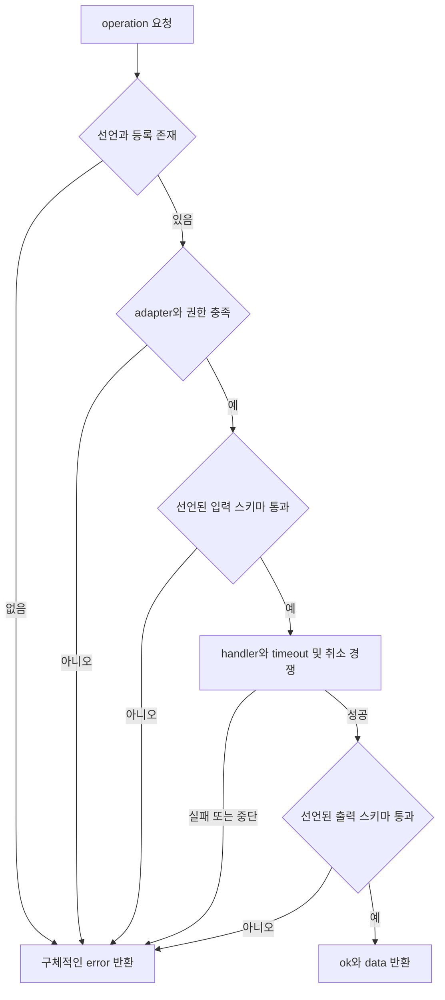
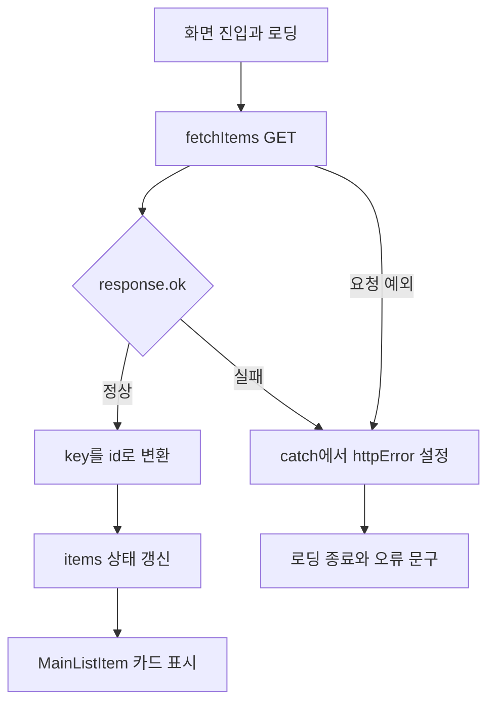
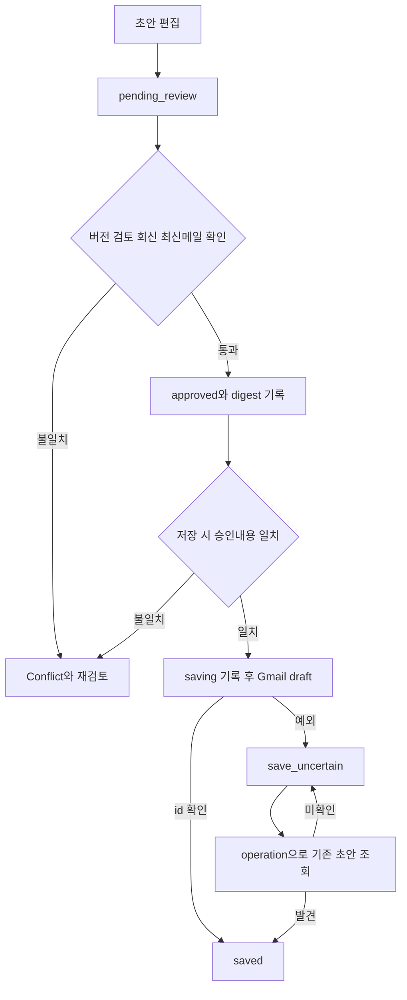
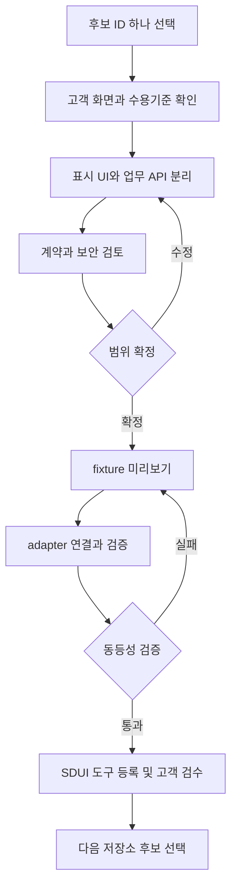
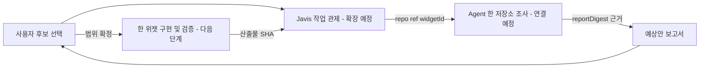

# SDUI 화면·코드 인수인계 보고서

목표: 16개 저장소의 52개 위젯 후보를 화면·처리·API·저장·검증 단위로 이해하고, 다음 제작자가 한 후보부터 이어갈 수 있게 한다.

기존 후보 목록의 고정 SHA 근거를 재사용하고 대표 3개 흐름은 원본 코드와 다시 대조했다. 새 기능 구현·운영 검증은 하지 않았다.

## 읽는 순서

1. 저장소와 위젯 ID를 선택한다.
2. 화면 결과와 받는 값을 읽고 코드 위치를 연다.
3. API·저장·부수효과를 확인한다.
4. 전환 작업과 회귀 기준을 확인하고 한 후보의 범위를 정한다.

## gomgom-ai

## 화면에서 코드를 따라 읽기

화면 동작 → 처리 코드 → 요청·저장 → 반환과 부수효과 → 수정·검증 순서로 읽는다. UI가 없는 후보는 표시 화면을 새로 만드는 제안이다. 이 문서는 기존 조사 SHA를 기준으로 재구성했으며 최신 앱 실행 검증이 아니다.

### R01-W01 · 음식 취향 질문

여섯 질문의 선택을 모아 추천 입력을 만든다.

**현재 상태:** 기존 화면 구현; 독립 SDUI 질문 위젯 분리 필요

|화면·코드 연결|확인 내용|
|---|---|
|화면에 나오는 결과|취향 태그와 결과 화면 이동|
|화면이 받는 값|질문 선택값, 기존 text/lat/lng|
|담당 로직|qnaList 순서대로 선택 태그를 수집하고 다음 질문 또는 결과 경로로 이동|
|요청 창구|기존 test_result 화면 호출; SDUI에서는 recommend API 입력으로 어댑트|
|저장소 경계|브라우저 상태; 추천 요청 이후 DB와 연결|
|반환과 별도인 동작|페이지 이동|

**핵심 파일의 확인 지점**

- [const qnaList](https://github.com/feed-mina/gomgom-ai/blob/991039defcd8342ab302380b11871d8b7695828b/gomgom_ai/templates/gomgom_ai/test.html#L43) — `gomgom_ai/templates/gomgom_ai/test.html`에서 이 기능의 선언·호출·계약을 확인한다. 코드 링크는 원래 조사 SHA에 고정되어 있다.
- [function goNextQuestion](https://github.com/feed-mina/gomgom-ai/blob/991039defcd8342ab302380b11871d8b7695828b/gomgom_ai/templates/gomgom_ai/test.html#L91) — `gomgom_ai/templates/gomgom_ai/test.html`에서 이 기능의 선언·호출·계약을 확인한다. 코드 링크는 원래 조사 SHA에 고정되어 있다.

**유지보수 시 변경할 범위:** qnaList를 JSON 문항 계약으로 분리하고 완료 이벤트로 types 배열 반환
**보안·공통화 경계:** 위치정보 선택 동의와 민감한 자유입력 최소화
**회귀 확인:** 마지막 질문 완료, 뒤로가기, 빈 선택 및 types 정규화 검증

### R01-W02 · 음식 추천 결과

자유문장·취향·위치로 가게 한 곳과 추천 이유를 표시한다.

**현재 상태:** JSON API와 SDUI manifest 구현; 운영 E2E 미검증

|화면·코드 연결|확인 내용|
|---|---|
|화면에 나오는 결과|store,description,category,keywords,restaurant; ok/data/errors|
|화면이 받는 값|text, lat, lng, types 최대 6개|
|담당 로직|recommend_api 검증 → run_recommend → 요기요 응답을 받은 후 GPT 호출 → 가게 매칭·실패 대안|
|요청 창구|POST /api/v1/gomgom/recommend|
|저장소 경계|Recommendation: 입력·취향·좌표·IP·성공여부·GPT 원문|
|반환과 별도인 동작|유료 모델 호출과 DB 기록; 읽기처럼 보여도 쓰기 발생|

**핵심 파일의 확인 지점**

- [def recommend_api](https://github.com/feed-mina/gomgom-ai/blob/991039defcd8342ab302380b11871d8b7695828b/gomgom_ai/views.py#L681) — `gomgom_ai/views.py`에서 이 기능의 선언·호출·계약을 확인한다. 코드 링크는 원래 조사 SHA에 고정되어 있다.
- [def run_recommend](https://github.com/feed-mina/gomgom-ai/blob/991039defcd8342ab302380b11871d8b7695828b/gomgom_ai/views.py#L389) — `gomgom_ai/views.py`에서 이 기능의 선언·호출·계약을 확인한다. 코드 링크는 원래 조사 SHA에 고정되어 있다.

**유지보수 시 변경할 범위:** types 내부 객체 입력(TypeError 가능), 좌표 검증, 비용 제한·권한·개인정보 필터 후 플러그인 연결
**보안·공통화 경계:** 현재 csrf_exempt; CORS는 인증이 아님. 위치/IP·모델 원문 보존 정책과 서버 인증/제한 필요
**회귀 확인:** 성공/모델 실패/빈 식당/잘못된 types/좌표·중복 요청 비용 확인

### R01-W03 · 주변 식당 목록

좌표 주변 최대 20개 식당을 목록으로 표시한다.

**현재 상태:** JSON API 구현; 목록 위젯 스키마 정리 가능

|화면·코드 연결|확인 내용|
|---|---|
|화면에 나오는 결과|restaurants 이름·평점·분류·로고|
|화면이 받는 값|lat,lng|
|담당 로직|좌표 캐시 조회; 없으면 외부 식당 조회 후 5분 캐시; 필드 정규화|
|요청 창구|GET /api/v1/gomgom/restaurants|
|저장소 경계|Django cache restaurants:{lat}:{lng}|
|반환과 별도인 동작|외부 조회와 캐시 쓰기|

**핵심 파일의 확인 지점**

- [def restaurants_api](https://github.com/feed-mina/gomgom-ai/blob/991039defcd8342ab302380b11871d8b7695828b/gomgom_ai/views.py#L730) — `gomgom_ai/views.py`에서 이 기능의 선언·호출·계약을 확인한다. 코드 링크는 원래 조사 SHA에 고정되어 있다.

**유지보수 시 변경할 범위:** 카드 공통 모델로 매핑; 로딩/빈 결과/실패 상태 분리
**보안·공통화 경계:** 외부 API 사용권·호출제한 확인; 위치 기본값을 고객 위치로 오해시키지 않기
**회귀 확인:** 좌표 변경 캐시키, 20개 상한, 외부 오류와 빈 목록 구분

## ui-inspector

## 화면에서 코드를 따라 읽기

화면 동작 → 처리 코드 → 요청·저장 → 반환과 부수효과 → 수정·검증 순서로 읽는다. UI가 없는 후보는 표시 화면을 새로 만드는 제안이다. 이 문서는 기존 조사 SHA를 기준으로 재구성했으며 최신 앱 실행 검증이 아니다.

### R02-W01 · 피드백 댓글 패널

페이지별 의견을 목록으로 보고 분류·해결 상태를 관리한다.

**현재 상태:** SDUI 패널 manifest+서버 구현; 현재 운영 동작 재검증 안 함

|화면·코드 연결|확인 내용|
|---|---|
|화면에 나오는 결과|핀 목록 및 저장 id/created|
|화면이 받는 값|페이지 URL, viewport, pin 텍스트·분류·resolved|
|담당 로직|createPanel 표시/필터 → 저장 액션 → repository save_pin → 목록 재조회|
|요청 창구|GET/POST /api/v1/inspector/pins|
|저장소 경계|inspector_pins, inspector_pin_replies|
|반환과 별도인 동작|핀 생성·수정; 답글 조회는 있지만 save_pin에 답글 추가는 없음|

**핵심 파일의 확인 지점**

- [export function createPanel](https://github.com/feed-mina/ui-inspector/blob/3a0282fc700d48771e794d95eb6b73f12fba2730/src/bookmarklet/ui.js#L1033) — `src/bookmarklet/ui.js`에서 이 기능의 선언·호출·계약을 확인한다. 코드 링크는 원래 조사 SHA에 고정되어 있다.
- [def save_pin](https://github.com/feed-mina/ui-inspector/blob/3a0282fc700d48771e794d95eb6b73f12fba2730/backend/app/main.py#L86) — `backend/app/main.py`에서 이 기능의 선언·호출·계약을 확인한다. 코드 링크는 원래 조사 SHA에 고정되어 있다.
- [def save_pin](https://github.com/feed-mina/ui-inspector/blob/3a0282fc700d48771e794d95eb6b73f12fba2730/backend/app/repository.py#L73) — `backend/app/repository.py`에서 이 기능의 선언·호출·계약을 확인한다. 코드 링크는 원래 조사 SHA에 고정되어 있다.

**유지보수 시 변경할 범위:** 고객별 tenant/role·URL범위·CSRF/인증 및 테스트 추가 후 고객 적용
**보안·공통화 경계:** 현재 API 사용자/테넌트 인증 없음. URL을 안다고 접근 허용하면 안 됨. 댓글 개인정보 별도 보호
**회귀 확인:** 다른 고객 페이지 접근 차단, 분류/빈댓글/없는 id, 답글 기능 범위 명확화

### R02-W02 · 화면 핀 위치 선택

선택한 DOM 요소에 핀을 붙이고 위치를 복원한다.

**현재 상태:** 기존 bookmarklet 구현; 일반 SDUI 기본요소로 직접 변환 불가

|화면·코드 연결|확인 내용|
|---|---|
|화면에 나오는 결과|화면 오버레이 핀 및 선택자/좌표 데이터|
|화면이 받는 값|클릭 좌표, 대상 선택자, 요소 내 비율·fallback 좌표|
|담당 로직|calculatePinPosition → createPinElement; 재표시 때 repositionPin|
|요청 창구|독립 위치 모듈은 API 없음; 저장 패널과 연결 가능|
|저장소 경계|DOM 및 메모리 상태|
|반환과 별도인 동작|페이지 DOM 관찰·삽입|

**핵심 파일의 확인 지점**

- [export function calculatePinPosition](https://github.com/feed-mina/ui-inspector/blob/3a0282fc700d48771e794d95eb6b73f12fba2730/src/bookmarklet/ui.js#L900) — `src/bookmarklet/ui.js`에서 이 기능의 선언·호출·계약을 확인한다. 코드 링크는 원래 조사 SHA에 고정되어 있다.
- [export function repositionPin](https://github.com/feed-mina/ui-inspector/blob/3a0282fc700d48771e794d95eb6b73f12fba2730/src/bookmarklet/ui.js#L947) — `src/bookmarklet/ui.js`에서 이 기능의 선언·호출·계약을 확인한다. 코드 링크는 원래 조사 SHA에 고정되어 있다.

**유지보수 시 변경할 범위:** 허용된 host overlay capability 또는 별도 SDK로 유지; 댓글 UI만 우선 전환
**보안·공통화 경계:** 대상 문서 접근 권한 필요; 교차 origin iframe 내부를 일반 위젯이 직접 읽을 수 없음
**회귀 확인:** 스크롤·viewport·DOM변경·선택자 소실 시 fallback, iframe 경계

### R02-W03 · 피드백 공유·JSON 가져오기

서버 없이 주석 상태를 압축 링크 또는 파일로 전달한다.

**현재 상태:** 상태 직렬화 구현; SDUI 액션 래퍼 필요

|화면·코드 연결|확인 내용|
|---|---|
|화면에 나오는 결과|공유 URL 또는 검증된 state/null|
|화면이 받는 값|v2 state(url,viewport,pins,env)|
|담당 로직|createShareUrl 압축; importStateFromJson은 validateState로 형식 검증|
|요청 창구|없음|
|저장소 경계|URL fragment와 다운로드 JSON|
|반환과 별도인 동작|URL 생성/파일 전달; 상태에 쓴 개인정보도 함께 전달됨|

**핵심 파일의 확인 지점**

- [export function createShareUrl](https://github.com/feed-mina/ui-inspector/blob/3a0282fc700d48771e794d95eb6b73f12fba2730/src/state.js#L32) — `src/state.js`에서 이 기능의 선언·호출·계약을 확인한다. 코드 링크는 원래 조사 SHA에 고정되어 있다.
- [export function importStateFromJson](https://github.com/feed-mina/ui-inspector/blob/3a0282fc700d48771e794d95eb6b73f12fba2730/src/state.js#L97) — `src/state.js`에서 이 기능의 선언·호출·계약을 확인한다. 코드 링크는 원래 조사 SHA에 고정되어 있다.

**유지보수 시 변경할 범위:** 내보내기 공통 모듈과 형식버전 유지, 민감필드 제외 옵션
**보안·공통화 경계:** 압축은 암호화가 아님. 고객 URL·댓글·작성자 공유 전 확인
**회귀 확인:** 버전 불일치·잘못된 JSON·8KB 경계·민감정보 공유 확인

## sdui-template-kit-productization

## 화면에서 코드를 따라 읽기

화면 동작 → 처리 코드 → 요청·저장 → 반환과 부수효과 → 수정·검증 순서로 읽는다. UI가 없는 후보는 표시 화면을 새로 만드는 제안이다. 이 문서는 기존 조사 SHA를 기준으로 재구성했으며 최신 앱 실행 검증이 아니다.

### R03-W01 · 템플릿 검색·가져오기

프로젝트와 검색어로 화면 틀을 찾고 사본을 만든다.

**현재 상태:** 로직 구현 / 독립 위젯 분리 필요

|화면·코드 연결|확인 내용|
|---|---|
|화면에 나오는 결과|필터된 목록, 새 id/name/sourceVersion의 manifest|
|화면이 받는 값|카탈로그 entries, query, project, manifest|
|담당 로직|filterCatalog로 목록 필터 → createCatalogImport로 깊은 복사와 provenance 기록|
|요청 창구|이 함수 자체는 네트워크 없음|
|저장소 경계|호출 측 프로젝트 저장소; 함수 자체 DB 저장 없음|
|반환과 별도인 동작|메모리 사본 생성|

**핵심 파일의 확인 지점**

- [filterCatalog](https://github.com/feed-mina/sdui-template-kit-productization/blob/744fb73f47c2b350d80e89c19010ece9fa4bf04d/src/template-catalog.js#L31) — `src/template-catalog.js`에서 이 기능의 선언·호출·계약을 확인한다. 코드 링크는 원래 조사 SHA에 고정되어 있다.
- [createCatalogImport](https://github.com/feed-mina/sdui-template-kit-productization/blob/744fb73f47c2b350d80e89c19010ece9fa4bf04d/src/template-catalog.js#L40) — `src/template-catalog.js`에서 이 기능의 선언·호출·계약을 확인한다. 코드 링크는 원래 조사 SHA에 고정되어 있다.

**유지보수 시 변경할 범위:** 현재 Studio UI에서 검색·선택 UI를 props/events 계약으로 분리
**보안·공통화 경계:** 가져온 JSON 검증과 출처 보존; 템플릿 표시는 실행 호환성 보장 아님
**회귀 확인:** 검색·빈결과·원본 불변·새 id·호환성 오류 표시

### R03-W02 · 플러그인 호환성·입출력 검사

선택한 위젯이 호스트에서 실행 가능한지 보여준다.

**현재 상태:** 검증·runtime 구현 / 검사결과 UI 분리 필요

|화면·코드 연결|확인 내용|
|---|---|
|화면에 나오는 결과|valid/issues 또는 ok/data/error|
|화면이 받는 값|manifest, targetAdapter, implementation, input|
|담당 로직|계약 버전·등록·권한·스키마 검사, timeout/cancel, 출력 검사|
|요청 창구|위젯 자체 검증은 로컬; 실제 action은 각각의 구현|
|저장소 경계|메모리 registry|
|반환과 별도인 동작|검사 자체 none; invoke는 등록 구현에 따라 다름|

**핵심 파일의 확인 지점**

- [validatePluginContract](https://github.com/feed-mina/sdui-template-kit-productization/blob/744fb73f47c2b350d80e89c19010ece9fa4bf04d/src/plugin-contract.js#L163) — `src/plugin-contract.js`에서 이 기능의 선언·호출·계약을 확인한다. 코드 링크는 원래 조사 SHA에 고정되어 있다.
- [createPluginRegistry](https://github.com/feed-mina/sdui-template-kit-productization/blob/744fb73f47c2b350d80e89c19010ece9fa4bf04d/src/plugin-runtime.js#L81) — `src/plugin-runtime.js`에서 이 기능의 선언·호출·계약을 확인한다. 코드 링크는 원래 조사 SHA에 고정되어 있다.

**유지보수 시 변경할 범위:** 기존 검사 결과를 카드로 표시; 서버별 권한검사를 유지
**보안·공통화 경계:** 브라우저 계약 검사는 서버 인증/인가 대체 불가; 비신뢰 코드를 격리하는 sandbox도 아님
**회귀 확인:** 미등록·권한없음·잘못된입력·timeout·출력불일치 재현

#### 선언된 위젯만 실행하는 검사 흐름

createPluginRegistry는 operation의 소유 플러그인과 등록 구현을 찾습니다. adapter·권한·입력 검사를 통과해야 handler를 호출하며, 실행 결과도 출력 스키마로 확인합니다.

|원본 값|처리·저장 연결|화면에서의 의미|
|---|---|---|
|operationId|operationOwners|소유 plugin을 찾는 식별자|
|capabilities|missingPermissions|실행 권한 검사|
|widget props|propsSchema|위젯 입력 검사|
|handler result.data|eventSchema|위젯 반환 데이터 검사|
|action/hydrator 입력·출력|inputSchema/outputSchema|비위젯 operation 계약|
|예외·timeout·취소|ok:false / error.code|오류 표시 후보|

입출력 스키마를 선언했지만 resolver가 찾지 못하면 SCHEMA_UNAVAILABLE입니다. timeout은 AbortController에 신호를 주지만 handler가 신호를 무시한 외부 작업을 자동 취소한다고 보장할 수 없습니다.

새 위젯은 contract 선언·implementation 등록·adapter 지원을 같이 확인합니다. 브라우저 권한 목록은 서버 인가나 비신뢰 코드 sandbox를 대신하지 않습니다.

### R03-W03 · 공개 화면 미리보기

선택한 pageId의 SDUI 화면과 연결 가능한 API 출처를 확인한다.

**현재 상태:** 렌더러 구현 / 고객 화면 계약은 후보별 필요

|화면·코드 연결|확인 내용|
|---|---|
|화면에 나오는 결과|HTML 응답/화면|
|화면이 받는 값|manifestValue, pageId|
|담당 로직|manifest와 화면을 읽어 HTML 생성; 허용 연결 출처 구성|
|요청 창구|manifest.api.origins 및 endpoint 정의에 따름|
|저장소 경계|manifest 패키지; 별도 DB 없음|
|반환과 별도인 동작|HTML 생성; 화면 action 실행 시 별도 부수효과|

**핵심 파일의 확인 지점**

- [allowedConnectOrigins](https://github.com/feed-mina/sdui-template-kit-productization/blob/744fb73f47c2b350d80e89c19010ece9fa4bf04d/src/published-page.js#L82) — `src/published-page.js`에서 이 기능의 선언·호출·계약을 확인한다. 코드 링크는 원래 조사 SHA에 고정되어 있다.
- [renderPublishedPage](https://github.com/feed-mina/sdui-template-kit-productization/blob/744fb73f47c2b350d80e89c19010ece9fa4bf04d/src/published-page.js#L113) — `src/published-page.js`에서 이 기능의 선언·호출·계약을 확인한다. 코드 링크는 원래 조사 SHA에 고정되어 있다.

**유지보수 시 변경할 범위:** 미리보기/실행 경계 표시, fixture와 실제 API 전환 분리
**보안·공통화 경계:** CSP 허용 출처를 명시; 개인정보는 public manifest에 넣지 않음
**회귀 확인:** 유효/누락 pageId, 외부 origin 차단, static/React 차이 확인

## planning-harness

## 화면에서 코드를 따라 읽기

화면 동작 → 처리 코드 → 요청·저장 → 반환과 부수효과 → 수정·검증 순서로 읽는다. UI가 없는 후보는 표시 화면을 새로 만드는 제안이다. 이 문서는 기존 조사 SHA를 기준으로 재구성했으며 최신 앱 실행 검증이 아니다.

### R04-W01 · 주소 찾기·상세주소 입력

주소 선택 결과를 공통 값으로 정규화하는 블록 초안이다.

**현재 상태:** draft 메타데이터·카탈로그 구현; 실제 어댑터 런타임 미확인

|화면·코드 연결|확인 내용|
|---|---|
|화면에 나오는 결과|ADDRESS_SELECTED 등 이벤트·onChange 계약 제안|
|화면이 받는 값|zipCode,roadAddress,detailAddress; provider/previewMode|
|담당 로직|manifest와 메타데이터에 mock/web-daum/mobile-native 어댑터 및 이벤트 선언|
|요청 창구|실제 검색 API 연결 미확인|
|저장소 경계|업무 DB 없음; formData 계약|
|반환과 별도인 동작|초안 자체는 외부 호출·저장 없음|

**핵심 파일의 확인 지점**

- ["status": "draft"](https://github.com/feed-mina/planning-harness/blob/2e3fba09de335094b7c42e3912bae863e1c1c03f/app/public/examples/address-select-block/metadata/address-select-block.screen.json#L5) — `app/public/examples/address-select-block/metadata/address-select-block.screen.json`에서 이 기능의 선언·호출·계약을 확인한다. 코드 링크는 원래 조사 SHA에 고정되어 있다.
- [address-select-block](https://github.com/feed-mina/planning-harness/blob/2e3fba09de335094b7c42e3912bae863e1c1c03f/app/public/src/template-catalog.js#L5) — `app/public/src/template-catalog.js`에서 이 기능의 선언·호출·계약을 확인한다. 코드 링크는 원래 조사 SHA에 고정되어 있다.

**유지보수 시 변경할 범위:** KMovement OPEN_POSTCODE와 값 계약 대조; 웹/모바일 어댑터 각각 구현·검증
**보안·공통화 경계:** 상세주소는 개인정보; 검색 제공자 스크립트·origin 허용을 좁힐 것
**회귀 확인:** mock은 외부 호출 0; 선택 취소·실패·상세주소 보존 및 actual host 호환

### R04-W02 · 한 번 눌러 생활 기록

버튼/항목/메모를 사용자별 날짜 기록으로 저장한다.

**현재 상태:** 화면·서버 구현; SDUI 독립 추출 전

|화면·코드 연결|확인 내용|
|---|---|
|화면에 나오는 결과|log,idempotent 및 삭제 상태|
|화면이 받는 값|id,buttonId 또는 buttonLabel,itemLabel,note,loggedAt 등|
|담당 로직|모달 → createQuickLogEntry: 기존 id 소유권·중복 확인, 사용자 시간대 날짜 계산, 버튼 모드 검증|
|요청 창구|POST /api/quick-log/logs; GET /api/quick-log/overview|
|저장소 경계|D1 user_quick_logs,user_quick_buttons,user_quick_button_items|
|반환과 별도인 동작|DB쓰기; 중복 POST는 원기록 반환, 삭제 복구는 명시 endpoint|

**핵심 파일의 확인 지점**

- [// Quick Log](https://github.com/feed-mina/planning-harness/blob/2e3fba09de335094b7c42e3912bae863e1c1c03f/app/public/assets/quick-log.js#L1) — `app/public/assets/quick-log.js`에서 이 기능의 선언·호출·계약을 확인한다. 코드 링크는 원래 조사 SHA에 고정되어 있다.
- [export async function createQuickLogEntry](https://github.com/feed-mina/planning-harness/blob/2e3fba09de335094b7c42e3912bae863e1c1c03f/app/src/domains/planning/quickLog/quickLog.ts#L498) — `app/src/domains/planning/quickLog/quickLog.ts`에서 이 기능의 선언·호출·계약을 확인한다. 코드 링크는 원래 조사 SHA에 고정되어 있다.
- [path === "/api/quick-log/logs"](https://github.com/feed-mina/planning-harness/blob/2e3fba09de335094b7c42e3912bae863e1c1c03f/app/src/router.ts#L919) — `app/src/router.ts`에서 이 기능의 선언·호출·계약을 확인한다. 코드 링크는 원래 조사 SHA에 고정되어 있다.

**유지보수 시 변경할 범위:** UI 모달과 DB adapter 분리, 고객에 불필요한 사진·위치 제외
**보안·공통화 경계:** 사용자 인증·user_id 격리 유지; 사진/위치/메모는 민감 필드
**회귀 확인:** 동일 id 재전송, 타인 id, 날짜 경계, 삭제 후 늦은 재전송

### R04-W03 · 작업 칸반 목록·상태 변경

사용자 보드의 작업을 모아 상태·우선순위를 바꾼다.

**현재 상태:** API 구현; 독립 SDUI 칸반 화면 추출 제안

|화면·코드 연결|확인 내용|
|---|---|
|화면에 나오는 결과|cards 배열/갱신 카드|
|화면이 받는 값|userId,boardId,status,cardId와 수정 body|
|담당 로직|listKanbanCards는 사용자·보드 조건 조회; updateKanbanCard는 소유권 조회 뒤 업데이트|
|요청 창구|GET /api/kanban/cards; PATCH /api/kanban/cards/:id|
|저장소 경계|D1 kanban_cards,kanban_boards|
|반환과 별도인 동작|작업 및 보드 updated_at 변경|

**핵심 파일의 확인 지점**

- [export async function listKanbanCards](https://github.com/feed-mina/planning-harness/blob/2e3fba09de335094b7c42e3912bae863e1c1c03f/app/src/domains/planning/kanban.ts#L243) — `app/src/domains/planning/kanban.ts`에서 이 기능의 선언·호출·계약을 확인한다. 코드 링크는 원래 조사 SHA에 고정되어 있다.
- [export async function updateKanbanCard](https://github.com/feed-mina/planning-harness/blob/2e3fba09de335094b7c42e3912bae863e1c1c03f/app/src/domains/planning/kanban.ts#L335) — `app/src/domains/planning/kanban.ts`에서 이 기능의 선언·호출·계약을 확인한다. 코드 링크는 원래 조사 SHA에 고정되어 있다.
- [path === "/api/kanban/cards"](https://github.com/feed-mina/planning-harness/blob/2e3fba09de335094b7c42e3912bae863e1c1c03f/app/src/router.ts#L1383) — `app/src/router.ts`에서 이 기능의 선언·호출·계약을 확인한다. 코드 링크는 원래 조사 SHA에 고정되어 있다.

**유지보수 시 변경할 범위:** 공통 상태보드 UI로 분리하되 회의/GitHub business adapter는 별도
**보안·공통화 경계:** 회의 source_raw와 GitHub 링크가 포함될 수 있음; 테넌트 격리와 출력필드 최소화
**회귀 확인:** 다른 사용자 보드 차단, 상태 허용값, 300개 목록 상한, 동시 수정

## KMovement

## 화면에서 코드를 따라 읽기

화면 동작 → 처리 코드 → 요청·저장 → 반환과 부수효과 → 수정·검증 순서로 읽는다. UI가 없는 후보는 표시 화면을 새로 만드는 제안이다. 이 문서는 기존 조사 SHA를 기준으로 재구성했으며 최신 앱 실행 검증이 아니다.

### R05-W01 · 여행 조건 기반 일정 추천

기간·지역·취향을 받아 일정과 지도 마커 상태를 만든다.

**현재 상태:** 기존 React 훅 구현; host 전용 플러그인 필요

|화면·코드 연결|확인 내용|
|---|---|
|화면에 나오는 결과|data(itinerary,markers,mapData),isLoading,error|
|화면이 받는 값|screenId,formData(duration,selectedArtists,selectedRegions,purposes,budget)|
|담당 로직|KRIDE_FOCUS·조건있음·미호출 확인 → requestItinerary; 통신 실패만 1.5초 후 1회 재시도; 장소수 0 오류|
|요청 창구|POST /kride-api/recommend/itinerary|
|저장소 경계|훅 메모리 상태; 원격 저장 여부 이 훅만으로 확정 안 됨|
|반환과 별도인 동작|추천 요청 및 analytics 이벤트|

**핵심 파일의 확인 지점**

- [export function useKrideItinerary](https://github.com/feed-mina/KMovement/blob/566fc5a629b5d8ed07c7e203bd68b87906b8a813/subproject/SDUI/metadata-project/components/DynamicEngine/hook/useKrideItinerary.ts#L67) — `subproject/SDUI/metadata-project/components/DynamicEngine/hook/useKrideItinerary.ts`에서 이 기능의 선언·호출·계약을 확인한다. 코드 링크는 원래 조사 SHA에 고정되어 있다.
- [async function requestItinerary](https://github.com/feed-mina/KMovement/blob/566fc5a629b5d8ed07c7e203bd68b87906b8a813/subproject/SDUI/metadata-project/components/DynamicEngine/hook/useKrideItinerary.ts#L25) — `subproject/SDUI/metadata-project/components/DynamicEngine/hook/useKrideItinerary.ts`에서 이 기능의 선언·호출·계약을 확인한다. 코드 링크는 원래 조사 SHA에 고정되어 있다.

**유지보수 시 변경할 범위:** 화면명 KRIDE_FOCUS 결합 제거; 요청취소·새 조건 재조회·API envelope 표준화
**보안·공통화 경계:** 위치·취향/분석 이벤트 동의; timeout 120초와 비용 제한 필요
**회귀 확인:** 통신/HTTP/빈일정 오류 구분, unmount·새 조건, 마커 누락

### R05-W02 · 장소 카드·찜

여행 장소의 사진·주소·추천 이유와 저장 상태를 표시한다.

**현재 상태:** 분리된 React 카드 구현; 낮은 복잡도의 UI 추출 후보

|화면·코드 연결|확인 내용|
|---|---|
|화면에 나오는 결과|카드 JSX와 contentId 이벤트|
|화면이 받는 값|TourPoi,isSaved,priority,onOpen,onToggleSave|
|담당 로직|TourPoiCard 표시 → 상세 콜백/찜 콜백; TourExploreScreen은 찜 id Set 관리|
|요청 창구|카드 자체 없음; 상위 fetchTourPois GET /api/v1/tour/poi|
|저장소 경계|상위 localStorage kride:saved-pois|
|반환과 별도인 동작|상위 찜 저장과 분석 이벤트|

**핵심 파일의 확인 지점**

- [export default function TourPoiCard](https://github.com/feed-mina/KMovement/blob/566fc5a629b5d8ed07c7e203bd68b87906b8a813/subproject/SDUI/metadata-project/components/plugins/travel/TourPoiCard.tsx#L17) — `subproject/SDUI/metadata-project/components/plugins/travel/TourPoiCard.tsx`에서 이 기능의 선언·호출·계약을 확인한다. 코드 링크는 원래 조사 SHA에 고정되어 있다.
- [const toggleSave](https://github.com/feed-mina/KMovement/blob/566fc5a629b5d8ed07c7e203bd68b87906b8a813/subproject/SDUI/metadata-project/components/plugins/travel/TourExploreScreen.tsx#L371) — `subproject/SDUI/metadata-project/components/plugins/travel/TourExploreScreen.tsx`에서 이 기능의 선언·호출·계약을 확인한다. 코드 링크는 원래 조사 SHA에 고정되어 있다.
- [export async function fetchTourPois](https://github.com/feed-mina/KMovement/blob/566fc5a629b5d8ed07c7e203bd68b87906b8a813/subproject/SDUI/metadata-project/services/tourApi.ts#L56) — `subproject/SDUI/metadata-project/services/tourApi.ts`에서 이 기능의 선언·호출·계약을 확인한다. 코드 링크는 원래 조사 SHA에 고정되어 있다.

**유지보수 시 변경할 범위:** 표시모델(title,image,address,badges)+open/toggle 이벤트로 표준화; 실제 저장은 adapter
**보안·공통화 경계:** 사진 이용권·외부 링크 안전성; 개인 찜 동기화는 사용자별 저장으로 별도 설계
**회귀 확인:** 빈 이미지·주소·contentId, 긴 제목·추천이유, 키보드 상세/찜 조작

### R05-W03 · 모바일 주소 선택 액션

플랫폼 주소 검색창 결과를 폼에 채운다.

**현재 상태:** 기존 모바일 액션 구현; 웹과 동일 실행 보장은 아님

|화면·코드 연결|확인 내용|
|---|---|
|화면에 나오는 결과|폼 상태 갱신; 별도 반환 데이터 없음|
|화면이 받는 값|OPEN_POSTCODE action, NavigationAdapter.openPostcode|
|담당 로직|provider callback의 zipCode/roadAddress를 base.setFormData에 병합|
|요청 창구|검색은 NavigationAdapter 제공자에 위임|
|저장소 경계|폼 상태; 회원가입 저장은 별도 REGISTER_SUBMIT|
|반환과 별도인 동작|주소검색창 호출·상태 갱신|

**핵심 파일의 확인 지점**

- [case "OPEN_POSTCODE"](https://github.com/feed-mina/KMovement/blob/566fc5a629b5d8ed07c7e203bd68b87906b8a813/subproject/SDUI/kride/packages/core/src/hooks/useBusinessActions.ts#L258) — `subproject/SDUI/kride/packages/core/src/hooks/useBusinessActions.ts`에서 이 기능의 선언·호출·계약을 확인한다. 코드 링크는 원래 조사 SHA에 고정되어 있다.

**유지보수 시 변경할 범위:** planning 주소 draft와 공통 값만 합의; 상세주소·취소·오류 callback 추가 제안
**보안·공통화 경계:** 주소 provider 권한·개인정보 유지; 로그인/가입 로직 전체를 공용 위젯에 넣지 않기
**회귀 확인:** 선택·취소·provider 부재, 기존 상세주소 보존, 웹/모바일 값 매핑

## MIMO

## 화면에서 코드를 따라 읽기

화면 동작 → 처리 코드 → 요청·저장 → 반환과 부수효과 → 수정·검증 순서로 읽는다. UI가 없는 후보는 표시 화면을 새로 만드는 제안이다. 이 문서는 기존 조사 SHA를 기준으로 재구성했으며 최신 앱 실행 검증이 아니다.

### R06-W01 · 상품 카드 목록

이미지·가격·설명으로 상품을 고르는 목록을 위젯 후보로 분리한다.

**현재 상태:** 표시 소스 있음 / SDUI 화면 예제 있음 / 실제 위젯 미제작

|화면·코드 연결|확인 내용|
|---|---|
|화면에 나오는 결과|상품 카드 화면; 제안 이벤트 select(itemId)|
|화면이 받는 값|Firebase 상품 객체: title,price,content,imgUrl|
|담당 로직|MainList가 GET 결과의 key를 id로 변환, 로딩·오류 분기 후 MainListItem 반복|
|요청 창구|Firebase REST GET /itmes.json|
|저장소 경계|Firebase Realtime Database 기존 상품 노드|
|반환과 별도인 동작|조회; 링크 클릭 이동|

**핵심 파일의 확인 지점**

- [function MainListItem](https://github.com/feed-mina/MIMO/blob/1ebd7114c480a2917bff4c99e455a3150e2963da/mimo-frontend/src/components/Main/MainList.jsx#L5) — `mimo-frontend/src/components/Main/MainList.jsx`에서 이 기능의 선언·호출·계약을 확인한다. 코드 링크는 원래 조사 SHA에 고정되어 있다.
- [const fetchItems](https://github.com/feed-mina/MIMO/blob/1ebd7114c480a2917bff4c99e455a3150e2963da/mimo-frontend/src/components/Main/MainList.jsx#L30) — `mimo-frontend/src/components/Main/MainList.jsx`에서 이 기능의 선언·호출·계약을 확인한다. 코드 링크는 원래 조사 SHA에 고정되어 있다.

**유지보수 시 변경할 범위:** 데이터 fetch를 host 어댑터로 분리; item.Url이 매핑되지 않는 문제 정리; 빈 목록 계약
**보안·공통화 경계:** URL·이미지 origin 제한, 외부 이미지 권리, 고객별 데이터 공급자 분리
**회귀 확인:** 설명용 items 0/1/다수, 로딩·실패·누락 이미지, 선택 이벤트 확인; 운영 API 미실행

#### 상품 카드의 가격이 화면에 나오기까지

MainList는 Firebase 응답의 각 key를 id로 바꾸고 title·price·content·imgUrl을 items에 넣습니다. MainListItem은 이 값으로 이미지·제목·가격·설명을 표시합니다.

|원본 값|처리·저장 연결|화면에서의 의미|
|---|---|---|
|응답 key|id|React 목록 key · 선택 식별값|
|title|item.title|상품명 및 이미지 대체 텍스트|
|price|item.price|상품 가격 표시|
|content|item.content|상품 설명|
|imgUrl|item.imgUrl|이미지 src|
|Url|매핑되지 않음|원본 href가 item.Url을 참조하므로 연결 보완 필요|

요청 실패는 httpError 표시로 이어집니다. 빈 목록 전용 안내는 별도로 보완할 부분이며, 상품 링크 Url은 응답 매핑에 포함되지 않습니다.

가격 형식을 바꾸면 MainListItem 표시와 adapter의 단위 계약을 함께 확인합니다. API 주소·인증 변경은 조회 adapter에서 다루고 카드 내부에 고객 토큰을 넣지 않습니다.

### R06-W02 · 별점 선택기

별점 표시와 마우스 선택을 작은 입력 위젯으로 분리한다.

**현재 상태:** 표시·선택 소스 있음 / 독립 SDUI 계약 필요

|화면·코드 연결|확인 내용|
|---|---|
|화면에 나오는 결과|별 모양 UI; 값 변경 콜백|
|화면이 받는 값|name,value,onChange|
|담당 로직|RatingInput 임시 hover 상태와 확정 value를 분리하고 onChange(name,nextValue) 호출|
|요청 창구|없음|
|저장소 경계|React 로컬 상태|
|반환과 별도인 동작|부모 콜백 호출|

**핵심 파일의 확인 지점**

- [function RatingInput](https://github.com/feed-mina/MIMO/blob/1ebd7114c480a2917bff4c99e455a3150e2963da/mimo-frontend/src/components/Review/RatingInput.jsx#L5) — `mimo-frontend/src/components/Review/RatingInput.jsx`에서 이 기능의 선언·호출·계약을 확인한다. 코드 링크는 원래 조사 SHA에 고정되어 있다.
- [function Rating](https://github.com/feed-mina/MIMO/blob/1ebd7114c480a2917bff4c99e455a3150e2963da/mimo-frontend/src/components/Review/Rating.jsx#L22) — `mimo-frontend/src/components/Review/Rating.jsx`에서 이 기능의 선언·호출·계약을 확인한다. 코드 링크는 원래 조사 SHA에 고정되어 있다.

**유지보수 시 변경할 범위:** 키보드·접근성·값 범위 검증과 JSON props 계약 추가
**보안·공통화 경계:** 개인정보 없는 입력 UI; 리뷰 저장 권한과 분리
**회귀 확인:** hover 후 취소·확정·외부 value 갱신, 키보드 검증 필요

### R06-W03 · 리뷰 작성 폼

닉네임·별점·본문·이미지를 모으는 입력 화면을 분리한다.

**현재 상태:** 폼·요청 코드 있음 / 저장 계약 불일치

|화면·코드 연결|확인 내용|
|---|---|
|화면에 나오는 결과|입력 폼; createReviews는 명시적 반환 데이터 없음|
|화면이 받는 값|nickname,rating,content,imgUrl|
|담당 로직|ReviewForm.handleSubmit가 FormData 조립 후 createReviews 호출, 입력 초기화|
|요청 창구|POST /createdReviews.json|
|저장소 경계|Firebase 리뷰 노드 쓰기 시도|
|반환과 별도인 동작|외부 저장 요청|

**핵심 파일의 확인 지점**

- [const handleSubmit](https://github.com/feed-mina/MIMO/blob/1ebd7114c480a2917bff4c99e455a3150e2963da/mimo-frontend/src/components/Review/ReviewForm.jsx#L29) — `mimo-frontend/src/components/Review/ReviewForm.jsx`에서 이 기능의 선언·호출·계약을 확인한다. 코드 링크는 원래 조사 SHA에 고정되어 있다.
- [export default async function createReviews](https://github.com/feed-mina/MIMO/blob/1ebd7114c480a2917bff4c99e455a3150e2963da/mimo-frontend/src/data/api.jsx#L13) — `mimo-frontend/src/data/api.jsx`에서 이 기능의 선언·호출·계약을 확인한다. 코드 링크는 원래 조사 SHA에 고정되어 있다.

**유지보수 시 변경할 범위:** FormData와 application/json 헤더 불일치 수정; 중복 제출·실패 상태; 업로드 어댑터 분리
**보안·공통화 경계:** 닉네임·이미지 개인정보, 업로드 크기/형식 검사, 사용자별 쓰기 인증 필요
**회귀 확인:** 실제 저장 미검증. 성공/실패 시 입력 보존, 중복 클릭, JSON·파일 처리 계약 테스트

## AIRefregatorRecommendation

## 화면에서 코드를 따라 읽기

화면 동작 → 처리 코드 → 요청·저장 → 반환과 부수효과 → 수정·검증 순서로 읽는다. UI가 없는 후보는 표시 화면을 새로 만드는 제안이다. 이 문서는 기존 조사 SHA를 기준으로 재구성했으며 최신 앱 실행 검증이 아니다.

### R07-W01 · 재료 상태 행

재료 이름·유통기한·수량과 수정/삭제 버튼을 표시한다.

**현재 상태:** 표시 컴포넌트 있음 / 부모 화면 실행 결함 있음

|화면·코드 연결|확인 내용|
|---|---|
|화면에 나오는 결과|재료 행 JSX; 제안 edit/remove 이벤트|
|화면이 받는 값|name,description,expires,qty,handleClickEdit,handleClickDelete|
|담당 로직|Ingredient가 props를 표시하고 버튼에 전달받은 콜백 연결|
|요청 창구|컴포넌트 자체 API 없음|
|저장소 경계|없음; 부모 화면은 고정 예제값|
|반환과 별도인 동작|콜백만 호출; 현재 부모 삭제는 alert|

**핵심 파일의 확인 지점**

- [export default function Ingredient](https://github.com/feed-mina/AIRefregatorRecommendation/blob/f25ea47ab5bdd7fa33fd28e58a37f87cb7b6d3af/frontend/src/app/fridge/components/Ingredient.jsx#L4) — `frontend/src/app/fridge/components/Ingredient.jsx`에서 이 기능의 선언·호출·계약을 확인한다. 코드 링크는 원래 조사 SHA에 고정되어 있다.
- [var IngreModal](https://github.com/feed-mina/AIRefregatorRecommendation/blob/f25ea47ab5bdd7fa33fd28e58a37f87cb7b6d3af/frontend/src/app/fridge/page.jsx#L22) — `frontend/src/app/fridge/page.jsx`에서 이 기능의 선언·호출·계약을 확인한다. 코드 링크는 원래 조사 SHA에 고정되어 있다.

**유지보수 시 변경할 범위:** 부모의 object.freeze 및 미정의 상태 참조 수정, 날짜·수량 계약, API 어댑터 별도
**보안·공통화 경계:** 사용자 보유 재료는 개인별 데이터; 프런트 표시와 서버 소유권 분리
**회귀 확인:** 행만 격리 렌더링 후 누락 날짜·수량 0·이벤트 확인. 전체 화면·CRUD 실행 미검증

### R07-W02 · 재료 입력 모달

이름·유통기한·수량 입력을 모달로 구성하는 후보다.

**현재 상태:** 화면 초안 / 실제 저장 미구현

|화면·코드 연결|확인 내용|
|---|---|
|화면에 나오는 결과|입력 화면 예제; 저장된 재료 반환 없음|
|화면이 받는 값|이름,기한,수량,열림 상태|
|담당 로직|현재 FridgePage의 모달은 입력·alert만 있고 React 상태 관리와 서버 연결 미완성|
|요청 창구|페이지 GET /fridge만 존재; CRUD Controller 메서드 없음|
|저장소 경계|user_ingredient 엔티티(raw_name,quantity,expires_at,user_id), 운영 DB 미확인|
|반환과 별도인 동작|현재 추가 버튼 alert; 실제 DB 저장 없음|

**핵심 파일의 확인 지점**

- [<Modal title=](https://github.com/feed-mina/AIRefregatorRecommendation/blob/f25ea47ab5bdd7fa33fd28e58a37f87cb7b6d3af/frontend/src/app/fridge/page.jsx#L63) — `frontend/src/app/fridge/page.jsx`에서 이 기능의 선언·호출·계약을 확인한다. 코드 링크는 원래 조사 SHA에 고정되어 있다.
- [public class UserIngredientController](https://github.com/feed-mina/AIRefregatorRecommendation/blob/f25ea47ab5bdd7fa33fd28e58a37f87cb7b6d3af/server/src/main/java/com/today/fridge/ingredient/controller/UserIngredientController.java#L3) — `server/src/main/java/com/today/fridge/ingredient/controller/UserIngredientController.java`에서 이 기능의 선언·호출·계약을 확인한다. 코드 링크는 원래 조사 SHA에 고정되어 있다.
- [public class UserIngredient](https://github.com/feed-mina/AIRefregatorRecommendation/blob/f25ea47ab5bdd7fa33fd28e58a37f87cb7b6d3af/server/src/main/java/com/today/fridge/ingredient/entity/UserIngredient.java#L16) — `server/src/main/java/com/today/fridge/ingredient/entity/UserIngredient.java`에서 이 기능의 선언·호출·계약을 확인한다. 코드 링크는 원래 조사 SHA에 고정되어 있다.

**유지보수 시 변경할 범위:** 상태 정리→CRUD 계약→서비스/DB→권한 검사 후 구현; 모달 외형만 공통화
**보안·공통화 경계:** 쓰기 구현 시 로그인 사용자 소유권·유효기한·수량 검증 필요
**회귀 확인:** 저장 실패·다른 사용자 접근·중복 제출 검증은 구현 후; 현 단계 예제 UI만

### R07-W03 · 서비스 소개 카드 묶음

서비스 기능을 제목·설명 카드 세 개로 안내한다.

**현재 상태:** 표시 소스 있음 / 데이터 props화 필요

|화면·코드 연결|확인 내용|
|---|---|
|화면에 나오는 결과|서비스 소개 섹션|
|화면이 받는 값|현재 코드 내 features 배열 title,desc|
|담당 로직|FeatureSection이 배열을 반복해 그리드 표시|
|요청 창구|없음|
|저장소 경계|없음|
|반환과 별도인 동작|없음|

**핵심 파일의 확인 지점**

- [export default function FeatureSection](https://github.com/feed-mina/AIRefregatorRecommendation/blob/f25ea47ab5bdd7fa33fd28e58a37f87cb7b6d3af/frontend/src/components/home/FeatureSection.jsx#L1) — `frontend/src/components/home/FeatureSection.jsx`에서 이 기능의 선언·호출·계약을 확인한다. 코드 링크는 원래 조사 SHA에 고정되어 있다.

**유지보수 시 변경할 범위:** features를 JSON 입력으로 분리, 반응형·문구 길이 확인
**보안·공통화 경계:** 공개 설명 문구만 사용; 소개 문구는 구현 완료 증거가 아님
**회귀 확인:** 0/1/3개 카드, 긴 제목·모바일 줄바꿈 확인; 기능 설명을 실제 기능 보증과 분리

## auto-marketing-Nblog

## 화면에서 코드를 따라 읽기

화면 동작 → 처리 코드 → 요청·저장 → 반환과 부수효과 → 수정·검증 순서로 읽는다. UI가 없는 후보는 표시 화면을 새로 만드는 제안이다. 이 문서는 기존 조사 SHA를 기준으로 재구성했으며 최신 앱 실행 검증이 아니다.

### R08-W01 · 캠페인 요구조건 추출 카드

캠페인 HTML에서 글자 수·사진 수·키워드·광고표기 조건과 원문 근거를 함께 표시한다.

**현재 상태:** 기존 순수 로직 있음 · SDUI 포장 미구현

|화면·코드 연결|확인 내용|
|---|---|
|화면에 나오는 결과|요구조건 rules, 원문 근거, 경고 목록|
|화면이 받는 값|html 문자열, options.sourceUrl|
|담당 로직|htmlToText로 태그를 제거한 뒤 정규식으로 조건을 추출하고 evidence·warnings를 만든다.|
|요청 창구|추출 함수 자체는 API 없음; 자료 획득은 nblog.js createRequirements 계층|
|저장소 경계|순수 파서 자체 저장 없음; 호출자가 requirements 산출물 관리|
|반환과 별도인 동작|함수 자체 외부 전송 없음|

**핵심 파일의 확인 지점**

- [parseCampaignHtml](https://github.com/feed-mina/auto-marketing-Nblog/blob/88fa888ff99f9191dc8cfea16c78e1f8811d6fa0/src/requirements.js#L72) — `src/requirements.js`에서 이 기능의 선언·호출·계약을 확인한다. 코드 링크는 원래 조사 SHA에 고정되어 있다.
- [htmlToText](https://github.com/feed-mina/auto-marketing-Nblog/blob/88fa888ff99f9191dc8cfea16c78e1f8811d6fa0/src/requirements.js#L15) — `src/requirements.js`에서 이 기능의 선언·호출·계약을 확인한다. 코드 링크는 원래 조사 SHA에 고정되어 있다.
- [createRequirements](https://github.com/feed-mina/auto-marketing-Nblog/blob/88fa888ff99f9191dc8cfea16c78e1f8811d6fa0/src/nblog.js#L555) — `src/nblog.js`에서 이 기능의 선언·호출·계약을 확인한다. 코드 링크는 원래 조사 SHA에 고정되어 있다.

**유지보수 시 변경할 범위:** 조건/근거/경고 DTO와 read-only 렌더러 분리. 지정 캠페인 전용 adapter는 공통 파서 밖에 유지
**보안·공통화 경계:** 캠페인 원문은 비신뢰 입력. 고객 자료 권리와 공개 범위를 확인하고 HTML 그대로 실행하지 않음
**회귀 확인:** 필수조건 누락·광고표기·원문 HTML script 포함 사례에서 경고와 추출값 대조. 이번 정적 분석만 수행

### R08-W02 · 초안 검증 결과와 수정 안내

초안이 요구조건을 만족하는지 오류·경고·정보별로 보여준다. 자동 검증 통과와 사람 승인 대기를 분리한다.

**현재 상태:** 기존 로직 있음 · 범용화 필요

|화면·코드 연결|확인 내용|
|---|---|
|화면에 나오는 결과|checks 상태·expected/actual·location·remediation 및 요약|
|화면이 받는 값|manifest, requirements, draft, options|
|담당 로직|제목 수·본문 길이·미디어 수·사실 근거·광고표기 등 규칙을 검사. 규칙 snapshot hash 생성|
|요청 창구|validateMissionDraft 로컬 호출|
|저장소 경계|함수 결과는 호출자 writeValidation이 파일 저장|
|반환과 별도인 동작|검증 자체 게시 없음; 파일 저장은 별도 호출자|

**핵심 파일의 확인 지점**

- [validateMissionDraft](https://github.com/feed-mina/auto-marketing-Nblog/blob/88fa888ff99f9191dc8cfea16c78e1f8811d6fa0/src/validator.js#L92) — `src/validator.js`에서 이 기능의 선언·호출·계약을 확인한다. 코드 링크는 원래 조사 SHA에 고정되어 있다.
- [createCheck](https://github.com/feed-mina/auto-marketing-Nblog/blob/88fa888ff99f9191dc8cfea16c78e1f8811d6fa0/src/validator.js#L46) — `src/validator.js`에서 이 기능의 선언·호출·계약을 확인한다. 코드 링크는 원래 조사 SHA에 고정되어 있다.
- [writeValidation](https://github.com/feed-mina/auto-marketing-Nblog/blob/88fa888ff99f9191dc8cfea16c78e1f8811d6fa0/src/nblog.js#L898) — `src/nblog.js`에서 이 기능의 선언·호출·계약을 확인한다. 코드 링크는 원래 조사 SHA에 고정되어 있다.

**유지보수 시 변경할 범위:** 검증 항목 공통 UI와 Nblog 규칙 adapter 분리. 동기화 연결 전 코드 계약1.1과 schema1.0 불일치 해소
**보안·공통화 경계:** 개인정보/절대경로 노출 검사 유지. 자동 통과는 외부 발행 허가가 아님
**회귀 확인:** 실패/경고/통과/사람승인대기 상태를 각각 표시하며 통과만으로 발행 버튼 활성화하지 않음

### R08-W03 · 블로그 초안·미디어 검토와 복사

제목·본문·태그·미디어 순서 및 검증 결과를 한 검토 화면에서 확인하고 복사한다.

**현재 상태:** 기존 화면 있음 · 추출 적합

|화면·코드 연결|확인 내용|
|---|---|
|화면에 나오는 결과|HTML 문자열; 브라우저에서 선택 부분 복사 상태|
|화면이 받는 값|manifest,draft,validation|
|담당 로직|buildPreviewHtml이 escaped HTML, 본문 블록, 검증 목록, 업로드 순서를 조립|
|요청 창구|로컬 HTML. 발행 승인 버튼은 비활성|
|저장소 경계|미리보기 파일은 writePreview 호출자가 기록|
|반환과 별도인 동작|클립보드 쓰기와 사용자가 선택한 로컬 미디어 폴더 읽기. 자동 게시 없음|

**핵심 파일의 확인 지점**

- [buildPreviewHtml](https://github.com/feed-mina/auto-marketing-Nblog/blob/88fa888ff99f9191dc8cfea16c78e1f8811d6fa0/src/preview.js#L91) — `src/preview.js`에서 이 기능의 선언·호출·계약을 확인한다. 코드 링크는 원래 조사 SHA에 고정되어 있다.
- [copyPayload](https://github.com/feed-mina/auto-marketing-Nblog/blob/88fa888ff99f9191dc8cfea16c78e1f8811d6fa0/src/preview.js#L118) — `src/preview.js`에서 이 기능의 선언·호출·계약을 확인한다. 코드 링크는 원래 조사 SHA에 고정되어 있다.
- [writePreview](https://github.com/feed-mina/auto-marketing-Nblog/blob/88fa888ff99f9191dc8cfea16c78e1f8811d6fa0/src/nblog.js#L936) — `src/nblog.js`에서 이 기능의 선언·호출·계약을 확인한다. 코드 링크는 원래 조사 SHA에 고정되어 있다.

**유지보수 시 변경할 범위:** HTML 전체문서 생성기에서 본문/검증/미디어 카드 분리; 클립보드·파일읽기 host adapter; 버튼 권한 명세
**보안·공통화 경계:** 로컬 경로/인증정보 비노출. 파일 선택·클립보드는 host capability로 제한
**회귀 확인:** 빈 초안·검증실패·클립보드 미지원·폴더선택 취소 시 사용자가 재시도 가능. 실제 브라우저는 이번 미실행

### R08-W04 · 사진·영상 분석 목록

업로드할 미디어의 썸네일·분석상태를 보고 확인이 필요한 자산을 찾는다.

**현재 상태:** 백엔드 도구 있음 · job adapter 필요

|화면·코드 연결|확인 내용|
|---|---|
|화면에 나오는 결과|분석된 manifest/미디어 결과|
|화면이 받는 값|context, manifest, options|
|담당 로직|analyzeMediaManifest가 자산을 분석; 이미지 썸네일·영상 대표 프레임과 기존 결과 재사용 경로|
|요청 창구|로컬 파일 분석; 브라우저 API로 직접 옮기지 않음|
|저장소 경계|분석 산출물·thumbnails 로컬 파일|
|반환과 별도인 동작|파일 읽기/썸네일 쓰기 및 영상 probe/extract 프로세스|

**핵심 파일의 확인 지점**

- [analyzeMediaManifest](https://github.com/feed-mina/auto-marketing-Nblog/blob/88fa888ff99f9191dc8cfea16c78e1f8811d6fa0/src/media-analysis.js#L417) — `src/media-analysis.js`에서 이 기능의 선언·호출·계약을 확인한다. 코드 링크는 원래 조사 SHA에 고정되어 있다.
- [analyzeAsset](https://github.com/feed-mina/auto-marketing-Nblog/blob/88fa888ff99f9191dc8cfea16c78e1f8811d6fa0/src/media-analysis.js#L256) — `src/media-analysis.js`에서 이 기능의 선언·호출·계약을 확인한다. 코드 링크는 원래 조사 SHA에 고정되어 있다.
- [extractRepresentativeFrame](https://github.com/feed-mina/auto-marketing-Nblog/blob/88fa888ff99f9191dc8cfea16c78e1f8811d6fa0/src/media-analysis.js#L229) — `src/media-analysis.js`에서 이 기능의 선언·호출·계약을 확인한다. 코드 링크는 원래 조사 SHA에 고정되어 있다.

**유지보수 시 변경할 범위:** 파일 분석 worker와 읽기용 media card를 분리. 승인된 미디어 ID만 전달하며 작업상태 DTO 정의
**보안·공통화 경계:** 개인사진·원본 경로를 SDUI manifest에 넣지 않음; 서버 파일 경로 임의 지정 금지
**회귀 확인:** 분석실패·중복/캐시·지원하지 않는 형식에서 UI 오류 상태 확인. 원본 업로드는 별도 승인 동작

## Diary

## 화면에서 코드를 따라 읽기

화면 동작 → 처리 코드 → 요청·저장 → 반환과 부수효과 → 수정·검증 순서로 읽는다. UI가 없는 후보는 표시 화면을 새로 만드는 제안이다. 이 문서는 기존 조사 SHA를 기준으로 재구성했으며 최신 앱 실행 검증이 아니다.

### R09-W01 · 일기 목록·페이지 이동

내 일기 필터와 페이지 선택으로 일기 카드 목록을 표시한다.

**현재 상태:** 목록 경로 있음 / 응답·권한 검증 필요

|화면·코드 연결|확인 내용|
|---|---|
|화면에 나오는 결과|diaryList,total,page,pageSize 및 카드 표시|
|화면이 받는 값|showOnlyMine,pageNo,pageSize,userId|
|담당 로직|fetchDiaryList→Controller.viewDiaryList→Service.selectDiaryList→repository 조회·DTO 변환|
|요청 창구|GET /api/diary/viewDiaryList|
|저장소 경계|DiaryRepository: 일기·사용자 데이터|
|반환과 별도인 동작|조회, 상세 라우트 이동|

**핵심 파일의 확인 지점**

- [const fetchDiaryList](https://github.com/feed-mina/Diary/blob/9da247cf829e46ea033ca74b9736e77608406902/Ai-Diary-vue/src/page/DiaryList.vue#L43) — `Ai-Diary-vue/src/page/DiaryList.vue`에서 이 기능의 선언·호출·계약을 확인한다. 코드 링크는 원래 조사 SHA에 고정되어 있다.
- [public ResponseEntity<?> viewDiaryList](https://github.com/feed-mina/Diary/blob/9da247cf829e46ea033ca74b9736e77608406902/Ai-Diary-server/src/main/java/com/domain/demo_backend/controller/DiaryController.java#L42) — `Ai-Diary-server/src/main/java/com/domain/demo_backend/controller/DiaryController.java`에서 이 기능의 선언·호출·계약을 확인한다. 코드 링크는 원래 조사 SHA에 고정되어 있다.
- [public PageInfo<DiaryResponse> selectDiaryList](https://github.com/feed-mina/Diary/blob/9da247cf829e46ea033ca74b9736e77608406902/Ai-Diary-server/src/main/java/com/domain/demo_backend/service/DiaryService.java#L46) — `Ai-Diary-server/src/main/java/com/domain/demo_backend/service/DiaryService.java`에서 이 기능의 선언·호출·계약을 확인한다. 코드 링크는 원래 조사 SHA에 고정되어 있다.

**유지보수 시 변경할 범위:** 빈 목록 diaryList가 문자열로 덮이는 분기, DTO 필드와 UI 필터 필드 차이, 서버 공개범위 확인
**보안·공통화 경계:** 비공개 일기는 서버에서 차단해야 함; 클라이언트 filter만으로 보안 보장 불가. 토큰 로그 제거 검토
**회귀 확인:** 빈 목록·타 사용자 비공개·필터·페이지 경계 검증 필요. 실제 DB 미접속

### R09-W02 · 일기 작성·감정 입력

제목·본문·감정·태그를 입력해 개인 기록을 저장하는 후보다.

**현재 상태:** 작성 UI와 저장 경로 있음 / 운영 검증 없음

|화면·코드 연결|확인 내용|
|---|---|
|화면에 나오는 결과|저장 응답 및 UI 이동/안내|
|화면이 받는 값|일기 요청,로그인 사용자,감정·태그·공개 상태|
|담당 로직|onClickSaveDiary→addDiaryList; Controller가 Bearer 검사와 서비스 저장 연결|
|요청 창구|POST /api/diary/addDiaryList|
|저장소 경계|DiaryService/DiaryRepository|
|반환과 별도인 동작|개인 일기 DB 쓰기|

**핵심 파일의 확인 지점**

- [const onClickSaveDiary](https://github.com/feed-mina/Diary/blob/9da247cf829e46ea033ca74b9736e77608406902/Ai-Diary-vue/src/page/DiaryWriting.vue#L89) — `Ai-Diary-vue/src/page/DiaryWriting.vue`에서 이 기능의 선언·호출·계약을 확인한다. 코드 링크는 원래 조사 SHA에 고정되어 있다.
- [public ResponseEntity<?> addDiaryList](https://github.com/feed-mina/Diary/blob/9da247cf829e46ea033ca74b9736e77608406902/Ai-Diary-server/src/main/java/com/domain/demo_backend/controller/DiaryController.java#L174) — `Ai-Diary-server/src/main/java/com/domain/demo_backend/controller/DiaryController.java`에서 이 기능의 선언·호출·계약을 확인한다. 코드 링크는 원래 조사 SHA에 고정되어 있다.

**유지보수 시 변경할 범위:** 입력 폼·저장 API 분리, 민감 필드 최소화, 중복 저장 방지와 서버 오류 메시지 계약
**보안·공통화 경계:** 내용·감정은 민감한 개인 기록; 토큰 로그·소유권·공개범위 정리 후 재사용
**회귀 확인:** 저장 성공/실패, 필수값, 공개/비공개, 타 계정 저장 방지 테스트 필요

### R09-W03 · 번역·문장별 음성 읽기

일기 텍스트를 일본어로 바꾸고 문장별 음성과 강조를 표시하는 후보다.

**현재 상태:** 함수·서버 소스 있음 / DiaryView 사용 태그 주석 처리

|화면·코드 연결|확인 내용|
|---|---|
|화면에 나오는 결과|translated_text,tts_audio_url 및 현재 문장 강조|
|화면이 받는 값|content 객체: 날짜·작성자·제목·본문·감정·태그|
|담당 로직|makeFullText→translateDiary; readJapanese는 문장별 TTS 후 ended 이벤트에서 다음 문장|
|요청 창구|POST /translate_only, /tts_only|
|저장소 경계|FastAPI 외부 번역/TTS 및 음성 파일 경로|
|반환과 별도인 동작|개인 내용 외부 전송, 음성 재생|

**핵심 파일의 확인 지점**

- [const translateDiary](https://github.com/feed-mina/Diary/blob/9da247cf829e46ea033ca74b9736e77608406902/Ai-Diary-vue/src/components/DiaryTranslator.vue#L72) — `Ai-Diary-vue/src/components/DiaryTranslator.vue`에서 이 기능의 선언·호출·계약을 확인한다. 코드 링크는 원래 조사 SHA에 고정되어 있다.
- [const readJapanese](https://github.com/feed-mina/Diary/blob/9da247cf829e46ea033ca74b9736e77608406902/Ai-Diary-vue/src/components/DiaryTranslator.vue#L104) — `Ai-Diary-vue/src/components/DiaryTranslator.vue`에서 이 기능의 선언·호출·계약을 확인한다. 코드 링크는 원래 조사 SHA에 고정되어 있다.
- [<!--            <DiaryTranslator](https://github.com/feed-mina/Diary/blob/9da247cf829e46ea033ca74b9736e77608406902/Ai-Diary-vue/src/page/DiaryView.vue#L158) — `Ai-Diary-vue/src/page/DiaryView.vue`에서 이 기능의 선언·호출·계약을 확인한다. 코드 링크는 원래 조사 SHA에 고정되어 있다.
- [async def translate_only](https://github.com/feed-mina/Diary/blob/9da247cf829e46ea033ca74b9736e77608406902/pronounce-api/app/main.py#L249) — `pronounce-api/app/main.py`에서 이 기능의 선언·호출·계약을 확인한다. 코드 링크는 원래 조사 SHA에 고정되어 있다.

**유지보수 시 변경할 범위:** 독립 컴포넌트로 연결을 새로 정의; 취소·언마운트 정리·비용한도·개인정보 동의
**보안·공통화 경계:** 기본 자동 전송을 가져오지 말고 명시 실행·내용 미리보기; 공급자 비용/보관 정책 필요
**회귀 확인:** 현재 UI 활성 기능으로 세지 않음. 공급자 호출 미실행; 타임아웃·중단·다음 문장 진행 테스트 필요

## StopWatch

## 화면에서 코드를 따라 읽기

화면 동작 → 처리 코드 → 요청·저장 → 반환과 부수효과 → 수정·검증 순서로 읽는다. UI가 없는 후보는 표시 화면을 새로 만드는 제안이다. 이 문서는 기존 조사 SHA를 기준으로 재구성했으며 최신 앱 실행 검증이 아니다.

### R10-W01 · 스탑워치

시작·정지·초기화와 경과시간 표시를 분리한다.

**현재 상태:** 로컬 동작 소스 있음 / SDUI 위젯 미제작

|화면·코드 연결|확인 내용|
|---|---|
|화면에 나오는 결과|HH:MM:SS, running 상태|
|화면이 받는 값|stopwatchSeconds 주입 상태,버튼 이벤트|
|담당 로직|startTimer가 1초 interval; stopTimer 해제; formattedTime 시분초 변환|
|요청 창구|시간 측정 자체 없음|
|저장소 경계|Vue 주입 상태; 영구 DB 없음|
|반환과 별도인 동작|interval·알림 음성|

**핵심 파일의 확인 지점**

- [const formattedTime](https://github.com/feed-mina/StopWatch/blob/96d1bcb2e328b0e5a63c6bdbb8cced0fa08381ce/MyVueApp/my-pwa-app/src/components/Stopwatch.vue#L24) — `MyVueApp/my-pwa-app/src/components/Stopwatch.vue`에서 이 기능의 선언·호출·계약을 확인한다. 코드 링크는 원래 조사 SHA에 고정되어 있다.
- [function startTimer](https://github.com/feed-mina/StopWatch/blob/96d1bcb2e328b0e5a63c6bdbb8cced0fa08381ce/MyVueApp/my-pwa-app/src/components/Stopwatch.vue#L35) — `MyVueApp/my-pwa-app/src/components/Stopwatch.vue`에서 이 기능의 선언·호출·계약을 확인한다. 코드 링크는 원래 조사 SHA에 고정되어 있다.

**유지보수 시 변경할 범위:** 독립 상태·unmount 정리·백그라운드 시간오차 정책; 이벤트 start/stop/reset
**보안·공통화 경계:** 토큰/전송 코드는 UI 타이머에서 제거; 알림 음원 권리 확인
**회귀 확인:** 중복 시작·정지·초기화·탭 비활성·언마운트 확인. 실행 테스트 미수행

### R10-W02 · 집중·휴식 타이머

25분 집중 완료 횟수와 5분 휴식을 표시한다.

**현재 상태:** 타이머 소스 있음 / 상태 정책 보강 필요

|화면·코드 연결|확인 내용|
|---|---|
|화면에 나오는 결과|MM:SS와 완료 횟수|
|화면이 받는 값|pomoSession,집중/휴식/정지/초기화 이벤트|
|담당 로직|startPomodoro 카운트다운 종료 시 세션 증가; startBreak는 5분 카운트다운|
|요청 창구|타이머 자체 없음|
|저장소 경계|Vue 로컬 상태|
|반환과 별도인 동작|interval·알림 음성·세션 증가|

**핵심 파일의 확인 지점**

- [function startPomodoro](https://github.com/feed-mina/StopWatch/blob/96d1bcb2e328b0e5a63c6bdbb8cced0fa08381ce/MyVueApp/my-pwa-app/src/components/PomodoroTimer.vue#L47) — `MyVueApp/my-pwa-app/src/components/PomodoroTimer.vue`에서 이 기능의 선언·호출·계약을 확인한다. 코드 링크는 원래 조사 SHA에 고정되어 있다.
- [function startBreak](https://github.com/feed-mina/StopWatch/blob/96d1bcb2e328b0e5a63c6bdbb8cced0fa08381ce/MyVueApp/my-pwa-app/src/components/PomodoroTimer.vue#L89) — `MyVueApp/my-pwa-app/src/components/PomodoroTimer.vue`에서 이 기능의 선언·호출·계약을 확인한다. 코드 링크는 원래 조사 SHA에 고정되어 있다.

**유지보수 시 변경할 범위:** 공통 timer-core와 mode 설정으로 합칠 후보; 휴식 중 중복 시작·시간 종료 오차 확인
**보안·공통화 경계:** 집중 기록과 외부 전송 권한 분리
**회귀 확인:** 25분/5분 전환·중복 클릭·종료 한 번 집계·일시정지 정책 테스트 필요

### R10-W03 · 측정 기록 전송 패널

측정 결과를 미리 확인하고 카카오로 보내는 별도 후보다.

**현재 상태:** 전송 경로 소스 있음 / 실전송 미검증

|화면·코드 연결|확인 내용|
|---|---|
|화면에 나오는 결과|성공/실패 알림; 서버 문자열 응답|
|화면이 받는 값|stopwatchTime 초,pomodoroCount,pomodoroTotalTime 분,Bearer 토큰|
|담당 로직|MainView.sendAllRecords→Spring sendRecord→카카오 메시지 API|
|요청 창구|POST /api/kakao/sendRecord|
|저장소 경계|이 경로 타이머 DB 저장 확인 안 됨|
|반환과 별도인 동작|외부 카카오 메시지 발송|

**핵심 파일의 확인 지점**

- [async function sendAllRecords](https://github.com/feed-mina/StopWatch/blob/96d1bcb2e328b0e5a63c6bdbb8cced0fa08381ce/MyVueApp/my-pwa-app/src/components/MainView.vue#L30) — `MyVueApp/my-pwa-app/src/components/MainView.vue`에서 이 기능의 선언·호출·계약을 확인한다. 코드 링크는 원래 조사 SHA에 고정되어 있다.
- [public ResponseEntity<String> sendRecord](https://github.com/feed-mina/StopWatch/blob/96d1bcb2e328b0e5a63c6bdbb8cced0fa08381ce/MyJavaApp/MyJavaApp/src/main/java/com/my/app/myjavaapp/controller/KakaoController.java#L80) — `MyJavaApp/MyJavaApp/src/main/java/com/my/app/myjavaapp/controller/KakaoController.java`에서 이 기능의 선언·호출·계약을 확인한다. 코드 링크는 원래 조사 SHA에 고정되어 있다.

**유지보수 시 변경할 범위:** localhost 주소 제거·host capability 어댑터, MainView notyf 선언 확인/수정, 토큰 만료 처리
**보안·공통화 경계:** 명시 클릭 승인, 사용자 토큰 격리·로그 제거, 재시도 중복 방지 필요
**회귀 확인:** 토큰 없음·0기록·401·실패·중복 클릭; 실제 발송은 이번 작업에서 하지 않음

## hardcarry2_team3

## 화면에서 코드를 따라 읽기

화면 동작 → 처리 코드 → 요청·저장 → 반환과 부수효과 → 수정·검증 순서로 읽는다. UI가 없는 후보는 표시 화면을 새로 만드는 제안이다. 이 문서는 기존 조사 SHA를 기준으로 재구성했으며 최신 앱 실행 검증이 아니다.

### R11-W01 · 게시글 목록·검색·정렬

글 목록을 최신/인기와 검색어로 조회하는 위젯 후보다.

**현재 상태:** 조회 소스 있음 / sort 누락 응답 분기 없음

|화면·코드 연결|확인 내용|
|---|---|
|화면에 나오는 결과|totalItems,diaryList,totalPages,currentPage|
|화면이 받는 값|page,size,sort,keyword|
|담당 로직|DiaryList.getData는 keyword 빈값·sort latest 고정으로 요청; 서버 getDiary는 latest/popular 및 검색 지원, getPagingData가 페이지 수 계산|
|요청 창구|GET /api/diary/getDiary|
|저장소 경계|back_diary: content,date,like|
|반환과 별도인 동작|DB 읽기; 좋아요·작성은 별도 쓰기 기능|

**핵심 파일의 확인 지점**

- [const getData](https://github.com/feed-mina/hardcarry2_team3/blob/a574b5efc243e90ea44be1e14028f4b44b182c30/frontend/src/component/Write/DiaryList.jsx#L61) — `frontend/src/component/Write/DiaryList.jsx`에서 이 기능의 선언·호출·계약을 확인한다. 코드 링크는 원래 조사 SHA에 고정되어 있다.
- [const getDiary](https://github.com/feed-mina/hardcarry2_team3/blob/a574b5efc243e90ea44be1e14028f4b44b182c30/backend/controllers/back-diary.js#L91) — `backend/controllers/back-diary.js`에서 이 기능의 선언·호출·계약을 확인한다. 코드 링크는 원래 조사 SHA에 고정되어 있다.
- [router.get('/getDiary'](https://github.com/feed-mina/hardcarry2_team3/blob/a574b5efc243e90ea44be1e14028f4b44b182c30/backend/routes/api/diary.js#L12) — `backend/routes/api/diary.js`에서 이 기능의 선언·호출·계약을 확인한다. 코드 링크는 원래 조사 SHA에 고정되어 있다.

**유지보수 시 변경할 범위:** sort 기본값/오류 정책, pageSize 상한, UI 데이터 어댑터; 검색·정렬 UI는 새로 연결하는 제안
**보안·공통화 경계:** 일기 내용과 작성자·연락처 수집을 분리; 고객별 필터와 서버 권한 검토
**회귀 확인:** sort 없음/latest/popular, 빈 검색, 페이지 끝, DB 오류; 운영 DB 미실행

### R11-W02 · 두 선택지 게임 카드

두 문구 중 하나를 선택하고 결과 화면으로 이동한다.

**현재 상태:** 실제 /game 라우트 연결 있음 / 요청 인자 불일치

|화면·코드 연결|확인 내용|
|---|---|
|화면에 나오는 결과|선택 결과 라우트와 쿠키 상태|
|화면이 받는 값|두 선택 문구,선택값 0/1|
|담당 로직|Game onClick 요청과 onNumberClick 쿠키 저장·navigate가 각각 실행|
|요청 창구|GET /api/balance/selectBalance?balance_type=…|
|저장소 경계|브라우저 cookie; 서버 연결은 별도|
|반환과 별도인 동작|HTTP 요청·쿠키·페이지 이동|

**핵심 파일의 확인 지점**

- [const onClick](https://github.com/feed-mina/hardcarry2_team3/blob/a574b5efc243e90ea44be1e14028f4b44b182c30/frontend/src/component/Game/Game.jsx#L17) — `frontend/src/component/Game/Game.jsx`에서 이 기능의 선언·호출·계약을 확인한다. 코드 링크는 원래 조사 SHA에 고정되어 있다.
- [const onNumberClick](https://github.com/feed-mina/hardcarry2_team3/blob/a574b5efc243e90ea44be1e14028f4b44b182c30/frontend/src/component/Game/Game.jsx#L36) — `frontend/src/component/Game/Game.jsx`에서 이 기능의 선언·호출·계약을 확인한다. 코드 링크는 원래 조사 SHA에 고정되어 있다.
- [path="/game"](https://github.com/feed-mina/hardcarry2_team3/blob/a574b5efc243e90ea44be1e14028f4b44b182c30/frontend/src/Main.jsx#L44) — `frontend/src/Main.jsx`에서 이 기능의 선언·호출·계약을 확인한다. 코드 링크는 원래 조사 SHA에 고정되어 있다.

**유지보수 시 변경할 범위:** onClick("A")에 두번째 balance_type 미전달 문제; 선택 emit만 공통화 후 서버 어댑터
**보안·공통화 경계:** 임베드 위젯은 쿠키 대신 emit, 하드코딩 HTTP 주소 제거; 쓰기라면 GET 사용 재검토
**회귀 확인:** A/B 선택값 요청 일치·중복 클릭·서버 실패 시 이동 정책 검증 필요

### R11-W03 · 상품 선택·투표 카드

상품 카드에 단일 선택 입력을 붙이는 후보이며 현재 투표 완성품은 아니다.

**현재 상태:** 컴포넌트 소스 있음 / 현재 Main 라우트 미연결

|화면·코드 연결|확인 내용|
|---|---|
|화면에 나오는 결과|상품 선택 UI; 제안 selectedId 이벤트|
|화면이 받는 값|상품 title,imgUrl,content,id; 선택 항목|
|담당 로직|ProductList는 Firebase 목록을 로드하고 radio 클릭 시 로컬 select 배열 변경; Express voteItems와 직접 연결 확인 안 됨|
|요청 창구|UI GET Firebase /itmes.json; 별도 서버 GET /api/item/voteItems|
|저장소 경계|Firebase 상품; 별도 back_item/back_item_vote|
|반환과 별도인 동작|현재 UI는 로컬 선택, 별도 서버는 카운터·IP/브라우저 기록 쓰기|

**핵심 파일의 확인 지점**

- [const ProductList =](https://github.com/feed-mina/hardcarry2_team3/blob/a574b5efc243e90ea44be1e14028f4b44b182c30/frontend/src/component/ProductVote/ProductList.jsx#L33) — `frontend/src/component/ProductVote/ProductList.jsx`에서 이 기능의 선언·호출·계약을 확인한다. 코드 링크는 원래 조사 SHA에 고정되어 있다.
- [const voteItems](https://github.com/feed-mina/hardcarry2_team3/blob/a574b5efc243e90ea44be1e14028f4b44b182c30/backend/controllers/back-item.js#L22) — `backend/controllers/back-item.js`에서 이 기능의 선언·호출·계약을 확인한다. 코드 링크는 원래 조사 SHA에 고정되어 있다.
- [function Main](https://github.com/feed-mina/hardcarry2_team3/blob/a574b5efc243e90ea44be1e14028f4b44b182c30/frontend/src/Main.jsx#L26) — `frontend/src/Main.jsx`에서 이 기능의 선언·호출·계약을 확인한다. 코드 링크는 원래 조사 SHA에 고정되어 있다.

**유지보수 시 변경할 범위:** 데이터 공급자 하나로 정리, 정식 POST·중복방지·선택 ID 전달 계약; MIMO 카드 외형만 공통화
**보안·공통화 경계:** UI와 투표 저장 분리; 중복투표·개인정보·GET 쓰기 수정 필요
**회귀 확인:** 현행 활성 화면이라고 표현하지 않음. 선택ID·0표 결과·중복투표·실패 복구 테스트 필요

## auto-media

## 화면에서 코드를 따라 읽기

화면 동작 → 처리 코드 → 요청·저장 → 반환과 부수효과 → 수정·검증 순서로 읽는다. UI가 없는 후보는 표시 화면을 새로 만드는 제안이다. 이 문서는 기존 조사 SHA를 기준으로 재구성했으며 최신 앱 실행 검증이 아니다.

### R12-W01 · 생성비용·재시도 요약

영상 요청 초수·이미지 시도 횟수·재시도와 추정 원가를 표시한다. 단가가 없으면 0원이 아니라 원가 미상이다.

**현재 상태:** 기존 순수 로직/화면 연결 있음 · 우선 후보

|화면·코드 연결|확인 내용|
|---|---|
|화면에 나오는 결과|ProjectCostSummary와 요약문|
|화면이 받는 값|CostEvent[], CostRateConfig|
|담당 로직|요청 단위 합산; 공급자별 단가를 곱함. 실패 요청도 시도에 포함. 누락 단가 있으면 추정원가 undefined|
|요청 창구|순수 계산 API 없음|
|저장소 경계|함수 자체 저장 없음; page의 costEvents 상태 소비|
|반환과 별도인 동작|없음|

**핵심 파일의 확인 지점**

- [summarizeProjectCost](https://github.com/feed-mina/auto-media/blob/484f545c1eeed488efd7356ebaa19ff0f6a9e4d8/app/cost-tracking.ts#L71) — `app/cost-tracking.ts`에서 이 기능의 선언·호출·계약을 확인한다. 코드 링크는 원래 조사 SHA에 고정되어 있다.
- [formatCostSummaryLine](https://github.com/feed-mina/auto-media/blob/484f545c1eeed488efd7356ebaa19ff0f6a9e4d8/app/cost-tracking.ts#L143) — `app/cost-tracking.ts`에서 이 기능의 선언·호출·계약을 확인한다. 코드 링크는 원래 조사 SHA에 고정되어 있다.
- [summarizeProjectCost consumer](https://github.com/feed-mina/auto-media/blob/484f545c1eeed488efd7356ebaa19ff0f6a9e4d8/app/page.tsx#L2312) — `app/page.tsx`에서 이 기능의 선언·호출·계약을 확인한다. 코드 링크는 원래 조사 SHA에 고정되어 있다.

**유지보수 시 변경할 범위:** events/rates schema, 숫자 요약 카드, unknown 상태를 공통 모듈로 추출
**보안·공통화 경계:** 실제 청구서가 아닌 추정치. 공급자 단가를 SDUI 데이터로 명시하며 고정 가격 추정 금지
**회귀 확인:** 단가 일부 미설정·실패시도·재시도 포함 입력을 실제 계산과 대조; 청구 확정액으로 표시하지 않음

### R12-W02 · 스토리보드 초안 적용 선택

초안을 현재 장면에 교체하거나 뒤에 추가하는 작업을 분리된 버튼/미리보기로 제공한다.

**현재 상태:** 기존 로직 있음 · UI 추출 필요

|화면·코드 연결|확인 내용|
|---|---|
|화면에 나오는 결과|새 장면 배열|
|화면이 받는 값|editorScenes,draftScenes,mode replace|append|
|담당 로직|replace면 장면ID 재번호; append면 기존ID와 충돌하지 않는 새ID 생성|
|요청 창구|순수 applyStoryboardDraft. 서버 저장은 상위 화면 책임|
|저장소 경계|함수 저장 없음; 상위 앱 state/프로젝트 저장과 분리|
|반환과 별도인 동작|상위 UI에서 편집 상태 변경; replace는 기존 장면 대체|

**핵심 파일의 확인 지점**

- [applyStoryboardDraft](https://github.com/feed-mina/auto-media/blob/484f545c1eeed488efd7356ebaa19ff0f6a9e4d8/app/storyboard-workflow.ts#L44) — `app/storyboard-workflow.ts`에서 이 기능의 선언·호출·계약을 확인한다. 코드 링크는 원래 조사 SHA에 고정되어 있다.
- [draft apply consumer](https://github.com/feed-mina/auto-media/blob/484f545c1eeed488efd7356ebaa19ff0f6a9e4d8/app/page.tsx#L3783) — `app/page.tsx`에서 이 기능의 선언·호출·계약을 확인한다. 코드 링크는 원래 조사 SHA에 고정되어 있다.

**유지보수 시 변경할 범위:** 적용 전후 비교, 적용/취소 이벤트 정의; 실제 저장 capability와 순수 변환 분리
**보안·공통화 경계:** 사용자 원본 대체를 명시. 고객 프로젝트 간 장면ID와 소유권 분리
**회귀 확인:** append ID 충돌 없음과 replace 대체 범위 확인; 미리보기는 저장 전임을 표시

### R12-W03 · 프롬프트 내보내기·다운로드

생성 초안과 편집 중인 장면 중 올바른 대상을 골라 프롬프트를 파일로 내보낸다.

**현재 상태:** 기존 로직/화면 있음 · 우선 후보

|화면·코드 연결|확인 내용|
|---|---|
|화면에 나오는 결과|ok=true 대상 장면/제목 또는 ok=false 오류|
|화면이 받는 값|workspaceView,draftScenes,editorScenes,draftIsStale,제목 등|
|담당 로직|초안 없음/입력 변경 후 오래된 초안이면 거절; 대상 선택 후 파일명 정리·텍스트 BOM/CRLF 보정|
|요청 창구|로컬 순수 helper; page exportAllPrompts가 사용|
|저장소 경계|브라우저 다운로드 파일|
|반환과 별도인 동작|사용자 다운로드/복사|

**핵심 파일의 확인 지점**

- [selectPromptExportTarget](https://github.com/feed-mina/auto-media/blob/484f545c1eeed488efd7356ebaa19ff0f6a9e4d8/app/prompt-export.ts#L28) — `app/prompt-export.ts`에서 이 기능의 선언·호출·계약을 확인한다. 코드 링크는 원래 조사 SHA에 고정되어 있다.
- [normalizeTextDownload](https://github.com/feed-mina/auto-media/blob/484f545c1eeed488efd7356ebaa19ff0f6a9e4d8/app/prompt-export.ts#L79) — `app/prompt-export.ts`에서 이 기능의 선언·호출·계약을 확인한다. 코드 링크는 원래 조사 SHA에 고정되어 있다.
- [exportAllPrompts](https://github.com/feed-mina/auto-media/blob/484f545c1eeed488efd7356ebaa19ff0f6a9e4d8/app/page.tsx#L3939) — `app/page.tsx`에서 이 기능의 선언·호출·계약을 확인한다. 코드 링크는 원래 조사 SHA에 고정되어 있다.

**유지보수 시 변경할 범위:** 표준 export action에 대상 선택·stale guard를 adapter로 유지; download capability 사용
**보안·공통화 경계:** 고객 프롬프트 내용의 공개 범위 확인; 원본 파일명 정리. 토큰/키 포함 금지
**회귀 확인:** 오래된 초안·빈 초안·한글 파일명·금지문자·줄바꿈을 확인. 실제 생성 API 없이 검증 가능

### R12-W04 · 장면 영상 생성 작업상태

장면의 저장된 이미지를 이용한 생성 요청과 상태를 표시한다. 외부 생성 버튼은 읽기 상태 카드와 별도 권한이다.

**현재 상태:** 기존 서버 기능 있음 · 고위험 후순위

|화면·코드 연결|확인 내용|
|---|---|
|화면에 나오는 결과|작업ID·상태·결과 또는 오류 응답|
|화면이 받는 값|projectId,sceneReference,qualityMode,prompt,duration,aspectRatio; 조회 jobId|
|담당 로직|principal/CSRF→소유 장면과 이미지→품질별 provider→작업 예약/생성; draft 영상은 거절|
|요청 창구|POST/GET/PATCH /api/video-jobs|
|저장소 경계|D1 video_jobs, scenes, image_assets, operation_keys|
|반환과 별도인 동작|POST는 유료 공급자 호출/DB 변경. 상태 갱신 경로도 분리 검토 필요|

**핵심 파일의 확인 지점**

- [POST](https://github.com/feed-mina/auto-media/blob/484f545c1eeed488efd7356ebaa19ff0f6a9e4d8/app/api/video-jobs/route.ts#L321) — `app/api/video-jobs/route.ts`에서 이 기능의 선언·호출·계약을 확인한다. 코드 링크는 원래 조사 SHA에 고정되어 있다.
- [GET](https://github.com/feed-mina/auto-media/blob/484f545c1eeed488efd7356ebaa19ff0f6a9e4d8/app/api/video-jobs/route.ts#L543) — `app/api/video-jobs/route.ts`에서 이 기능의 선언·호출·계약을 확인한다. 코드 링크는 원래 조사 SHA에 고정되어 있다.
- [pollVideoJobStatus](https://github.com/feed-mina/auto-media/blob/484f545c1eeed488efd7356ebaa19ff0f6a9e4d8/app/page.tsx#L2900) — `app/page.tsx`에서 이 기능의 선언·호출·계약을 확인한다. 코드 링크는 원래 조사 SHA에 고정되어 있다.
- [videoJobs](https://github.com/feed-mina/auto-media/blob/484f545c1eeed488efd7356ebaa19ff0f6a9e4d8/db/schema.ts#L570) — `db/schema.ts`에서 이 기능의 선언·호출·계약을 확인한다. 코드 링크는 원래 조사 SHA에 고정되어 있다.

**유지보수 시 변경할 범위:** 읽기 상태위젯 먼저; 생성·재시도는 한도/승인/중복방지 connector로 분리. runtime host capability가 선행
**보안·공통화 경계:** 서버 verified principal·CSRF·계정소유권·이미지URL 검사 유지. 공급자키 프런트/SDUI에 노출 금지
**회귀 확인:** 타계정 장면/CSRF/중복요청/유료생성 승인 확인. 이번 유료 호출·실행 없음

## mina-Hermes-javis

## 화면에서 코드를 따라 읽기

화면 동작 → 처리 코드 → 요청·저장 → 반환과 부수효과 → 수정·검증 순서로 읽는다. UI가 없는 후보는 표시 화면을 새로 만드는 제안이다. 이 문서는 기존 조사 SHA를 기준으로 재구성했으며 최신 앱 실행 검증이 아니다.

### R13-W01 · 작업 이벤트 흐름도

작업이 어느 단계에서 진행·실패했는지 보여준다.

**현재 상태:** 메일용 구현 / 범용 작업 adapter 제안

|화면·코드 연결|확인 내용|
|---|---|
|화면에 나오는 결과|ReactFlow 노드·연결선·선택 상세|
|화면이 받는 값|events:JobEvent[], job:Job|
|담당 로직|최근 run_id 이벤트 선택 → 노드별 최근 상태와 재시도선 계산|
|요청 창구|GET /api/v1/mail/jobs/{id}/events|
|저장소 경계|mail_events / mail_jobs|
|반환과 별도인 동작|읽기 전용; 화면 노드 선택|

**핵심 파일의 확인 지점**

- [RunGraph](https://github.com/feed-mina/mina-Hermes-javis/blob/8db03f81267f6fe89d384e7785ed3b961814b5fb/src/v2/OperationsConsole.tsx#L16) — `src/v2/OperationsConsole.tsx`에서 이 기능의 선언·호출·계약을 확인한다. 코드 링크는 원래 조사 SHA에 고정되어 있다.
- [events](https://github.com/feed-mina/mina-Hermes-javis/blob/8db03f81267f6fe89d384e7785ed3b961814b5fb/server/api.py#L57) — `server/api.py`에서 이 기능의 선언·호출·계약을 확인한다. 코드 링크는 원래 조사 SHA에 고정되어 있다.
- [events](https://github.com/feed-mina/mina-Hermes-javis/blob/8db03f81267f6fe89d384e7785ed3b961814b5fb/server/repository.py#L41) — `server/repository.py`에서 이 기능의 선언·호출·계약을 확인한다. 코드 링크는 원래 조사 SHA에 고정되어 있다.

**유지보수 시 변경할 범위:** 메일 고정 names/positions/pairs를 props로 분리; 저장소용 이벤트 API는 신규
**보안·공통화 경계:** 메일 제목·이벤트를 공용 고객 화면에 노출 금지. 현재 API key 인증은 고객별 격리와 다름
**회귀 확인:** run_id 혼합·기록없음·실패·재시도·대기 상태를 구분

### R13-W02 · 초안 비교·검토 카드

원문과 제안 초안을 비교하고 버전이 맞을 때 검토한다.

**현재 상태:** 메일용 구현 / 다른 도메인 adapter 필요

|화면·코드 연결|확인 내용|
|---|---|
|화면에 나오는 결과|새 Job 상태와 버전; 승인 기록|
|화면이 받는 값|Job의 payload/draft/version, 사용자 수정|
|담당 로직|Composer 편집 → Workflow edit/review/approve → 버전·상태 검사|
|요청 창구|PATCH /mail/jobs/{id}, POST /review, /approve; save-draft는 별도|
|저장소 경계|mail_jobs / mail_events|
|반환과 별도인 동작|승인은 DB 쓰기; 초안 저장은 Gmail 외부 쓰기|

**핵심 파일의 확인 지점**

- [Composer](https://github.com/feed-mina/mina-Hermes-javis/blob/8db03f81267f6fe89d384e7785ed3b961814b5fb/src/v2/LiveConsole.tsx#L13) — `src/v2/LiveConsole.tsx`에서 이 기능의 선언·호출·계약을 확인한다. 코드 링크는 원래 조사 SHA에 고정되어 있다.
- [edit](https://github.com/feed-mina/mina-Hermes-javis/blob/8db03f81267f6fe89d384e7785ed3b961814b5fb/server/workflow.py#L87) — `server/workflow.py`에서 이 기능의 선언·호출·계약을 확인한다. 코드 링크는 원래 조사 SHA에 고정되어 있다.
- [approve](https://github.com/feed-mina/mina-Hermes-javis/blob/8db03f81267f6fe89d384e7785ed3b961814b5fb/server/workflow.py#L107) — `server/workflow.py`에서 이 기능의 선언·호출·계약을 확인한다. 코드 링크는 원래 조사 SHA에 고정되어 있다.

**유지보수 시 변경할 범위:** 비교 UI와 승인 action 분리; 작업별 버전/digest 계약
**보안·공통화 경계:** 메일 원문 민감; 초안 표시 UI만 우선 분리. 외주 고객 발송까지 연결한 구현은 없음
**회귀 확인:** 수정 후 오래된 승인 차단; 미승인 저장 차단; 외부발송 없음

#### 초안을 고친 뒤 다시 검토하고 저장하기

Composer의 편집은 Workflow.edit로 이어져 상태를 pending_review로 되돌립니다. approve는 버전·검토 상태·회신 필요·최신 메일을 확인하고 승인 내용을 digest로 고정합니다.

|원본 값|처리·저장 연결|화면에서의 의미|
|---|---|---|
|job.id|mail_jobs.id|작업 선택 및 변경 대상|
|version|version + 1|오래된 수정·승인 차단|
|draft|payload.draft|화면 초안 및 저장 내용|
|digest(payload)|approval.digest|승인 당시 내용과 저장 시 내용 대조|
|operation UUID|operation|저장 결과 불확실 시 조회 표식|
|Gmail 응답 id|draft_id|저장 완료 근거|
|job_id|mail_events.job_id|작업 이벤트 FK 관계|

approve의 실패는 DB 승인으로 진행되지 않습니다. save_uncertain에서는 새 초안을 무작정 만들지 않고 operation으로 기존 결과를 조회합니다. saved는 발송 완료가 아니라 초안 저장입니다.

비교 UI만 먼저 추출하고 approve/save를 별도 권한 action으로 유지합니다. 메일 원문을 다른 고객·공개 템플릿에 넣지 않습니다. 외주 연락 실행기로 확장하려면 별도 범위와 테스트가 필요합니다.

### R13-W03 · 평가 결과·사례 비교

변경 전후 결과의 통과·실패 근거를 펼쳐본다.

**현재 상태:** 메일 평가 UI 구현 / 위젯용 fixture adapter 필요

|화면·코드 연결|확인 내용|
|---|---|
|화면에 나오는 결과|사례별 결과·입력/초안·이벤트 그래프|
|화면이 받는 값|EvalRun 목록 및 cases/checks/events|
|담당 로직|실행 선택 → 요약 집계 표시 → 사례 선택과 규칙별 결과 표시|
|요청 창구|GET/POST /api/v1/mail/evaluations|
|저장소 경계|평가 저장소(메일 평가 도메인)|
|반환과 별도인 동작|조회 none/read; 평가 시작은 모델호출 및 결과저장|

**핵심 파일의 확인 지점**

- [EvalConsole](https://github.com/feed-mina/mina-Hermes-javis/blob/8db03f81267f6fe89d384e7785ed3b961814b5fb/src/v2/OperationsConsole.tsx#L56) — `src/v2/OperationsConsole.tsx`에서 이 기능의 선언·호출·계약을 확인한다. 코드 링크는 원래 조사 SHA에 고정되어 있다.
- [eval_list](https://github.com/feed-mina/mina-Hermes-javis/blob/8db03f81267f6fe89d384e7785ed3b961814b5fb/server/api.py#L70) — `server/api.py`에서 이 기능의 선언·호출·계약을 확인한다. 코드 링크는 원래 조사 SHA에 고정되어 있다.

**유지보수 시 변경할 범위:** 수동 평가 버튼과 결과 표시 분리; SDUI 케이스 스키마 신규
**보안·공통화 경계:** 합성 메일 데이터 평가; 모델비용 발생 가능. 점수와 고객품질 보장 구별
**회귀 확인:** 규칙실패/실행오류/미실행 구분, 이전 결과 불변

## private-cycle-work

## 화면에서 코드를 따라 읽기

화면 동작 → 처리 코드 → 요청·저장 → 반환과 부수효과 → 수정·검증 순서로 읽는다. UI가 없는 후보는 표시 화면을 새로 만드는 제안이다. 이 문서는 기존 조사 SHA를 기준으로 재구성했으며 최신 앱 실행 검증이 아니다.

### R14-W01 · 개인 프로젝트 진행 카드

프로젝트 목표·완료기준·할 일·최근 기록을 보며 다음 행동을 선택한다.

**현재 상태:** 기존 화면/API 있음 · 조회 위젯 우선

|화면·코드 연결|확인 내용|
|---|---|
|화면에 나오는 결과|프로젝트 목록/상세 및 할일/로그|
|화면이 받는 값|인증 사용자; project id, 목표/완료규칙/상태, todos/logs|
|담당 로직|소유권 조회 후 프로젝트·할일·최근 로그를 조립. UI는 진행/정체/완료를 표시|
|요청 창구|GET/POST/PATCH /api/private/projects 및 하위 todos/logs|
|저장소 경계|private_projects,private_project_todos,private_project_logs,private_project_github_links|
|반환과 별도인 동작|생성/수정/삭제는 D1 변경; GitHub링크 검증은 별도 요청|

**핵심 파일의 확인 지점**

- [loadList](https://github.com/feed-mina/private-cycle-work/blob/e525f4688234ef7c58c7402ce42e1e252a0800b8/public/private/projects.html#L186) — `public/private/projects.html`에서 이 기능의 선언·호출·계약을 확인한다. 코드 링크는 원래 조사 SHA에 고정되어 있다.
- [GET projects](https://github.com/feed-mina/private-cycle-work/blob/e525f4688234ef7c58c7402ce42e1e252a0800b8/src/private/projects.ts#L45) — `src/private/projects.ts`에서 이 기능의 선언·호출·계약을 확인한다. 코드 링크는 원래 조사 SHA에 고정되어 있다.
- [GET project detail](https://github.com/feed-mina/private-cycle-work/blob/e525f4688234ef7c58c7402ce42e1e252a0800b8/src/private/projects.ts#L83) — `src/private/projects.ts`에서 이 기능의 선언·호출·계약을 확인한다. 코드 링크는 원래 조사 SHA에 고정되어 있다.

**유지보수 시 변경할 범위:** goal/doneRule/nextAction DTO로 카드 추출; 변경 기능은 별도 action permission. upstream 회사 코드 소유권 검토
**보안·공통화 경계:** user_email 소유권 유지. 회사 프로젝트/메모 원문을 개인 판매용 샘플로 복사하지 않음
**회귀 확인:** 다른 사용자 ID 접근 거절·빈 목록·정체판정·완료기준 표시 확인. 조회부터 통합

### R14-W02 · 저장소 개발이력 목록

프로젝트·브랜치·이력종류별로 실제 변경 근거를 5건씩 표시한다. 커밋 수는 완료기능 수가 아니다.

**현재 상태:** 기존 UI/API 있음 · 우선 후보

|화면·코드 연결|확인 내용|
|---|---|
|화면에 나오는 결과|events, total,page,pages,page_size=5|
|화면이 받는 값|page,project,branch,kind와 소유 사용자|
|담당 로직|필터 검증→소유 source와 SHA 이력 조회→total/page/pages/page_size 계산|
|요청 창구|GET /api/private/development/events; status는 별도 조회|
|저장소 경계|private_dev_sources,private_dev_events,private_dev_branch_events|
|반환과 별도인 동작|조회 자체 외부 GitHub 동기화 없음; POST sync/setup는 별개|

**핵심 파일의 확인 지점**

- [renderEvents](https://github.com/feed-mina/private-cycle-work/blob/e525f4688234ef7c58c7402ce42e1e252a0800b8/public/private/development.js#L40) — `public/private/development.js`에서 이 기능의 선언·호출·계약을 확인한다. 코드 링크는 원래 조사 SHA에 고정되어 있다.
- [loadEvents](https://github.com/feed-mina/private-cycle-work/blob/e525f4688234ef7c58c7402ce42e1e252a0800b8/public/private/development.js#L53) — `public/private/development.js`에서 이 기능의 선언·호출·계약을 확인한다. 코드 링크는 원래 조사 SHA에 고정되어 있다.
- [GET development events](https://github.com/feed-mina/private-cycle-work/blob/e525f4688234ef7c58c7402ce42e1e252a0800b8/src/private/development.ts#L251) — `src/private/development.ts`에서 이 기능의 선언·호출·계약을 확인한다. 코드 링크는 원래 조사 SHA에 고정되어 있다.

**유지보수 시 변경할 범위:** 범용 paginated evidence table로 분리. 동기화 버튼은 관리자 capability에만 노출
**보안·공통화 경계:** 개인 저장소 이름/커밋 정보 비공개. GitHub 토큰은 서버. Javis 읽기 연동과 실제 agent 실행을 혼동 금지
**회귀 확인:** 7건 데이터에서 5+2, 필터 변경 페이지 초기화, 잘못된 page400, 타사용자 차단

### R14-W03 · 개인 주·월 일정과 하루 요약

기간별 개인 일정과 할일 요약을 보여준다. 회사 일정은 같은 조회에서 별도로 병렬 수집되므로 기본 공용 위젯에서 제외해야 한다.

**현재 상태:** 기존 화면/API 있음 · 경계분리 선행

|화면·코드 연결|확인 내용|
|---|---|
|화면에 나오는 결과|주간7일 또는 월간42칸과 summary/company|
|화면이 받는 값|week/month, 인증사용자|
|담당 로직|개인일정·할일·companyRange를 Promise.all로 읽고 날짜별 summary/days/company 조립|
|요청 창구|GET /api/private/schedule/week 또는 month|
|저장소 경계|private_schedules,private_todos; 회사 upstream 읽기 별도|
|반환과 별도인 동작|GET 안에서 upstream 네트워크 조회 가능; 일정변경은 POST/PATCH 별도|

**핵심 파일의 확인 지점**

- [GET schedule week](https://github.com/feed-mina/private-cycle-work/blob/e525f4688234ef7c58c7402ce42e1e252a0800b8/src/private/schedule.ts#L172) — `src/private/schedule.ts`에서 이 기능의 선언·호출·계약을 확인한다. 코드 링크는 원래 조사 SHA에 고정되어 있다.
- [GET schedule month](https://github.com/feed-mina/private-cycle-work/blob/e525f4688234ef7c58c7402ce42e1e252a0800b8/src/private/schedule.ts#L191) — `src/private/schedule.ts`에서 이 기능의 선언·호출·계약을 확인한다. 코드 링크는 원래 조사 SHA에 고정되어 있다.
- [schedule page entry](https://github.com/feed-mina/private-cycle-work/blob/e525f4688234ef7c58c7402ce42e1e252a0800b8/public/private/schedule.html#L52) — `public/private/schedule.html`에서 이 기능의 선언·호출·계약을 확인한다. 코드 링크는 원래 조사 SHA에 고정되어 있다.

**유지보수 시 변경할 범위:** 순수 calendar grid를 language-study-log와 공유 제안; 개인/학습/회사 데이터 adapter 및 권한은 각각 유지
**보안·공통화 경계:** 회사 일정의 전달/공개 권한을 개인 API와 혼합하지 않음. 공용화 시 company 값 기본 미포함
**회귀 확인:** 기간 경계·빈 일정·월42칸·회사조회 실패에서 개인 일정 표시 유지 여부 확인

### R14-W04 · 세션노트·실행항목 정리

목적과 완료기준을 가진 노트를 작성하고 종료 때 할일/프로젝트 기록으로 연결한다.

**현재 상태:** 기존 기능 있음 · 쓰기 후순위

|화면·코드 연결|확인 내용|
|---|---|
|화면에 나오는 결과|노트/상태·MD 또는 HTML 내보내기|
|화면이 받는 값|session_type,category,title,purpose,outline,linked_target_type/id,completion_criteria|
|담당 로직|소유권/연결대상 확인→저장; finish에서 outline todo와 요약을 연결 대상에 기록|
|요청 창구|/api/private/session-notes 및 start/finish/reopen/export|
|저장소 경계|meeting_notes,private_todos,private_project_logs/todos,private_schedule_logs|
|반환과 별도인 동작|finish는 다수 DB 쓰기; 원래 notes.html의 publish/회의/vault 버튼은 다른 기능|

**핵심 파일의 확인 지점**

- [POST session-notes](https://github.com/feed-mina/private-cycle-work/blob/e525f4688234ef7c58c7402ce42e1e252a0800b8/src/private/notes.ts#L131) — `src/private/notes.ts`에서 이 기능의 선언·호출·계약을 확인한다. 코드 링크는 원래 조사 SHA에 고정되어 있다.
- [POST finish](https://github.com/feed-mina/private-cycle-work/blob/e525f4688234ef7c58c7402ce42e1e252a0800b8/src/private/notes.ts#L171) — `src/private/notes.ts`에서 이 기능의 선언·호출·계약을 확인한다. 코드 링크는 원래 조사 SHA에 고정되어 있다.
- [GET export](https://github.com/feed-mina/private-cycle-work/blob/e525f4688234ef7c58c7402ce42e1e252a0800b8/src/private/notes.ts#L205) — `src/private/notes.ts`에서 이 기능의 선언·호출·계약을 확인한다. 코드 링크는 원래 조사 SHA에 고정되어 있다.
- [start session consumer](https://github.com/feed-mina/private-cycle-work/blob/e525f4688234ef7c58c7402ce42e1e252a0800b8/public/private/notes.html#L724) — `public/private/notes.html`에서 이 기능의 선언·호출·계약을 확인한다. 코드 링크는 원래 조사 SHA에 고정되어 있다.

**유지보수 시 변경할 범위:** 노트 editor/export UI와 종료 명령 분리. 중복 종료/재개 후 할일 재생성 검증 후 agent action 허용
**보안·공통화 경계:** 개인 세션노트만 추출. 회사 회의/출석/원문/외부발행 액션을 함께 옮기지 않음
**회귀 확인:** 타대상소유권·중복finish·재개·내보내기 escaping 확인. 외부 publish 미포함

## language-study-log

## 화면에서 코드를 따라 읽기

화면 동작 → 처리 코드 → 요청·저장 → 반환과 부수효과 → 수정·검증 순서로 읽는다. UI가 없는 후보는 표시 화면을 새로 만드는 제안이다. 이 문서는 기존 조사 SHA를 기준으로 재구성했으며 최신 앱 실행 검증이 아니다.

### R15-W01 · 학습 주·월 달력

날짜별 완료율·공부시간·복습 수를 표시하고 날짜 선택을 부모에 알린다.

**현재 상태:** 기존 독립 컴포넌트 · 우선 후보

|화면·코드 연결|확인 내용|
|---|---|
|화면에 나오는 결과|주/월 달력 React 화면; date/view callback|
|화면이 받는 값|date,today,view,days,loading,onDate,onView|
|담당 로직|calendarDays로 날짜칸 생성; count 대비 completed 비율을 계산|
|요청 창구|컴포넌트 직접 API 없음; StudySchedule→GET /api/dashboard/schedule|
|저장소 경계|컴포넌트 저장 없음; 데이터 원천 study_plans/review_sessions 등|
|반환과 별도인 동작|날짜선택 callback만. 상위 조회는 schema ensure가 있어 완전 무쓰기 단정 금지|

**핵심 파일의 확인 지점**

- [StudyCalendar](https://github.com/feed-mina/language-study-log/blob/e69a55b2d0ecab5e1458a428382b22a342c68ac9/app/components/StudyCalendar.tsx#L3) — `app/components/StudyCalendar.tsx`에서 이 기능의 선언·호출·계약을 확인한다. 코드 링크는 원래 조사 SHA에 고정되어 있다.
- [scheduleGet](https://github.com/feed-mina/language-study-log/blob/e69a55b2d0ecab5e1458a428382b22a342c68ac9/app/components/StudySchedule.tsx#L25) — `app/components/StudySchedule.tsx`에서 이 기능의 선언·호출·계약을 확인한다. 코드 링크는 원래 조사 SHA에 고정되어 있다.
- [readSchedule](https://github.com/feed-mina/language-study-log/blob/e69a55b2d0ecab5e1458a428382b22a342c68ac9/worker/study-schedule.ts#L32) — `worker/study-schedule.ts`에서 이 기능의 선언·호출·계약을 확인한다. 코드 링크는 원래 조사 SHA에 고정되어 있다.

**유지보수 시 변경할 범위:** 날짜·집계 DTO를 calendar 공통형으로 변환; 날짜/보기 event 계약 정의
**보안·공통화 경계:** 읽기 달력 UI 공통화 가능. 개인 일정 데이터/권한과 학습 데이터 모델은 따로
**회귀 확인:** 월/주 전환·0건·날짜이동·loading 시 완료율 표시. 개인달력과 학습 규칙 병합하지 않음

### R15-W02 · 하루 학습량·일정 카드

선택한 하루의 학습·복습 목록과 배정시간/목표시간 차이를 보여준다.

**현재 상태:** 기존 독립 컴포넌트 · 우선 후보

|화면·코드 연결|확인 내용|
|---|---|
|화면에 나오는 결과|일정 카드와 여유/초과 시간; complete/undo/edit/review 이벤트|
|화면이 받는 값|date,items,budget,canEdit,busy 및 행동 callbacks|
|담당 로직|items.minutes 합계와 budget 비교; 유형/완료상태에 맞는 버튼 표시|
|요청 창구|직접 API 없음; 상위 props handler가 저장|
|저장소 경계|UI 자체 저장 없음|
|반환과 별도인 동작|클릭 callback에 따라 상위 DB 변경; 읽기모드 canEdit 차단|

**핵심 파일의 확인 지점**

- [DayAgenda](https://github.com/feed-mina/language-study-log/blob/e69a55b2d0ecab5e1458a428382b22a342c68ac9/app/components/DayAgenda.tsx#L3) — `app/components/DayAgenda.tsx`에서 이 기능의 선언·호출·계약을 확인한다. 코드 링크는 원래 조사 SHA에 고정되어 있다.
- [save](https://github.com/feed-mina/language-study-log/blob/e69a55b2d0ecab5e1458a428382b22a342c68ac9/app/components/StudySchedule.tsx#L28) — `app/components/StudySchedule.tsx`에서 이 기능의 선언·호출·계약을 확인한다. 코드 링크는 원래 조사 SHA에 고정되어 있다.
- [POST](https://github.com/feed-mina/language-study-log/blob/e69a55b2d0ecab5e1458a428382b22a342c68ac9/app/api/dashboard/schedule/route.ts#L31) — `app/api/dashboard/schedule/route.ts`에서 이 기능의 선언·호출·계약을 확인한다. 코드 링크는 원래 조사 SHA에 고정되어 있다.

**유지보수 시 변경할 범위:** list-item, duration-summary, allowedActions schema로 추출. 학습완료/복습행동은 도메인 adapter
**보안·공통화 경계:** canEdit UI 차단만 믿지 않고 서버 인증 필수. minutes 단위를 다른 프로젝트와 통일
**회귀 확인:** 예산초과·시간미정·완료/취소·읽기전용 입력에서 버튼과 합계가 일치

### R15-W03 · 미완료 항목 재계획 큐

놓친 학습을 검색하고 5개씩 확인하여 날짜 재배정·보관·복원한다. 일부 실패는 선택을 남겨 재시도한다.

**현재 상태:** 기존 UI/API 있음 · 공통틀 후보

|화면·코드 연결|확인 내용|
|---|---|
|화면에 나오는 결과|items/summary/totals/nextCursor; 결과 메시지|
|화면이 받는 값|period,language,search,cursor,selected ids,target date,time|
|담당 로직|검색250ms 지연/Abort; 서버5건 페이지; 순차 변경; 자정초과 사전차단; 실패항목 유지|
|요청 창구|GET /api/dashboard/schedule?mode=recovery; POST action=plan|
|저장소 경계|study_plans 및 학습 lifecycle/receipt 기록|
|반환과 별도인 동작|사용자 명시 버튼에서 계획 날짜/상태 변경|

**핵심 파일의 확인 지점**

- [RecoveryQueue](https://github.com/feed-mina/language-study-log/blob/e69a55b2d0ecab5e1458a428382b22a342c68ac9/app/components/RecoveryQueue.tsx#L10) — `app/components/RecoveryQueue.tsx`에서 이 기능의 선언·호출·계약을 확인한다. 코드 링크는 원래 조사 SHA에 고정되어 있다.
- [perform](https://github.com/feed-mina/language-study-log/blob/e69a55b2d0ecab5e1458a428382b22a342c68ac9/app/components/RecoveryQueue.tsx#L29) — `app/components/RecoveryQueue.tsx`에서 이 기능의 선언·호출·계약을 확인한다. 코드 링크는 원래 조사 SHA에 고정되어 있다.
- [recoveryPage](https://github.com/feed-mina/language-study-log/blob/e69a55b2d0ecab5e1458a428382b22a342c68ac9/worker/study-schedule.ts#L13) — `worker/study-schedule.ts`에서 이 기능의 선언·호출·계약을 확인한다. 코드 링크는 원래 조사 SHA에 고정되어 있다.

**유지보수 시 변경할 범위:** 검색/선택/페이지/부분실패 UI 공통화; reschedule/archive/restore 상태전이는 도메인별 유지
**보안·공통화 경계:** 현재 학습 스키마는 owner 전제. 다중 고객용 전환 전 tenant/auth 범위 추가 검토
**회귀 확인:** 첫5건/다음페이지·검색변경·부분실패·자정초과·인증실패에서 선택/입력 보존

### R15-W04 · 복습카드 세션·평가

배정한 카드의 답을 확인하고 난이도를 평가하여 다음 복습일을 보여준다.

**현재 상태:** 기존 로직 있음 · 학습 전용 유지

|화면·코드 연결|확인 내용|
|---|---|
|화면에 나오는 결과|카드 목록·평가상태·nextDue|
|화면이 받는 값|sessionId,cardId,rating,requestId|
|담당 로직|현재세션조회; 오래된 응답 배제; 서버 receipt/버전검사와 복습계산 후 저장|
|요청 창구|GET /api/dashboard/schedule?session=...; POST action=rate|
|저장소 경계|study_cards,review_logs,review_session_cards,scheduled_review_receipts|
|반환과 별도인 동작|평가시 다음 due/세션완료상태 변경|

**핵심 파일의 확인 지점**

- [openReview](https://github.com/feed-mina/language-study-log/blob/e69a55b2d0ecab5e1458a428382b22a342c68ac9/app/components/StudySchedule.tsx#L35) — `app/components/StudySchedule.tsx`에서 이 기능의 선언·호출·계약을 확인한다. 코드 링크는 원래 조사 SHA에 고정되어 있다.
- [rate](https://github.com/feed-mina/language-study-log/blob/e69a55b2d0ecab5e1458a428382b22a342c68ac9/app/components/StudySchedule.tsx#L43) — `app/components/StudySchedule.tsx`에서 이 기능의 선언·호출·계약을 확인한다. 코드 링크는 원래 조사 SHA에 고정되어 있다.
- [rateSessionCard](https://github.com/feed-mina/language-study-log/blob/e69a55b2d0ecab5e1458a428382b22a342c68ac9/worker/study-schedule.ts#L105) — `worker/study-schedule.ts`에서 이 기능의 선언·호출·계약을 확인한다. 코드 링크는 원래 조사 SHA에 고정되어 있다.
- [schedulePost](https://github.com/feed-mina/language-study-log/blob/e69a55b2d0ecab5e1458a428382b22a342c68ac9/app/components/schedule-client.ts#L7) — `app/components/schedule-client.ts`에서 이 기능의 선언·호출·계약을 확인한다. 코드 링크는 원래 조사 SHA에 고정되어 있다.

**유지보수 시 변경할 범위:** 카드 뒤집기 표시 UI만 quiz와 공유 제안. 복습계산/평가값/저장 adapter 유지
**보안·공통화 경계:** 인증된 POST, 요청 크기 제한, requestId 멱등성/동시평가 보존. 범용 투표점수와 합치지 않음
**회귀 확인:** 동일 requestId 재시도·동시평가충돌·세션닫기 후 이전응답·완료된 세션 재조회 확인

## mina-Hermes-Agent

## 화면에서 코드를 따라 읽기

화면 동작 → 처리 코드 → 요청·저장 → 반환과 부수효과 → 수정·검증 순서로 읽는다. UI가 없는 후보는 표시 화면을 새로 만드는 제안이다. 이 문서는 기존 조사 SHA를 기준으로 재구성했으며 최신 앱 실행 검증이 아니다.

### R16-W01 · 산출물 제출·상태 영수증

보고서가 저장됐는지, 게시됐는지, 알림을 시도했는지 구분한다.

**현재 상태:** CLI 구현 / 상태 표시 위젯과 범용 API 신규

|화면·코드 연결|확인 내용|
|---|---|
|화면에 나오는 결과|queued / published / failed 및 digest/commit|
|화면이 받는 값|검토된 HTML/MD 파일|
|담당 로직|safe_file 검사 → hash로 제출식별 → outbox → 게시영수증 → 알림시도표식|
|요청 창구|현재 CLI submit/publish/notify/status; 웹 API 없음|
|저장소 경계|workspace/finance/outbox, receipts, notified JSON|
|반환과 별도인 동작|submit 파일쓰기; publish GitHub쓰기; notify 알림출력|

**핵심 파일의 확인 지점**

- [submit](https://github.com/feed-mina/mina-Hermes-Agent/blob/77384f26761b2e86955fa1ee5260a40f289e1698/scripts/finance_reports.py#L40) — `scripts/finance_reports.py`에서 이 기능의 선언·호출·계약을 확인한다. 코드 링크는 원래 조사 SHA에 고정되어 있다.
- [publish_one](https://github.com/feed-mina/mina-Hermes-Agent/blob/77384f26761b2e86955fa1ee5260a40f289e1698/scripts/finance_reports.py#L65) — `scripts/finance_reports.py`에서 이 기능의 선언·호출·계약을 확인한다. 코드 링크는 원래 조사 SHA에 고정되어 있다.
- [notify](https://github.com/feed-mina/mina-Hermes-Agent/blob/77384f26761b2e86955fa1ee5260a40f289e1698/scripts/finance_reports.py#L124) — `scripts/finance_reports.py`에서 이 기능의 선언·호출·계약을 확인한다. 코드 링크는 원래 조사 SHA에 고정되어 있다.

**유지보수 시 변경할 범위:** 기술 보고서 전용 어댑터 설계; 게시/수신/읽음 ACK 분리
**보안·공통화 경계:** 금융 전용 경로·ME 권한이 하드코딩됨. 그대로 범용 업무에 연결하지 않음
**회귀 확인:** 동일 hash 중복방지, 다른내용 충돌, 게시성공≠수신/인식성공

### R16-W02 · 보고서 작성 가이드 카드

화면·코드·입출력·보안 근거를 빠짐없이 작성하도록 안내한다.

**현재 상태:** Markdown 지침 존재 / 위젯 UI 신규

|화면·코드 연결|확인 내용|
|---|---|
|화면에 나오는 결과|작성 체크리스트와 코드 링크; 실제 분석 결과는 별도|
|화면이 받는 값|사용자가 선택한 저장소/화면/범위|
|담당 로직|screen-code-handover 지침을 근거 수집과 설명 항목으로 제시|
|요청 창구|없음: 현재 Markdown 스킬|
|저장소 경계|skills/screen-code-handover Markdown|
|반환과 별도인 동작|가이드 표시 자체 없음|

**핵심 파일의 확인 지점**

- [실제 코드에서 연결 찾기](https://github.com/feed-mina/mina-Hermes-Agent/blob/77384f26761b2e86955fa1ee5260a40f289e1698/skills/screen-code-handover/SKILL.md#L47) — `skills/screen-code-handover/SKILL.md`에서 이 기능의 선언·호출·계약을 확인한다. 코드 링크는 원래 조사 SHA에 고정되어 있다.

**유지보수 시 변경할 범위:** 문서형 체크리스트를 SDUI form/view로 구성; 자동분석완료로 표시하지 않음
**보안·공통화 경계:** 첨부문서를 실행지시로 해석하지 않음; 민감코드/토큰 복사 금지
**회귀 확인:** 각 후보에 화면·핸들러·API/저장 연결 또는 없음 근거 존재

### R16-W03 · 스킬 원본·배포본 일치 검사

공통 스킬을 전달할 때 단일 문서가 원본과 일치하는지 보여준다.

**현재 상태:** 검사 스크립트 구현 / 결과 카드 신규

|화면·코드 연결|확인 내용|
|---|---|
|화면에 나오는 결과|단일 배포문서 또는 검사결과|
|화면이 받는 값|SKILL.md와 참조 Markdown|
|담당 로직|build_portable.py가 연결 문서를 모아 PORTABLE.md 생성/검사|
|요청 창구|CLI; 웹 API 없음|
|저장소 경계|skills/screen-code-handover/PORTABLE.md|
|반환과 별도인 동작|생성 모드는 파일쓰기; check 모드는 비교|

**핵심 파일의 확인 지점**

- [build_portable.py](https://github.com/feed-mina/mina-Hermes-Agent/blob/77384f26761b2e86955fa1ee5260a40f289e1698/skills/screen-code-handover/scripts/build_portable.py#L43) — `skills/screen-code-handover/scripts/build_portable.py`에서 이 기능의 선언·호출·계약을 확인한다. 코드 링크는 원래 조사 SHA에 고정되어 있다.

**유지보수 시 변경할 범위:** 관리용 로컬/서버 검사 adapter와 상태 위젯 분리
**보안·공통화 경계:** 스킬 일치는 에이전트가 읽고 이해했다는 ACK가 아님
**회귀 확인:** 참조파일 누락·내용변경 감지; 운영 사본 일치는 별도검사

---

# 기존 후보 목록·공통화·자동화 제안 보존

# 16개 저장소 SDUI 위젯 후보 보고서

최종 목표: 기존 고객 화면 1개를 SDUI로 전환할 수 있도록, 16개 저장소의 위젯 후보와 공통화 경계를 결정한다.

## 전체 3줄

1. 금·토 보고서의 16개 대상에서 소스 근거가 있는 위젯 후보 52개를 정리했다.
2. 비슷한 기능은 10개 묶음으로 비교하되 UI와 권한·업무 처리는 나누어 공통화한다.
3. 병합안 검토 → 한 저장소·한 위젯 예상안 → 구현·검증 → SDUI 등록 순서로 진행한다.

현재 위치: 전체 SDUI 파일럿 목표 중 위젯 후보 조사·공통화 제안 단계. 실제 제작·배포·외주 연락은 미착수.

## 가설과 검증

가설: 비슷한 화면 부품은 표시와 업무 처리를 분리하면 중복 작업을 줄일 수 있다.
검증: 후보 두 개의 props/events·권한·부수효과·실패 조건을 대조하고, 하나의 fixture로 둘 다 표현되는지 확인한다. 아직 절감 시간·수익은 측정하지 않았다.

## 조사 범위

2026-09-18 00:00 KST부터 2026-09-20T06:27:11.819263Z UTC까지. 기본 브랜치 커밋 + MIMO main을 추가로 조회하고 SHA 중복 제거. 모든 브랜치·미커밋 로컬 작업 전체를 조사한 것은 아니다.

기존 16개 개발 자산 범위를 유지한다. ME는 개인기록·보고서 게시 저장소, evol은 회사 영역으로 별도 표시하며 위젯 소스를 추출하지 않았다. KmongBlockchain은 pushedAt 갱신은 있으나 이 기간 기본 브랜치 커밋은 0건으로 확인되어 16개에 추가하지 않았다.

|저장소|브랜치|금18|토19|일20|후보 수|공개 범위|
|---|---|---:|---:|---:|---:|---|
|gomgom-ai|main|2|3|0|3|공개|
|ui-inspector|main|2|13|2|3|공개|
|sdui-template-kit-productization|main|0|15|5|3|비공개|
|planning-harness|main|0|2|0|3|비공개|
|KMovement|main|0|2|0|3|공개|
|MIMO|update-readme|0|4|0|3|공개|
|AIRefregatorRecommendation|main|0|3|0|3|비공개|
|auto-marketing-Nblog|main|0|3|0|4|비공개|
|Diary|main|0|5|0|3|공개|
|StopWatch|main|2|3|0|3|공개|
|hardcarry2_team3|master|5|1|0|3|공개|
|auto-media|main|4|2|0|4|비공개|
|mina-Hermes-javis|main|0|2|1|3|비공개|
|private-cycle-work|main|0|2|0|4|비공개|
|language-study-log|main|3|4|2|4|공개|
|mina-Hermes-Agent|main|0|4|18|3|비공개|

커밋 수에는 병합과 문서 게시가 포함된다. 코드 개발 완료량·납품량으로 해석하지 않는다. 이번 보고서 발행 커밋은 조사 마감 이후이므로 제외된다.

## 위젯 단위 SDUI 아이템 목록

아래 ID가 검토·제작·검증의 추적 단위다. 현재 SDUI 지원을 모두 완료했다는 뜻이 아니다.

|ID|저장소|위젯|현재 상태|필요 작업|
|---|---|---|---|---|
|R01-W01|gomgom-ai|음식 취향 질문|기존 화면 구현; 독립 SDUI 질문 위젯 분리 필요|qnaList를 JSON 문항 계약으로 분리하고 완료 이벤트로 types 배열 반환|
|R01-W02|gomgom-ai|음식 추천 결과|JSON API와 SDUI manifest 구현; 운영 E2E 미검증|types 내부 객체 입력(TypeError 가능), 좌표 검증, 비용 제한·권한·개인정보 필터 후 플러그인 연결|
|R01-W03|gomgom-ai|주변 식당 목록|JSON API 구현; 목록 위젯 스키마 정리 가능|카드 공통 모델로 매핑; 로딩/빈 결과/실패 상태 분리|
|R02-W01|ui-inspector|피드백 댓글 패널|SDUI 패널 manifest+서버 구현; 현재 운영 동작 재검증 안 함|고객별 tenant/role·URL범위·CSRF/인증 및 테스트 추가 후 고객 적용|
|R02-W02|ui-inspector|화면 핀 위치 선택|기존 bookmarklet 구현; 일반 SDUI 기본요소로 직접 변환 불가|허용된 host overlay capability 또는 별도 SDK로 유지; 댓글 UI만 우선 전환|
|R02-W03|ui-inspector|피드백 공유·JSON 가져오기|상태 직렬화 구현; SDUI 액션 래퍼 필요|내보내기 공통 모듈과 형식버전 유지, 민감필드 제외 옵션|
|R03-W01|sdui-template-kit-productization|템플릿 검색·가져오기|로직 구현 / 독립 위젯 분리 필요|현재 Studio UI에서 검색·선택 UI를 props/events 계약으로 분리|
|R03-W02|sdui-template-kit-productization|플러그인 호환성·입출력 검사|검증·runtime 구현 / 검사결과 UI 분리 필요|기존 검사 결과를 카드로 표시; 서버별 권한검사를 유지|
|R03-W03|sdui-template-kit-productization|공개 화면 미리보기|렌더러 구현 / 고객 화면 계약은 후보별 필요|미리보기/실행 경계 표시, fixture와 실제 API 전환 분리|
|R04-W01|planning-harness|주소 찾기·상세주소 입력|draft 메타데이터·카탈로그 구현; 실제 어댑터 런타임 미확인|KMovement OPEN_POSTCODE와 값 계약 대조; 웹/모바일 어댑터 각각 구현·검증|
|R04-W02|planning-harness|한 번 눌러 생활 기록|화면·서버 구현; SDUI 독립 추출 전|UI 모달과 DB adapter 분리, 고객에 불필요한 사진·위치 제외|
|R04-W03|planning-harness|작업 칸반 목록·상태 변경|API 구현; 독립 SDUI 칸반 화면 추출 제안|공통 상태보드 UI로 분리하되 회의/GitHub business adapter는 별도|
|R05-W01|KMovement|여행 조건 기반 일정 추천|기존 React 훅 구현; host 전용 플러그인 필요|화면명 KRIDE_FOCUS 결합 제거; 요청취소·새 조건 재조회·API envelope 표준화|
|R05-W02|KMovement|장소 카드·찜|분리된 React 카드 구현; 낮은 복잡도의 UI 추출 후보|표시모델(title,image,address,badges)+open/toggle 이벤트로 표준화; 실제 저장은 adapter|
|R05-W03|KMovement|모바일 주소 선택 액션|기존 모바일 액션 구현; 웹과 동일 실행 보장은 아님|planning 주소 draft와 공통 값만 합의; 상세주소·취소·오류 callback 추가 제안|
|R06-W01|MIMO|상품 카드 목록|표시 소스 있음 / SDUI 화면 예제 있음 / 실제 위젯 미제작|데이터 fetch를 host 어댑터로 분리; item.Url이 매핑되지 않는 문제 정리; 빈 목록 계약|
|R06-W02|MIMO|별점 선택기|표시·선택 소스 있음 / 독립 SDUI 계약 필요|키보드·접근성·값 범위 검증과 JSON props 계약 추가|
|R06-W03|MIMO|리뷰 작성 폼|폼·요청 코드 있음 / 저장 계약 불일치|FormData와 application/json 헤더 불일치 수정; 중복 제출·실패 상태; 업로드 어댑터 분리|
|R07-W01|AIRefregatorRecommendation|재료 상태 행|표시 컴포넌트 있음 / 부모 화면 실행 결함 있음|부모의 object.freeze 및 미정의 상태 참조 수정, 날짜·수량 계약, API 어댑터 별도|
|R07-W02|AIRefregatorRecommendation|재료 입력 모달|화면 초안 / 실제 저장 미구현|상태 정리→CRUD 계약→서비스/DB→권한 검사 후 구현; 모달 외형만 공통화|
|R07-W03|AIRefregatorRecommendation|서비스 소개 카드 묶음|표시 소스 있음 / 데이터 props화 필요|features를 JSON 입력으로 분리, 반응형·문구 길이 확인|
|R08-W01|auto-marketing-Nblog|캠페인 요구조건 추출 카드|기존 순수 로직 있음 · SDUI 포장 미구현|조건/근거/경고 DTO와 read-only 렌더러 분리. 지정 캠페인 전용 adapter는 공통 파서 밖에 유지|
|R08-W02|auto-marketing-Nblog|초안 검증 결과와 수정 안내|기존 로직 있음 · 범용화 필요|검증 항목 공통 UI와 Nblog 규칙 adapter 분리. 동기화 연결 전 코드 계약1.1과 schema1.0 불일치 해소|
|R08-W03|auto-marketing-Nblog|블로그 초안·미디어 검토와 복사|기존 화면 있음 · 추출 적합|HTML 전체문서 생성기에서 본문/검증/미디어 카드 분리; 클립보드·파일읽기 host adapter; 버튼 권한 명세|
|R08-W04|auto-marketing-Nblog|사진·영상 분석 목록|백엔드 도구 있음 · job adapter 필요|파일 분석 worker와 읽기용 media card를 분리. 승인된 미디어 ID만 전달하며 작업상태 DTO 정의|
|R09-W01|Diary|일기 목록·페이지 이동|목록 경로 있음 / 응답·권한 검증 필요|빈 목록 diaryList가 문자열로 덮이는 분기, DTO 필드와 UI 필터 필드 차이, 서버 공개범위 확인|
|R09-W02|Diary|일기 작성·감정 입력|작성 UI와 저장 경로 있음 / 운영 검증 없음|입력 폼·저장 API 분리, 민감 필드 최소화, 중복 저장 방지와 서버 오류 메시지 계약|
|R09-W03|Diary|번역·문장별 음성 읽기|함수·서버 소스 있음 / DiaryView 사용 태그 주석 처리|독립 컴포넌트로 연결을 새로 정의; 취소·언마운트 정리·비용한도·개인정보 동의|
|R10-W01|StopWatch|스탑워치|로컬 동작 소스 있음 / SDUI 위젯 미제작|독립 상태·unmount 정리·백그라운드 시간오차 정책; 이벤트 start/stop/reset|
|R10-W02|StopWatch|집중·휴식 타이머|타이머 소스 있음 / 상태 정책 보강 필요|공통 timer-core와 mode 설정으로 합칠 후보; 휴식 중 중복 시작·시간 종료 오차 확인|
|R10-W03|StopWatch|측정 기록 전송 패널|전송 경로 소스 있음 / 실전송 미검증|localhost 주소 제거·host capability 어댑터, MainView notyf 선언 확인/수정, 토큰 만료 처리|
|R11-W01|hardcarry2_team3|게시글 목록·검색·정렬|조회 소스 있음 / sort 누락 응답 분기 없음|sort 기본값/오류 정책, pageSize 상한, UI 데이터 어댑터; 검색·정렬 UI는 새로 연결하는 제안|
|R11-W02|hardcarry2_team3|두 선택지 게임 카드|실제 /game 라우트 연결 있음 / 요청 인자 불일치|onClick("A")에 두번째 balance_type 미전달 문제; 선택 emit만 공통화 후 서버 어댑터|
|R11-W03|hardcarry2_team3|상품 선택·투표 카드|컴포넌트 소스 있음 / 현재 Main 라우트 미연결|데이터 공급자 하나로 정리, 정식 POST·중복방지·선택 ID 전달 계약; MIMO 카드 외형만 공통화|
|R12-W01|auto-media|생성비용·재시도 요약|기존 순수 로직/화면 연결 있음 · 우선 후보|events/rates schema, 숫자 요약 카드, unknown 상태를 공통 모듈로 추출|
|R12-W02|auto-media|스토리보드 초안 적용 선택|기존 로직 있음 · UI 추출 필요|적용 전후 비교, 적용/취소 이벤트 정의; 실제 저장 capability와 순수 변환 분리|
|R12-W03|auto-media|프롬프트 내보내기·다운로드|기존 로직/화면 있음 · 우선 후보|표준 export action에 대상 선택·stale guard를 adapter로 유지; download capability 사용|
|R12-W04|auto-media|장면 영상 생성 작업상태|기존 서버 기능 있음 · 고위험 후순위|읽기 상태위젯 먼저; 생성·재시도는 한도/승인/중복방지 connector로 분리. runtime host capability가 선행|
|R13-W01|mina-Hermes-javis|작업 이벤트 흐름도|메일용 구현 / 범용 작업 adapter 제안|메일 고정 names/positions/pairs를 props로 분리; 저장소용 이벤트 API는 신규|
|R13-W02|mina-Hermes-javis|초안 비교·검토 카드|메일용 구현 / 다른 도메인 adapter 필요|비교 UI와 승인 action 분리; 작업별 버전/digest 계약|
|R13-W03|mina-Hermes-javis|평가 결과·사례 비교|메일 평가 UI 구현 / 위젯용 fixture adapter 필요|수동 평가 버튼과 결과 표시 분리; SDUI 케이스 스키마 신규|
|R14-W01|private-cycle-work|개인 프로젝트 진행 카드|기존 화면/API 있음 · 조회 위젯 우선|goal/doneRule/nextAction DTO로 카드 추출; 변경 기능은 별도 action permission. upstream 회사 코드 소유권 검토|
|R14-W02|private-cycle-work|저장소 개발이력 목록|기존 UI/API 있음 · 우선 후보|범용 paginated evidence table로 분리. 동기화 버튼은 관리자 capability에만 노출|
|R14-W03|private-cycle-work|개인 주·월 일정과 하루 요약|기존 화면/API 있음 · 경계분리 선행|순수 calendar grid를 language-study-log와 공유 제안; 개인/학습/회사 데이터 adapter 및 권한은 각각 유지|
|R14-W04|private-cycle-work|세션노트·실행항목 정리|기존 기능 있음 · 쓰기 후순위|노트 editor/export UI와 종료 명령 분리. 중복 종료/재개 후 할일 재생성 검증 후 agent action 허용|
|R15-W01|language-study-log|학습 주·월 달력|기존 독립 컴포넌트 · 우선 후보|날짜·집계 DTO를 calendar 공통형으로 변환; 날짜/보기 event 계약 정의|
|R15-W02|language-study-log|하루 학습량·일정 카드|기존 독립 컴포넌트 · 우선 후보|list-item, duration-summary, allowedActions schema로 추출. 학습완료/복습행동은 도메인 adapter|
|R15-W03|language-study-log|미완료 항목 재계획 큐|기존 UI/API 있음 · 공통틀 후보|검색/선택/페이지/부분실패 UI 공통화; reschedule/archive/restore 상태전이는 도메인별 유지|
|R15-W04|language-study-log|복습카드 세션·평가|기존 로직 있음 · 학습 전용 유지|카드 뒤집기 표시 UI만 quiz와 공유 제안. 복습계산/평가값/저장 adapter 유지|
|R16-W01|mina-Hermes-Agent|산출물 제출·상태 영수증|CLI 구현 / 상태 표시 위젯과 범용 API 신규|기술 보고서 전용 어댑터 설계; 게시/수신/읽음 ACK 분리|
|R16-W02|mina-Hermes-Agent|보고서 작성 가이드 카드|Markdown 지침 존재 / 위젯 UI 신규|문서형 체크리스트를 SDUI form/view로 구성; 자동분석완료로 표시하지 않음|
|R16-W03|mina-Hermes-Agent|스킬 원본·배포본 일치 검사|검사 스크립트 구현 / 결과 카드 신규|관리용 로컬/서버 검사 adapter와 상태 위젯 분리|

## 공통화 제안 — 아직 병합하지 않음

|그룹|공유 후보|별도 유지|판단|
|---|---|---|---|
|G01 목록·카드 표시 (R06-W01 MIMO · R07-W01 냉장고 · R01-W03 gomgom · R05-W02 KMovement)|제목·보조문구·상태·선택 이벤트를 받는 표시 부품|상품 가격/이미지 권리, 재료 소유자, 추천 이력은 각각의 adapter|UI만 공통화 후보. 도메인 응답은 그대로 합치지 않음|
|G02 기간·달력·일정 (R14-W03 private-cycle-work · R15-W01/W02 language-study-log)|주·월 그리드, 날짜 선택, 선택한 하루 카드|시간대/기간 경계/집계 단위, 회사 upstream, 학습량·복습 계산|달력 UI 공유, 업무 규칙·조회 API 분리|
|G03 타이머 표시 (R10-W01/W02 StopWatch)|경과/남은 시간 표시와 시작/정지 버튼의 상태 표현|집중/휴식 전환·백그라운드 복구·저장 시각|같은 레포 두 타이머부터 비교. 별도 레포의 기록을 타이머로 간주하지 않음|
|G04 추천 결과 (R01-W02 gomgom-ai · R05-W01 KMovement)|결과 카드/선택/비어 있음/오류 표시|음식·여행 모델, AI 비용, 위치정보, DB 쓰기|추천 엔진 통합 보류. 결과 표시만 공통 후보|
|G05 주소 선택 (R04-W01 planning-harness · R05-W03 KMovement)|주소 검색 결과와 상세주소 선택값의 계약|주소 provider·모바일 bridge·위치 동의. gomgom 좌표/지도 결과는 별도 adapter로 비교|주소 draft를 완성 위젯으로 세지 않음. 주소와 지도 엔진은 병합하지 않음|
|G06 작성·검토·승인 (R09-W02 Diary · R08-W03 Nblog · R13-W02 Javis · R06-W03 MIMO)|입력폼, 이전/수정안 비교, 검토 상태 표시|비밀 일기, 메일, 게시물, 리뷰 권한; 승인·발행 side effect|편집기/비교 UI 공유 후보. 저장·발행은 별도 action|
|G07 실행 이력·상태·영수증 (Javis · Agent · auto-media · private-cycle-work)|task/run ID, 단계, 시간, 실패 원인, 산출물 링크|메일 state와 제작 state, 금융 outbox 경로, 민감 이벤트|조회용 공통 view 제안. 자동 실행 API는 아직 신규|
|G08 검증·미리보기·내보내기 (SDUI · Nblog · auto-media · Agent)|검사 결과표, 오류 위치, preview, provenance|manifest, 영상 설정, 블로그 sync 계약, 스킬 bundle의 서로 다른 schema|결과 표현 공통화. 기존 validator를 adapter로 호출|
|G09 핀·댓글·피드백 (R02-W01/W02 ui-inspector · 고객 화면 검수)|화면 위치를 가리키는 핀과 피드백 목록|화면 URL·세션·작성자 권한, 다른 고객 핀 격리. 캡처 연결은 향후 별도 제안|독립 위젯 유지. 인증 없는 저장 API를 공용 배포하지 않음|
|G10 목록·검색·페이지 이동 (R09-W01 Diary · R11-W01 hardcarry · R14-W02 개발이력 · R03-W01 SDUI)|검색 입력·다음 페이지·로딩/빈결과/오류 표시|서버/클라이언트 페이지 방식, 정렬키, 소유자 필터|목록 틀 공유 후보. 비밀글과 공개 목록의 조회 API는 분리|

## 반복 작업을 줄이는 모듈

|모듈|현재 근거|할 일|
|---|---|---|
|M01 계약 검사|기존 src/plugin-contract.js + plugin-runtime.js|props/events, input/output, 버전, permissions, timeout 검사를 재사용. 고객 권한은 서버에서도 검사.|
|M02 도메인 adapter|신규 경계 설계|UI에서 Flask/FastAPI/Spring/Cloudflare 차이를 감춘다. 원래 API 인증·tenant·저장 규칙은 유지.|
|M03 상태 표시|신규 공통 UI|loading/empty/error/ready/disabled를 공통 표시. 데이터가 없음을 성공·실패로 추정하지 않음.|
|M04 근거·출처|기존 catalog provenance + 신규 audit schema|sourceRepo/ref/path, widgetId, reportDigest, validationEvidence를 남긴다.|
|M05 검증 fixture|기존 테스트를 참조, 후보별 추가|정상/빈 결과/실패/권한없음/취소 테스트를 공통 harness로 실행. DOM·접근성·원래 화면 동등성 별도.|
|M06 작업 영수증|Agent 영수증 패턴 참고, 신규 기술업무용 adapter|published/notified/acknowledged를 분리. 금융 전용 스크립트·권한을 그대로 확장하지 않음.|

## 한 저장소씩 진행할 예상안

기술 파일럿은 API 쓰기가 없는 카드/목록 표시 1개부터 권장한다. MIMO 상품카드를 우선 비교 대상으로 두되, 고객 화면이 아직 특정되지 않아 고객 파일럿 확정은 보류한다.

SDUI 계약: widgets는 propsSchema/eventSchema, hydrators/actions는 inputSchema/outputSchema를 사용한다. sideEffect(none/read/write/external), permissions, 버전, timeout을 기존 계약에 맞춰 선언한다. API 키는 manifest/브라우저에 저장하지 않고 서버 adapter가 보유한다.

## Javis–Agent 연결 제안

Javis는 작업 선택·보고서 비교·검토 화면, Agent는 정해진 한 저장소를 읽고 근거와 산출물을 만드는 역할로 제안한다. 현재 메일 전용 API/그래프를 일반 Git 작업 실행기로 간주하지 않는다.

queued → inspecting → proposal_ready → awaiting_review → approved → implementing → validating → delivered; 실패는 blocked, 승인 전 구현 금지. 모두 신규 제안 상태명.

제안 작업 필드: taskId, repo, sourceRef, widgetId, stage, reportDigest, approvalRef, artifactUrls, evidence, error, updatedAt. 새 API·범용 작업 스케줄러·상태 연결은 아직 구현하지 않았다.

실행 규칙: activeRepo 1개, 자료 조사 중 병렬 읽기는 가능하나 실제 제작은 순서대로. 수정된 sourceRef/reportDigest는 이전 승인과 구분한다. failed/blocked는 자동으로 다음 저장소를 진행하지 않는다.

에이전트 인식은 파일 저장/알림 발송만으로 판정하지 않는다. 동일 digest를 포함한 ACK가 있어야 읽음 확인으로 기록한다.

보낼 확인 문구: 이 보고서의 inventoryDigest, 16개 대상, 현재 단계(후보 검토), 다음 저장소 1개를 답해줘. 아직 위젯 제작·병합·배포·외주 연락은 시작하지 마.

inventoryDigest: `517bfa91638f810ce65558cedb7469a05b3c19b6bfaead848db6c78aecd52ac4`

## 검증 범위

16개 후보 근거 파일·줄·SHA를 정적으로 대조했다. 애플리케이션 테스트·운영 API·16개 앱 화면 실행은 이번 범위에서 미실행. 보고서 HTML 상호작용 검증 결과는 별도 검수 파일에 기록한다.
