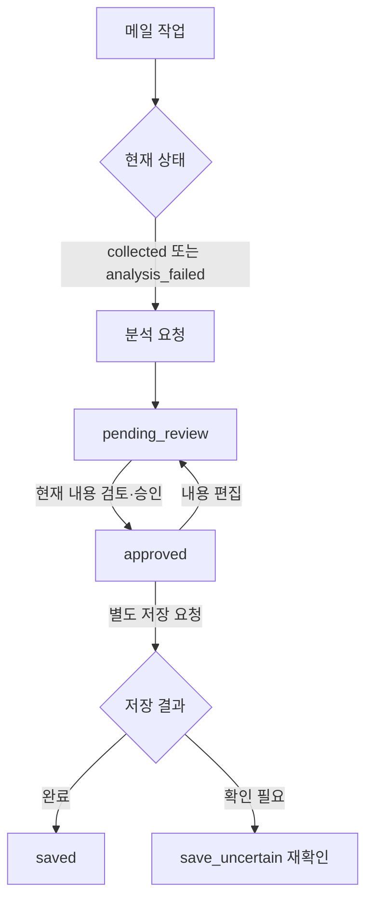

# mina-Hermes-javis — screen-code-handover 업데이트 인수인계

한국시간 2026년 9월 18~19일 업데이트 보고서. 활동 집계 마감은 9월 19일 21:24:15입니다.

메일을 분류하고 답장 초안을 검토하는 자비스 프로젝트입니다. 이번 변경은 실제 메일 경로와 목업 화면을 구분한 인수인계 문서입니다.

| 항목 | 기준 |
|---|---|
| 보고서 범위 | 이번 기간의 변경과 관련 기능. 전체 시스템 설명은 아래 기존 상세 문서로 연결합니다. |
| 확인 브랜치 | main |
| 소스 기준 | `7d02e85ede89` |
| 검증 범위 | 진입점과 live API 상태 계약을 정적으로 확인했습니다. 기존 verification의 브리지 3개·입력 5개 통과는 이전 작업의 기록입니다. |
| 보고서 세트 | [쉬운 설명](easy-guide.md) · [수정·검증 지시](fix-guide.md) · [코드 인수인계](screen-code-handover.md) |

## 이번 변경의 경계

- 9월 19일 11:34, 화면·코드 문서, 데이터 사전, 검증 기록과 설명 이미지를 추가했습니다.
- 메일 내용 승인, Gmail 초안 저장, 배포 후보 승인을 서로 다른 동작으로 설명했습니다. 메일 발송 기능을 추가한 커밋은 아닙니다.

기존 보고서의 코드 기반 메일 작업실 재구성입니다. 이번 작업에서 새로 실행·캡처한 화면은 아닙니다.

## 핵심 파일과 역할

| 핵심 파일 | 함수·컴포넌트 | 담당 역할 |
|---|---|---|
| [src/main.tsx](https://github.com/feed-mina/mina-Hermes-javis/blob/7d02e85ede89cbd96e8c5b6a9b441a2778b822e3/src/main.tsx) | bootstrap | 목업 여부를 확인하고 화면을 시작합니다. 예시 응답 사용 여부가 여기서 결정됩니다. |
| [src/api/live.ts](https://github.com/feed-mina/mina-Hermes-javis/blob/7d02e85ede89cbd96e8c5b6a9b441a2778b822e3/src/api/live.ts) | actions / liveRequest / liveApi | 상태별 버튼 허용과 실제 요청 계약을 모읍니다. 저장에는 ID와 버전이 함께 전달됩니다. |
| [handover/code-map.md](https://github.com/feed-mina/mina-Hermes-javis/blob/7d02e85ede89cbd96e8c5b6a9b441a2778b822e3/handover/code-map.md) | 화면·API 대응표 | 실제 서버와 이전 화면의 역할을 구분해 유지보수 위치를 찾게 합니다. |

## 입력·처리·반환과 부수 효과

| 담당 기능 | 입력 | 처리와 분기 | 반환·출력 | 별도로 일어나는 변경 |
|---|---|---|---|---|
| actions | job, dirty | 상태·답장 필요 여부·quality_gate·미저장 수정 여부 검사 | analyze/edit/approve/save/reconcile 허용값 | 없음 |
| liveApi.edit | id,version,draft | PATCH /jobs/:id | 갱신된 Job | 서버 초안과 버전 변경 요청 |
| liveApi.save | id,version | POST /jobs/:id/save-draft | 서버 응답 | Gmail 초안 저장 요청; 메일 발송 아님 |

## 동작 흐름

화살표는 호출·데이터 전달 또는 조건 분기를 뜻합니다. 도식에 없는 운영 연결은 확인되지 않았습니다.

## 데이터와 연결 관계

| 저장·전달 대상 | 주요 값 | 관계와 주의점 |
|---|---|---|
| Job | id,state,version,payload,approval | 화면 버튼과 서버 동시 수정 검사의 기준입니다. |
| JobEvent | seq,action,actor,details,at | 실행·검토 사건의 이력입니다. |
| 외부 Gmail | draft_id | 초안 저장 결과입니다. 발송 완료 식별값으로 해석하지 않습니다. |

## 유지보수와 확인 순서

| 바꾸거나 확인할 것 | 확인 위치와 기준 |
|---|---|
| 버튼 조건 | actions와 서버의 상태·버전 검증을 함께 확인합니다. |
| 통신 오류 | liveRequest와 브리지의 인증·요청 출처 검사를 확인합니다. |
| 문서 검증 | 이전 검증 3개+5개 통과 기록을 이번 전체 서비스 검증으로 합산하지 않습니다. |

안전한 화면 검수용 명령은 저장소 루트의 `npm run dev -- --mode mock`입니다. `start:live`는 원격 SSH 연결을 포함하므로 이 보고서 작업에서 실행하지 않았습니다.

## 검증 결과와 남은 범위

진입점과 live API 상태 계약을 정적으로 확인했습니다. 기존 verification의 브리지 3개·입력 5개 통과는 이전 작업의 기록입니다.

실제 Gmail, PostgreSQL, Hermes, LangSmith 연결과 전체 UI 빌드는 이번에 실행하지 않았습니다. AGENTS.md가 요청한 work-map-guide 스킬은 현재 제공 목록과 저장소에서 찾지 못해 별도 HTML 진행 기록으로 보완합니다.

## 기존 상세 문서와 활동 근거

- [전체 인수인계](https://github.com/feed-mina/mina-Hermes-javis/blob/7d02e85ede89cbd96e8c5b6a9b441a2778b822e3/handover/README.md)
- [검증 기록](https://github.com/feed-mina/mina-Hermes-javis/blob/7d02e85ede89cbd96e8c5b6a9b441a2778b822e3/handover/verification.md)

| 한국시간 | 커밋 | 기록된 작업 | 구분 |
|---|---|---|---|
| 09/19 11:34 | [7d02e85](https://github.com/feed-mina/mina-Hermes-javis/commit/7d02e85ede89cbd96e8c5b6a9b441a2778b822e3) | docs: 화면·코드 인수인계 문서와 검증 보고서 추가 [skip ci] | 변경 기록 |
