# 자비스 메일 에이전트 화면·코드 인수인계

받은 메일을 분류하고 답장을 제안한 뒤, 사람이 검토·승인한 내용을 Gmail 초안으로 저장하는 제품이다. **답장 내용 승인, Gmail 초안 저장, 배포 후보 승인은 서로 다른 작업**이다. 이 저장소에는 메일 발송 기능이 없다.

|항목|이 문서의 기준|
|---|---|
|대상|mina-Hermes-javis main, `b30f873b76964806e93db19e5c626bdb5009f28e`|
|읽는 순서|실행 모드 → 메일 처리 → 실행 이력·평가 → 데이터·운영|
|활용|화면의 상태에서 처리 함수·저장 필드·실패 복구 경로 찾기|
|변경 범위|handover 문서·그림과 별도 완료 보고서. 앱 코드·운영 설정은 변경하지 않음|
|그림|코드 기반 설명용 재구성. 실제 메일·실행 캡처가 아님|
|검증|소스 추적, 브리지 테스트3개, 검토 입력 테스트5개, Python 문법 검사|

[API·화면 대응](code-map.md) · [데이터 사전](data-dictionary.md) · [검증 기록](verification.md)

API(Application Programming Interface)는 프로그램의 요청·응답 창구다. DB(Database)는 데이터베이스, LLMOps(Large Language Model Operations)는 언어 모델의 실행·평가·개선을 관리하는 운영 체계를 뜻한다.

## 1. 세 가지 실행 경로를 먼저 구분하기

|경로|시작 코드|실제 역할|
|---|---|---|
|검수용 목업|src/main.tsx → ConsoleApp, VITE_ENABLE_MOCKS=true|MSW 모의 응답으로 메일 작업실·감독 그래프·버전 판정 검수|
|실제 메일 관제|ConsoleApp → LiveConsole → live-bridge → server/api.py|Gmail 수집, 모델 분석, 검토·승인·초안 저장, 평가와 배포 판정|
|로컬 연결 설정|backend/app.py의 /setup|Hermes·Gmail·PostgreSQL·LangSmith 연결 검사; 실제 메일 워크플로 서버와 별도|

MSW(Mock Service Worker)는 브라우저 요청에 예시 응답을 제공하는 도구다. 목업에서 버튼을 눌렀다고 실제 메일을 처리한 것이 아니다. `src/App.tsx`와 `src/pages/Details.tsx` 등 이전 화면도 있지만 현재 진입점은 `src/v2/ConsoleApp.tsx`다.

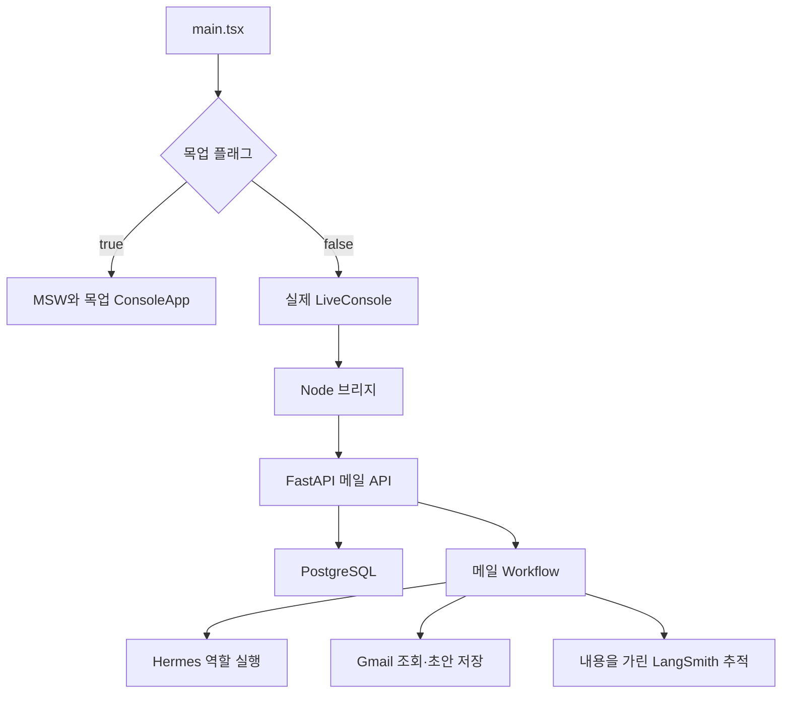

[src/api/live.ts](../src/api/live.ts)는 실제 API 요청과 상태별 버튼 가능 여부를 정의한다. [scripts/live-bridge.mjs](../scripts/live-bridge.mjs)는 브라우저 세션과 요청 출처를 검사한 뒤 서버 전용 토큰을 붙인다. [server/api.py](../server/api.py)는 다시 인증·입력·계정 범위를 검사한다.

문서·README의 과거 검증 기록은 당시 결과다. 이번에 운영 로그인, 실제 수신함, 배포 서버 상태를 다시 조회한 것은 아니다. 화면에 ‘실제 연결’이라고 쓰여 있어도 런타임 연결 성공 증거는 별도 확인한다.

## 2. S01 · 메일 한 건을 가져와 분석하기

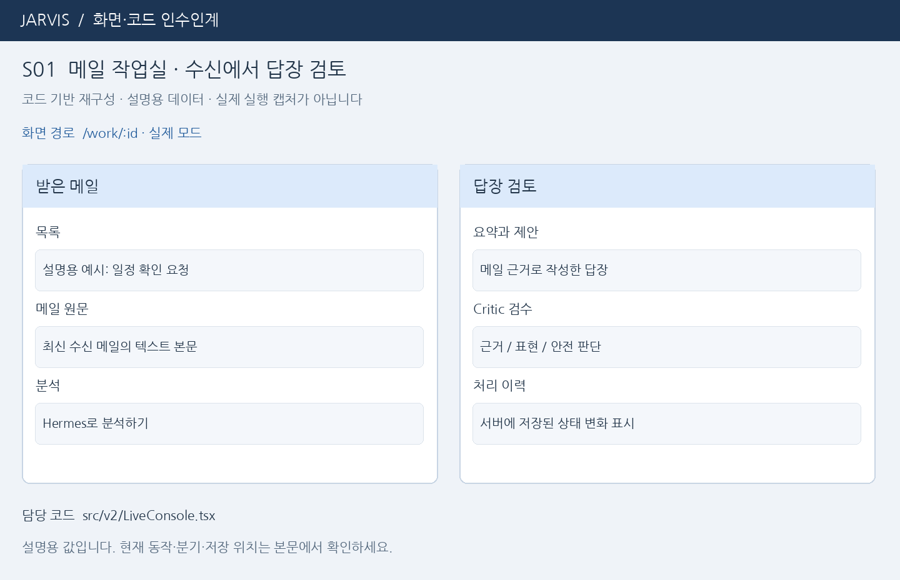

**기능:** 메일 목록과 원문, 분석 이력, 답장 검토를 한 화면에서 본다. 가져오기는 Gmail 조회와 DB 저장이고, 분석은 모델 실행이다.

|단계|입력·처리|반환·화면 위치|
|---|---|---|
|F1 가져오기|POST collect, 화면 기본 limit3; API1–10|added 작업 ID 목록과 좌측 목록|
|F2 중복·최신 검사|Workflow.collect가 수집 잠금, Gmail 계정과 대화 최신 수신 ID 확인|같은 account+gmail_id는 추가하지 않음|
|F3 원문 추출|Gmail.extract/body가 제목·발신자·회신 대상·대화 ID와 텍스트를 추출|가운데 원문; 첨부 내용은 읽지 않음|
|F4 분석 시작|collected 또는 analysis_failed만 허용; analyzing으로 버전 증가|진행 상태와 이벤트|
|F5 분석 결과|스키마 검증 후 pending_review, 요약·초안·검수 정보를 저장|오른쪽 답장 검토|

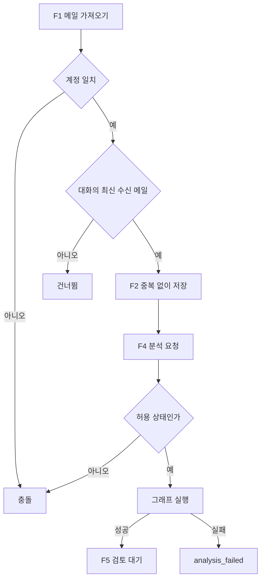

[LiveConsole.tsx](../src/v2/LiveConsole.tsx)의 `Workspace`는 목록5초, 작업 상세·이벤트3초 간격으로 재조회한다. 연결 실패 시 마지막 자료를 보여줄 수 있지만 수정·승인 버튼은 막는다. 서버로 보내지 않은 로컬 입력은 서버 갱신과 충돌하면 유지하고 재확인을 요구한다.

[workflow.py](../server/workflow.py)의 `Workflow.collect/analyze`는 상태 전이와 외부 호출을 연결한다. [gmail.py](../server/gmail.py)의 `Gmail.collect`는 최근7일 받은편지함을 조회하고, `body`는 텍스트를 최대20000자까지 추출한다. HTML은 텍스트로 풀고 script/style 및 첨부파일 내용을 제외한다.

**DB 연결:** mail_jobs의 id는 내부 UUID이고 gmail_id/thread_id/message_id는 Gmail 메시지·대화·메일 헤더 식별자다. 서로 바꿔 쓰지 않는다. 원문과 모델 결과는 payload JSONB, 상태는 state, 동시 수정 비교는 version이다.

## 3. S02 · 수정한 내용의 검수·승인·초안 저장

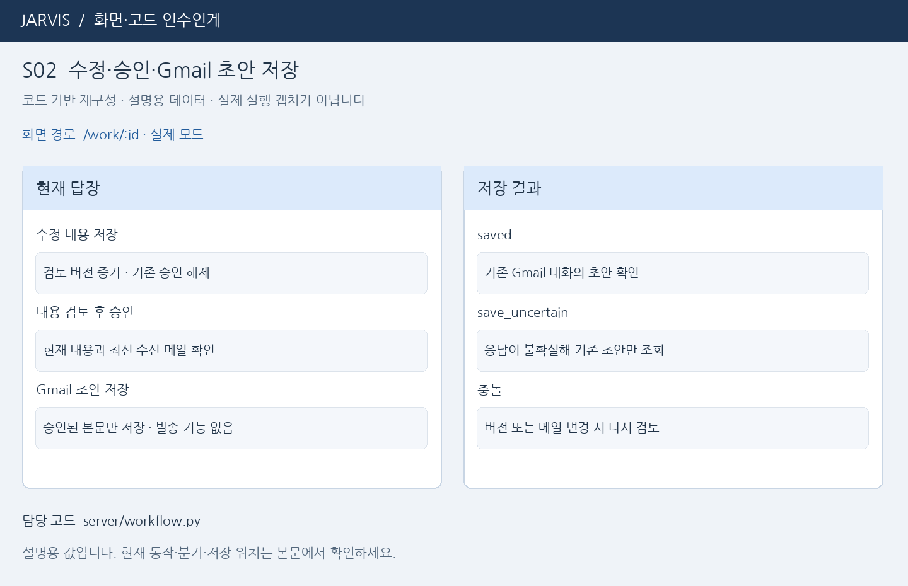

**기능:** 답장을 수정하면 기존 승인을 해제하고 현재 버전으로 다시 검수한다. 승인 후에도 Gmail에 저장하는 조작은 별도다.

|함수|입력|핵심 검사|결과와 부작용|
|---|---|---|---|
|Workflow.edit|id,version,draft|1–16000자, 검토 대기 또는 승인 상태|pending_review, 새 version; 파이프라인 결과는 needs_review|
|Workflow.review|id,version|현재 버전·검토 대기, 잠금|Critic 재검수 결과 저장; 이벤트 기록|
|Workflow.approve|id,version|검수 차단 여부, needs_reply, 최신 수신 메일|현재 내용 digest를 approval에 저장|
|Workflow.save|id,version|현재 승인·본문 digest·최신 수신 일치|saving→saved 또는 save_uncertain|
|Workflow._reconcile|저장 중/불확실 작업|operation 표식의 기존 Gmail 초안 조회|찾으면 saved; 못 찾으면 보류 유지|

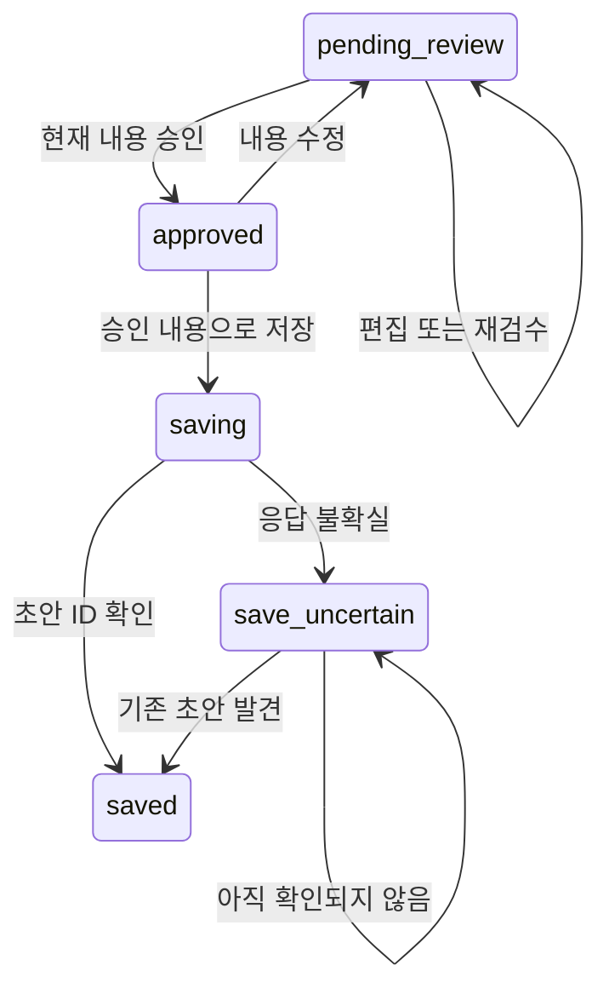

[repository.py](../server/repository.py)의 `change`는 행 잠금 후 version과 허용 state를 확인하고 상태·payload·승인·작업 정보를 갱신한다. 이벤트도 같은 연결에서 기록한다. `lock`은 PostgreSQL advisory lock으로 같은 메일의 동시 외부 작업을 막는다.

`digest(payload)`는 recipient/reply_subject/draft/thread_id/message_id를 정렬한 JSON의 SHA-256으로 계산한다. 승인한 본문·받는 사람·대화가 바뀌면 저장할 수 없다. `needs_reply=false`인 알림은 승인 경로를 거절한다.

**중복 저장 방지:** Gmail 초안 생성 POST는 자동 재시도하지 않는다. operation UUID로 만든 Message-ID 표식을 초안에 넣는다. 응답이 끊기면 다시 POST하지 않고 최대5페이지의 기존 초안을 조회한다. 조회에서 못 찾았다고 없다는 증거로 보지 않는다.

**재시작 복구:** Repository.recover는 analyzing을 analysis_failed, saving을 save_uncertain으로 바꾼다. 운영자가 save_uncertain을 임의로 approved로 되돌리면 중복 초안 위험이 있으므로 기존 초안 확인 흐름을 따른다.

## 4. S03 · 역할별 실행과 감독 그래프

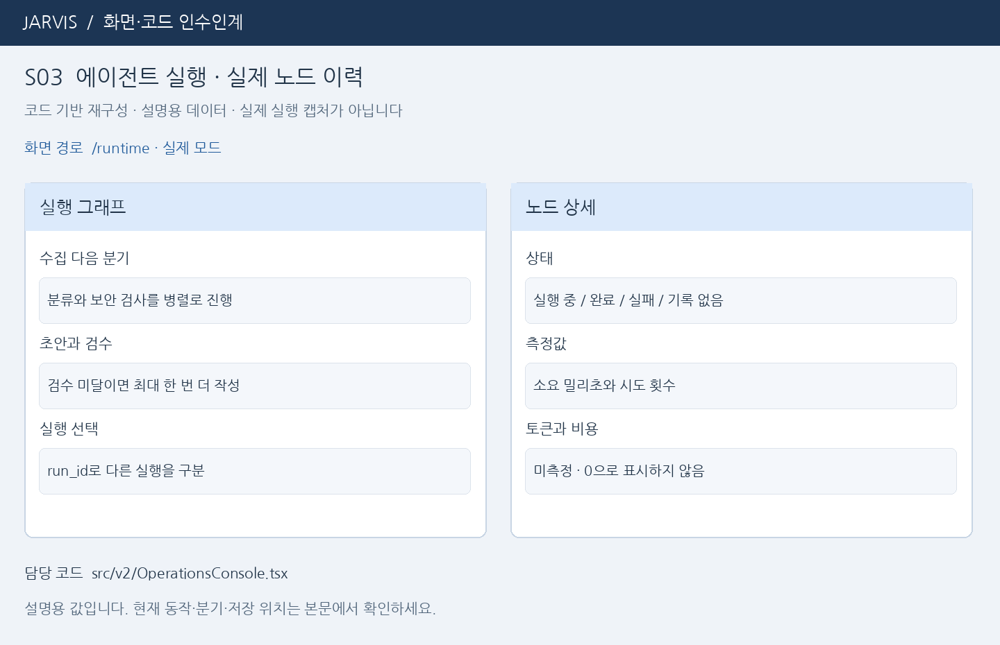

**기능:** 실제 이벤트를 기준으로 어떤 역할이 실행·완료·실패했는지 보여준다. 코드에 없는 실행이나 측정하지 않은 비용을 그래프에서 추정하지 않는다.

[server/pipeline.py](../server/pipeline.py)는 LangGraph의 역할 흐름이다. [role_runner.py](../server/role_runner.py)는 기존 Hermes 컨테이너 설정으로 모델을 실행한다. ‘분류·작성·검수’는 역할과 프롬프트가 분리된 구조이며 반드시 서로 다른 모델을 사용하는 것은 아니다.

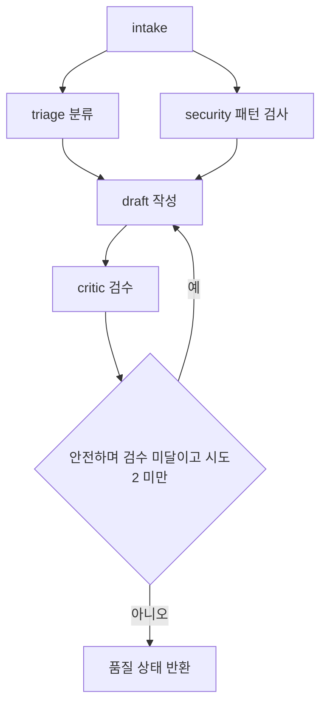

분류와 보안은 병렬 분기이며 둘 다 끝나야 draft로 넘어간다. 보안 패턴 실패 시 draft/critic의 모델 호출은 생략되고 차단 결과를 만든다. 다만 triage는 병렬로 이미 실행되는 구조이므로 ‘보안에 걸린 원문은 어떤 모델에도 보내지 않는다’고 설명하면 안 된다.

`execute(payload,emit,role_fn)`는 category/summary/needs_reply/draft, quality_gate, security_check, critic, node_runs, role_models, duration_ms 등을 반환한다. `emit`은 node_started/completed/failed를 호출하는 부수 효과다. 바깥 Workflow가 이를 DB 이벤트로 저장한다.

|판정·측정|현재 기준|
|---|---|
|Critic 통과|passed=true, safe=true, groundedness≥80, quality≥70|
|수정 반복|draft 최대2회; 미달 상태로 종료할 수 있음|
|보안|정규식 패턴 기반 heuristic-v1; 모든 공격 탐지 보장 아님|
|시간|노드·전체 duration_ms, 밀리초|
|토큰·비용|None/null, 미측정; 0원/0토큰과 다름|
|LangSmith|작업 ID·상태 중심, 메일 원문·요약·답장 제외|

[OperationsConsole.tsx](../src/v2/OperationsConsole.tsx)의 `RunGraph`는 run_id로 실행을 선택하고 노드별 마지막 이벤트를 표시한다. 이벤트가 없으면 ‘기록 없음’으로 남긴다. 화면은 저장 이벤트를 주기적으로 읽는 구조이며 전체 에이전트 메모리를 실시간으로 수집하는 기능과 같지 않다.

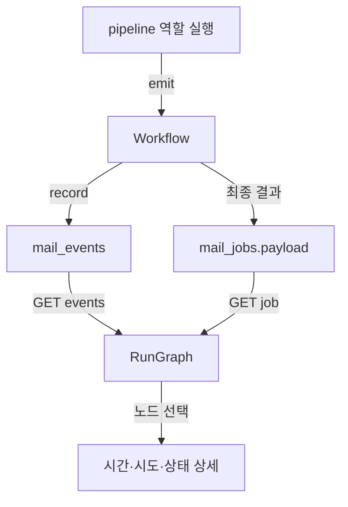

## 5. S04 · Eval Studio에서 고정 사례 평가

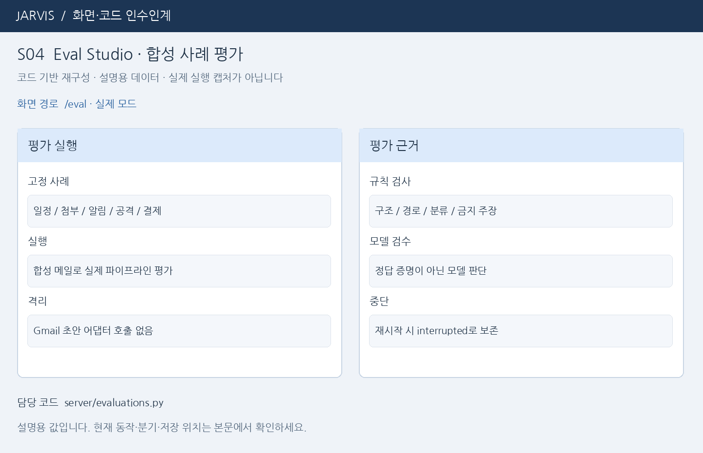

**기능:** 실제 수신함 대신5개 합성 메일로 파이프라인을 평가한다. 합성 자료라도 기본 runner는 실제 역할 모델을 호출하므로 평가 실행에는 외부 모델 사용이 발생할 수 있다.

[server/evaluations.py](../server/evaluations.py)의 `Evaluations.create`는 고정 데이터셋·평가 버전·파이프라인 버전을 기록한다. FastAPI BackgroundTasks가 `run`을 실행하고 사례별 결과와 진행 상태를 eval_runs에 저장한다. 일반 평가와 Release 실험은 같은 평가 잠금과 실행 중 검사를 사용한다.

|입력/처리|출력|
|---|---|
|일정·첨부·알림·공격·결제5개 합성 사례|cases 결과 배열|
|출력 필드·실행 노드·분류·금지 주장·보안 검사|규칙별 boolean과 사례 통과 여부|
|실제 Critic 결과|모델 판단 점수와 피드백; 독립 정답이 아님|
|서버 재시작|running을 interrupted로 보존|

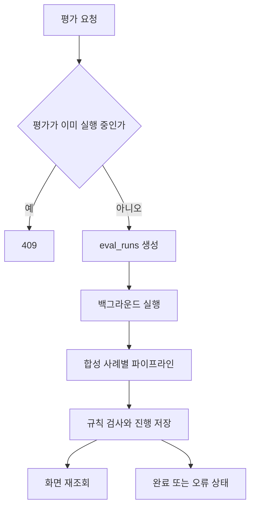

평가는 Gmail 어댑터를 가져오거나 초안을 저장하지 않는다. 이번 문서 작업에서는 실제 모델 평가를 실행하지 않았다. ‘평가 API가 있다’와 ‘현재 후보가 검증됐다’를 구분한다.

## 6. S05 · Release Gate의 비교·사람 검토·승인

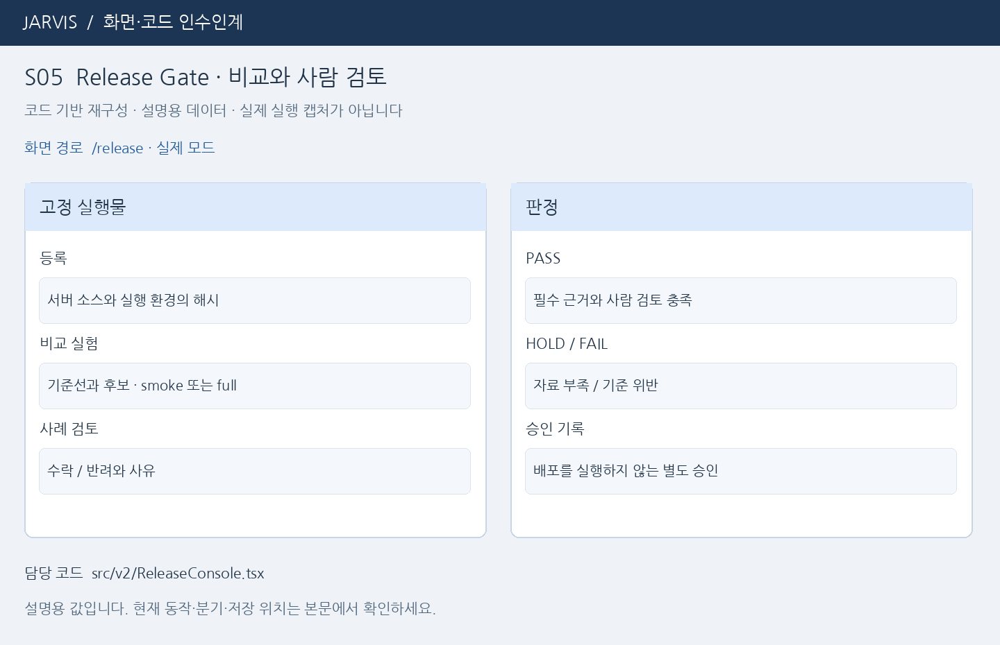

**기능:** 기준선과 후보의 고정된 실행물을 같은 사례로 비교하고 사람이 결과를 검토한다. PASS는 배포 검토 가능한 상태이며 자동 배포가 아니다.

|핵심 파일|책임|
|---|---|
|[release_runtime.py](../server/release_runtime.py)|서버 소스와 모델·컨테이너·의존성 정보를 snapshot으로 고정한다. 실행 전후 환경 변화와 digest를 확인한다.|
|[release_gate.py](../server/release_gate.py)|실험 생성·진행·판정·사례 검토·승인을 관리한다. 자료 부족을 PASS로 처리하지 않는다.|
|[release_dataset.py](../server/release_dataset.py)|30개 합성 사례와 표본·통과율·지연 기준을 정의한다.|
|[ReleaseConsole.tsx](../src/v2/ReleaseConsole.tsx), [ReleaseReviewGroup.tsx](../src/v2/ReleaseReviewGroup.tsx)|실행물 선택, 실험 진행, 사례 쌍 검토와 승인 조작을 담당한다.|

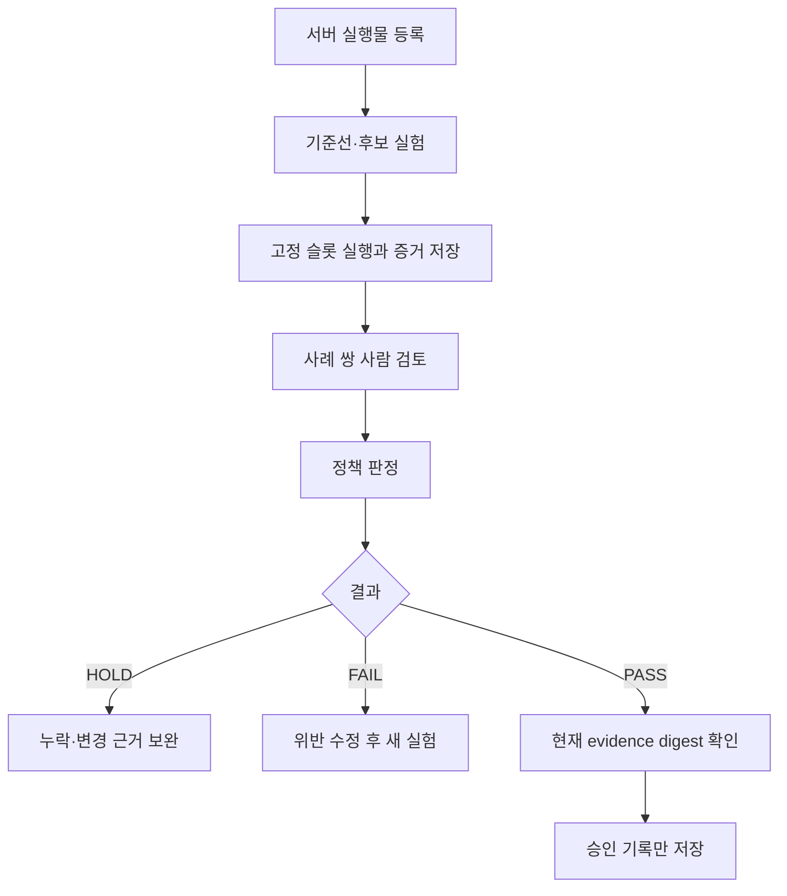

|기준|코드의 의미|
|---|---|
|smoke|선택5사례×1회×기준선/후보=10실행. 전체 정책 표본을 충족하지 않아 HOLD일 수 있음|
|full|30사례×3회×2실행물=180실행 슬롯, 사람 검토90쌍|
|실행물 동일성|실질적으로 같은 소스·런타임 자기 비교는 HOLD|
|규칙 통과율|후보95% 이상이며 기준선보다 내려가지 않아야 함|
|지연|오류가 아닌 실행의 nearest-rank p95를 비교, 후보/기준선≤1.20|
|보안·구조·도구|위반0, 증거 누락 없음; 제한된 합성 검사|
|사람 검토|모든 쌍 확인, 반려가 있으면 FAIL|
|비용|현 정책 cost_required=false라 N/A; 비용을 실제 측정한 것은 아님|
|승인|현재 증거·평가 코드·정책 일치 필요, 기록에 deployment=not_executed|

`Releases.create`는 request_key로 같은 요청을 재사용하되 인자가 다르면 충돌시킨다. `run`은 슬롯을 순서대로 실행하고 오류 시 이미 얻은 근거를 보존한다. 누락된 슬롯을 빼고 좋은 결과만 비교하지 않는다.

`evidence_digest`는 실험과 검토 기록의 해시다. 화면을 연 뒤 다른 검토가 추가되면 이전 digest로 승인할 수 없다. 반려는 비어 있지 않은 사유가 필요하며 API `CaseReviewInput`이 검증한다.

`prepare_release_candidate.py`와 `prepare_security_candidate.py`는 고정 후보를 만드는 도구다. 파일이 존재하거나 후보가 등록됐다고 현재 운영 pipeline이 해당 후보로 교체됐다는 뜻은 아니다. 특히 기본 pipeline의 보안 패턴과 후보 보안 패턴을 혼용하지 않는다.

## 7. S06 · 목업 감독 화면의 의미

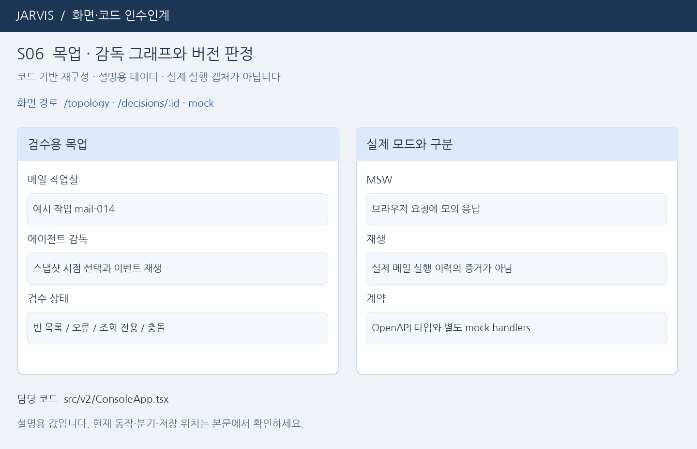

**기능:** 메일 처리 흐름·감독 그래프·버전 판정의 사용성을 예시 상태로 검수한다. 실제 관제와 별도의 경로·데이터 계약을 사용한다.

[ConsoleApp.tsx](../src/v2/ConsoleApp.tsx)는 mock일 때 MailRoom/Topology/DecisionRoom을 선택한다. [useTask.ts](../src/v2/useTask.ts)는 시점 선택과 SSE(Server-Sent Events, 서버가 보내는 이벤트 스트림) 재생을 다룬다. `acceptsSnapshot`은 현재 구현에서 mail-014와 증가하는 seq 범위를 확인한다.

|모의 상태|확인할 사용자 경험|
|---|---|
|normal|정상 작업과 선택 영역|
|loading/empty/error|느린 응답, 빈 자료, 실패 안내|
|readonly|조회 전용 조작 제한|
|conflict|승인 충돌 후 재확인|

[contracts/openapi.yaml](../contracts/openapi.yaml)은 관제 계약, [schema.d.ts](../src/api/schema.d.ts)는 생성 타입이다. 실제 메일 API는 `/api/v1/mail/*`, 목업 workspace는 `/api/v1/tasks/*`를 사용한다. OpenAPI 파일의 모든 경로가 현재 FastAPI에 구현됐다고 보지 않는다.

## 8. S07 · 연결 설정, 예약 수집과 백업

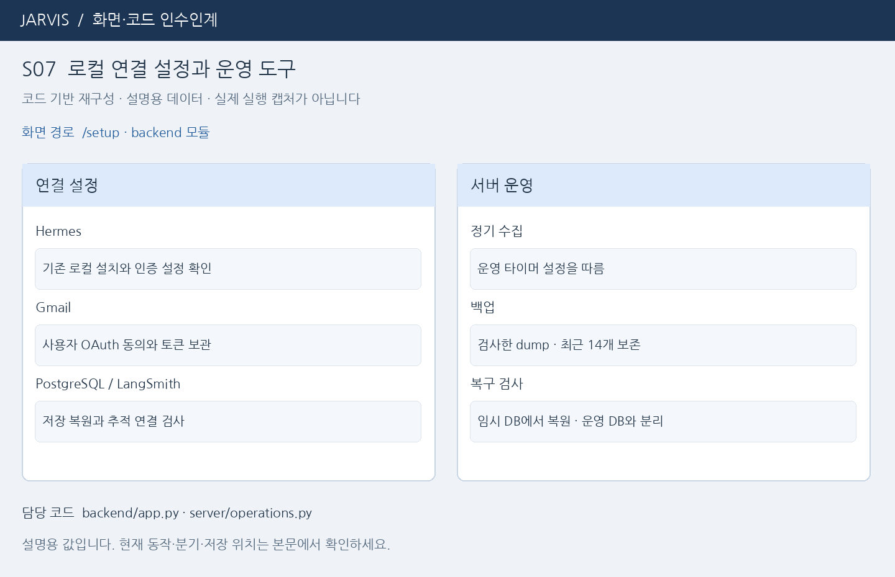

**기능:** 로컬 연결 설정과 서버 운영은 서로 다른 환경에서 실행한다. backend는 Windows 연결 지원을 포함하고, server는 Linux·Docker·systemd 기반 운영 경로를 가진다.

[backend/app.py](../backend/app.py)는 localhost 허용·세션·변경 요청 검사를 수행하고 연결 상태를 조회한다. [backend/storage.py](../backend/storage.py)는 setup 검사 결과를 저장하며 `check_graph`는 새 연결에서 체크포인트를 다시 읽어 영속화를 확인한다. [backend/secure_token.py](../backend/secure_token.py)는 로컬 토큰 보호를 담당한다.

[server/operations.py](../server/operations.py)는 collect/backup/restore-check/health를 제공한다. 백업은 partial 파일을 쓰고 pg_restore 목록 검사를 통과하면 dump로 바꾸며 최근14개만 남긴다. 복원 검사는 고유 임시 DB를 만들고 검사 후 삭제한다.

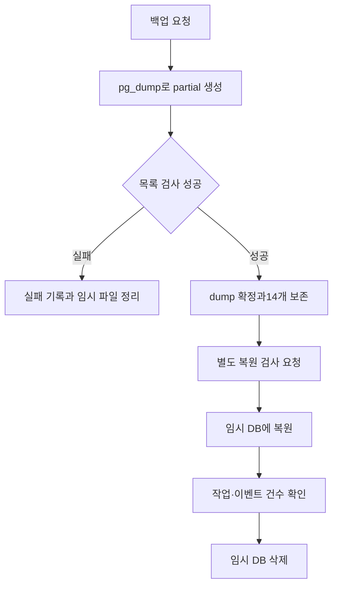

타이머 파일의 주기와 설치 여부는 구분한다. `server/operations/`에 서비스 정의가 있어도 운영에서 현재 활성화됐는지는 systemd에서 확인해야 한다. 이번 작업은 운영 타이머, 백업, 수신함을 변경하지 않았다.

## 9. 신원·세션·외부 호출 경계

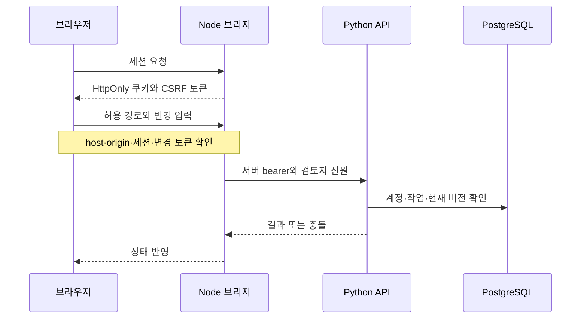

CSRF(Cross-Site Request Forgery)는 다른 사이트에서 사용자의 권한으로 요청을 보내는 공격이다. 브리지는 허용 origin, 세션과 변경 토큰으로 이를 검사한다. 서버 bearer는 브라우저에 보내지 않는다.

공개 모드의 브리지는 로그인 프록시가 덮어쓴 이메일 헤더를 신뢰하므로 loopback 뒤에서 실행하는 전제가 중요하다. API는 Origin이 있는 직접 브라우저 요청을 거절한다. 정적 헤더나 allowlist 문자열만으로 운영 접근 제어가 검증됐다고 보지 않는다.

LangSmith 추적 코드가 가리는 것은 추적에 보내는 메일 내용이다. 분석 모델은 원문을 입력으로 받는다. ‘원문을 어디에도 외부 전송하지 않는다’는 의미가 아니다.

## 10. 데이터 구조와 복구 기준

자체 업무 테이블은 mail_jobs, mail_events, eval_runs, release_records다. 별도 연결 설정 모듈에는 jarvis_setup_checks가 있다. LangGraph 체크포인트 테이블은 설치된 라이브러리의 `PostgresSaver.setup()`이 관리하며 이름·열을 임의로 이 문서에 만들어 넣지 않았다.

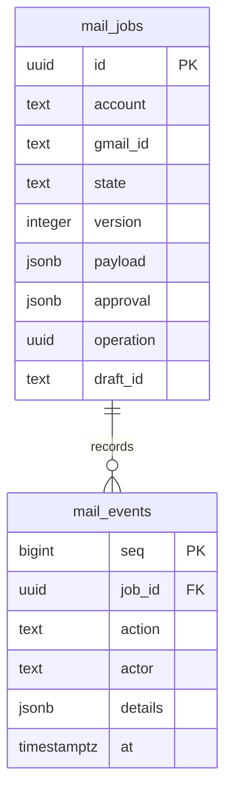

mail_events.job_id는 NULL 가능한 FK다. 위 그림은 메일에 연결된 이벤트를 나타낸다. eval_runs/release_records의 account와 payload 속 ID는 자동으로 mail_jobs의 FK가 되지 않는다.

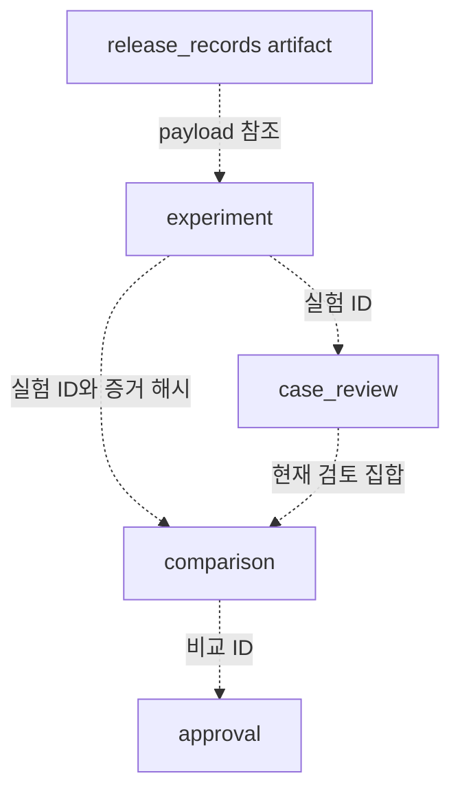

JSONB는 구조가 있는 JSON을 PostgreSQL에 저장하는 타입이다. release_records는 kind에 따라 payload 의미가 달라진다. 전체 열·타입·NULL·기본값·고유 제약과 JSON 필드 의미는 [data-dictionary.md](data-dictionary.md)에 있다.

## 11. 실행·테스트·배포·복구 가이드

### 프런트엔드

저장소 루트에서 잠금 파일로 설치하고 원하는 모드를 명시한다. Windows에서는 npm.cmd를 사용할 수 있다.

```bash
npm ci
npm run dev -- --mode mock
npm test
npm run test:bridge
npm run build:live
```

`start:live`는 단순 로컬 예제가 아니다. 기존 설정의 원격 SSH 서버에 연결하고 서버 토큰을 읽어 터널과 브리지를 연다. 따라서 안전한 화면 검수에는 mock 모드를 사용하며 이 문서 작성 중 start:live를 실행하지 않았다.

### Python 서버

server/pyproject.toml의 Python 범위는3.11 이상3.14 미만이다. PostgreSQL, LangGraph, LangSmith, Google OAuth와 Hermes Docker 실행 환경이 필요하다. 로컬 setup backend와 운영 server의 환경 파일·DB·토큰 보관 방식이 다르다.

server 폴더에서 `uv sync`로 잠금 의존성을 준비한다. 전체 pytest는 PostgreSQL 테스트 DB와 설정을 필요로 하므로 테스트 소스의 DB 이름·대상과 외부 호출 대체 여부를 확인한다. 운영 DB에 연결한 상태로 무심코 실행하지 않는다.

```bash
# 외부 서비스 없이 가능한 검토 입력 검사
python -m unittest test_review_input.py

# 환경이 준비된 별도 테스트 DB에서만 전체 테스트
uv run pytest
```

### 변경 지점

|변경 목적|먼저 볼 코드|함께 확인할 계약|
|---|---|---|
|메일 표시·편집|LiveConsole.tsx, live.ts|dirty 입력 보존, version, 연결 실패 조작 제한|
|분류·초안·검수|pipeline.py, role_runner.py|스키마, 병렬 join, 최대2회, 외부 도구 비활성|
|승인·저장|workflow.py, repository.py, gmail.py|digest, 최신 수신 ID, operation, 불확실 저장 복구|
|노드 시각화|OperationsConsole.tsx|run_id, 이벤트 없는 노드, 실제 duration 단위|
|배포 판정|release_gate.py, release_dataset.py|고정 표본·정책·사람 검토·evidence_digest|
|모델 후보|prepare_*_candidate.py|고정 실행물 변화와 운영 코드 변화 구분|
|로그인|live-bridge.mjs, web-compose.yaml|프록시 신뢰 경계, loopback, 명시적 계정 허용|

### 장애 진단

|증상|확인 순서|
|---|---|
|메일이 안 보임|Gmail 연결 계정 → 최근7일 검색 → 최신 수신 메시지 → account 필터|
|분석 실패|mail_events의 실패 node/error_type → Hermes 컨테이너 → 모델 출력 스키마|
|승인 버튼 비활성|needs_reply → dirty → quality_gate → 현재 version|
|승인409|최신 version, digest, 새 메일 도착 여부|
|저장 불확실|operation 표식의 기존 Gmail 초안 조회; 새 초안 생성 금지|
|그래프가 빈 상태|run_id와 node 이벤트 유무; 이전 버전 기록을 추정해서 채우지 않음|
|평가 HOLD|smoke 표본, 동일 실행물, 누락 슬롯, 미검토 사례, 환경·정책 변화|
|평가 FAIL|규칙 위반·오류·지연·사람 반려의 근거|
|브라우저401/403|허용 계정 → 프록시 → host/origin → 세션과 CSRF|

### 배포와 복구

main 문서 커밋은 서버 배포가 아니다. 서비스 코드 교체, systemd 재시작, 후보 승인·배포, 실제 Gmail 초안 쓰기는 별도 운영 작업이다. 이번에는 실행하지 않는다.

서버 재시작 후 recover가 상태를 보정하는지 확인하고, 백업은 파일 생성뿐 아니라 격리 복원 검사로 읽을 수 있는지 확인한다. 운영 DB 롤백과 Gmail 외부 부작용은 같은 트랜잭션이 아니므로 DB만 되돌려 저장이 없던 것처럼 처리하지 않는다.

## 12. 재사용 가능한 모듈과 제한

메일 상태 전이·승인 digest·중복 외부 쓰기 복구 구조는 다른 승인형 작업에도 참고할 수 있다. 단, Gmail의 대화·Message-ID 규칙은 도메인 고유이므로 다른 외부 서비스에는 별도 식별자와 확인 API가 필요하다.

`judge`와 `percentile`처럼 순수 판정 함수는 화면과 분리해 재사용하기 쉽다. 평가 데이터셋과 정책은 제품 목적에 맞게 버전을 관리해야 한다. 현재30개 합성 사례 통과를 일반 보안·품질 보장으로 확대하지 않는다.

작업 완료 보고 규칙의 `work-map-guide` 스킬은 이번 환경에서 찾지 못했다. 사용했다고 표현하지 않고, 동일 저장소의 work-map-guide 폴더에 변경·검증·미완료·다음 확인을 담은 독립 HTML 보고서를 추가한다.
