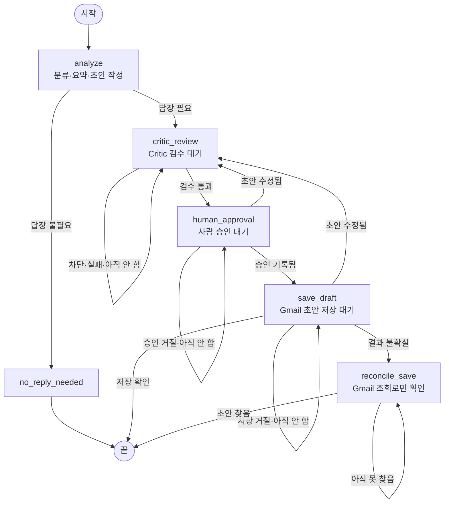

# 자비스 1~5단계 구현·서버 적용 결과

2026-09-13 기준

## 완료 범위

| 단계 | 구현 | 검증 |
|---|---|---|
| 1. 서버 저장소 | Hostinger 전용 PostgreSQL, LangGraph 체크포인트, 작업·이벤트 이력 | 실제 DB 연결, 서버 프로그램 재시작 후 상태·체크포인트 유지 |
| 2. Gmail 수집 | 최근 7일 받은편지함, 요청당 기본 3건/최대 10건, 중복 방지, 토큰 갱신·파일 원자적 교체 | 실제 1건 수집, 반복 수집 시 0건 추가; 갱신 파일 권한 테스트 |
| 3. Hermes 처리 | 기존 개인 개발용 Hermes로 분류·요약·답장 제안, LangSmith 기록 | 실제 메일 분석 성공, LangSmith 성공 기록 재조회 |
| 4. 사용자 승인 | 수정, 승인 버전 검사, 수정 시 승인 취소, 새 메일 도착 시 승인 거부 | 분리된 테스트 DB에서 검증 |
| 5. Gmail 초안 저장 | 승인된 내용만 원래 대화에 초안으로 저장, 중복 호출 방지, 불확실한 응답 조정 | 모의 Gmail API로 저장 형식·동시성·타임아웃·재조회 검증 |

실제 Gmail에 새 초안을 만드는 검증은 하지 않았습니다. 이번에 분석한 메일은 답장이 필요 없는 알림으로 분류됐고, 승인되지 않았습니다. 본 시스템에는 메일 발송 기능이 없습니다.

## 실제 확인한 작업

- 작업 ID: 014ab513-eab2-41ae-b4ca-7d798ced57e1
- 현재 상태: pending_review / 버전 3
- 요약·답장 제안: 생성됨
- 분류: notification / needs_reply=false
- Gmail 초안: 생성하지 않음
- LangSmith: jarvis-personal → jarvis-mail-analysis → success
- LangSmith에는 작업 ID와 상태만 기록하며 메일 원문·요약·답장 내용은 기록하지 않습니다.

## 서버 위치

- 서버 코드: /docker/jarvis-integration/server
- 실행 서비스: jarvis-mail.service
- 내부 API: http://127.0.0.1:8010
- PostgreSQL: 127.0.0.1:15432, jarvis-mail-postgres-1
- 데이터 볼륨: jarvis-mail_jarvis_mail_data
- 인증 설정: /docker/jarvis-integration/.secrets (키와 토큰은 배포 ZIP에 포함하지 않음)

현재 API는 서버 안에서만 접속하고 운영자 토큰이 있어야 합니다. 브라우저의 직접 요청은 차단됩니다. 6단계 화면 연결을 적용했습니다. 로컬 SSH 브리지를 통해 접속하며 실행 방법은 ../LIVE-START.md를 참고하세요.

## 현재 사용 방식

서버에서 아래 명령을 실행합니다. 운영자 도구가 서버 설정의 인증 토큰을 자동으로 사용합니다. 토큰을 명령이나 채팅에 입력하지 않습니다.

```bash
cd /docker/jarvis-integration/server
.venv/bin/python manage.py status
.venv/bin/python manage.py collect --limit 3
.venv/bin/python manage.py list
```

작업 ID를 확인한 뒤 순서대로 처리합니다. 아래 JOB_ID와 숫자는 조회 결과에 맞게 바꿉니다.

```bash
# 분석하고 상세 내용을 조회합니다. show 결과에는 실제 메일 내용이 포함됩니다.
.venv/bin/python manage.py analyze JOB_ID --summary
.venv/bin/python manage.py show JOB_ID

# 필요하다면 서버의 UTF-8 파일에 수정할 답장을 작성하고 적용합니다.
.venv/bin/python manage.py edit JOB_ID --version 3 --file /path/to/reply.txt

# 내용을 사람이 확인한 뒤 현재 버전으로 승인합니다.
.venv/bin/python manage.py approve JOB_ID --version 4

# 승인 응답에서 바뀐 버전을 확인하고 Gmail 초안을 저장합니다.
.venv/bin/python manage.py save JOB_ID --version 5
```

수정하지 않았다면 버전 숫자도 다릅니다. 항상 바로 앞 응답의 version을 사용합니다.
답장이 필요 없다고 분류된 알림은 승인을 거부합니다. 무인 일괄 승인은 제공하지 않습니다.
10분 간격 자동 수집을 적용했습니다. 백업 및 상태 점검은 ../OPERATIONS.md를 참고하세요.

## 오류 처리

- analysis_failed: 같은 작업에서 analyze를 다시 실행할 수 있습니다.
- 승인 충돌: show로 새 버전과 내용을 확인한 뒤 다시 판단합니다.
- 새 메일 도착: 이전 답장 승인을 중단하고 새 메일을 수집해 검토합니다.
- save_uncertain: save를 다시 호출하면 기존 Gmail 초안을 조회만 합니다. 새 초안을 재생성하지 않습니다.
- 조회로 초안을 찾지 못해도 실패로 단정하지 않습니다. Gmail에서 사람이 확인할 때까지 보류합니다.
- 재시작 중이던 분석은 analysis_failed, 저장 중이던 작업은 save_uncertain으로 복구합니다.
- Gmail 테스트 앱의 재동의가 필요하면 기존 OAuth 연결 절차로 갱신해야 합니다.

## LangGraph 흐름과 LangChain 연결

2026-11-11 추가. 메일 한 건의 전체 흐름을 `workflow.py`의 그래프(`lifecycle_graph`) 하나로 묶었습니다. 노드 이름은 코드와 같습니다.



- `analyze`가 끝나면 그래프는 `critic_review`에서 멈춥니다(LangGraph `interrupt`). 그 뒤 운영자가 검수·승인·저장을 누를 때마다 해당 노드가 `Command(resume=...)`로 이어서 실행되고, 다음 대기 노드에서 다시 멈춥니다. 멈춘 위치는 PostgreSQL 체크포인트에 남아 서버를 재시작해도 이어집니다.
- 답장이 필요 없는 알림·광고는 `no_reply_needed`로 가서 끝납니다. 승인·저장 노드로 가는 길이 없습니다.
- `save_draft`로 들어가는 길은 `human_approval` 하나뿐입니다. 그리고 판정은 예전과 똑같이 DB가 합니다(버전 일치, 승인 기록과 내용 지문, 한 번만 저장). 노드는 기존 검사 코드를 그대로 부르기 때문에, 그래프에 저장 명령을 직접 넣어도 승인 기록이 없으면 저장되지 않습니다.
- 초안 수정, 일괄 검수, 재시작 복구는 그래프 밖에서 DB 상태를 바꿉니다. 다음 동작 때 그래프가 DB 상태를 읽고 맞는 노드로 옮겨 간 뒤 실행합니다. 이 그래프가 생기기 전의 작업이나 체크포인트 장애 때는 같은 검사를 그래프 없이 실행하고 `graph_bypassed` 이벤트를 남깁니다.
- 모델 호출은 `chains.py`의 LangChain 체인(프롬프트 → 모델 → 출력 형식 검사)을 거칩니다. 프롬프트와 출력 형식은 `pipeline.py`의 것을 복사 없이 가져다 쓰고, 기본 모델은 기존 Hermes 역할 실행기(`role_runner.py`)를 감싼 어댑터입니다. 형식이 틀린 모델 답은 받아들이지 않고 실패로 처리합니다. `JARVIS_LANGCHAIN_ROLES=0`이면 예전 직접 호출로 돌아갑니다.
- 버전 판정(release gate)의 후보 평가는 예전처럼 별도 프로세스에서 `pipeline.py` 사본과 자체 역할 호출로 돌며 이 체인을 거치지 않습니다. 후보가 `pipeline.py`에 반영되면 체인은 바뀐 프롬프트를 그대로 읽습니다.
- 검증 범위: 가짜 모델·가짜 Gmail과 로컬 PostgreSQL 16으로만 테스트했습니다(`test_graph.py`, `test_chains.py`). 실제 Hermes·Gmail·LangSmith에는 연결해 보지 않았습니다.

## 검증 범위와 남은 일

분리된 jarvis_test DB에서 12개 테스트 통과. 실제 메일 수집·분석·추적, 중복 수집 방지, 서비스 재시작 뒤 상태 유지 확인.
실제 사용자 승인 후 Gmail 초안 생성, 실제 화면 연동, 정기 수집, 공개 화면 로그인, 백업 복구 및 전체 서버 재부팅 검증은 이후 단계입니다.

## 코드 보관

이번 서버 코드의 로컬 원본은 D:\jarvis-console-local-integration\jarvis-console\server 입니다.
함께 제공하는 jarvis-server-steps-1-5.zip에는 실행 코드·의존성 잠금 파일·테스트를 담았습니다. 비밀 값, DB 내용, 실제 메일은 들어 있지 않습니다.
2026-09-13부터 상위 jarvis-console 폴더를 화면·서버 코드의 공통 작업 원본으로 사용합니다. 서버 배포는 별도로 진행합니다.


